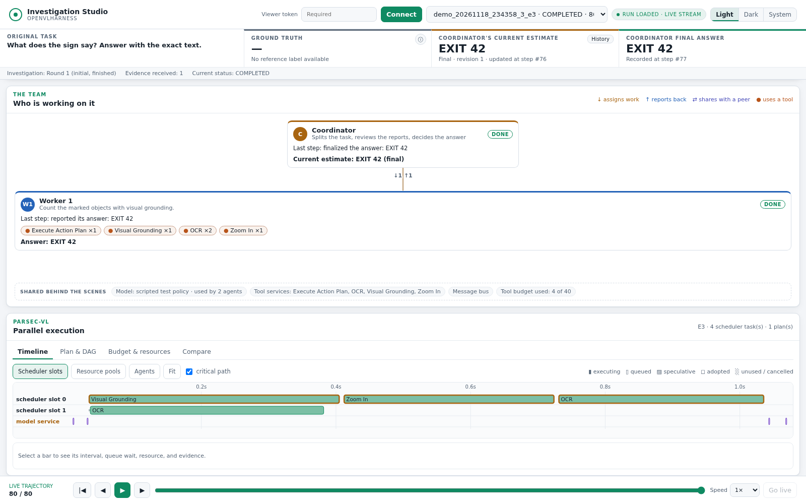

# PARSEC-VL

**Parallel Adaptive Reasoning with Speculative Execution and Constrained Tool Budgets**
CISC 654 — Parallel Computing

PARSEC-VL adds dependency-aware tool scheduling, multicore Monte Carlo planning
and budget-aware speculation to a multi-agent visual-reasoning system. A
coordinator and 1–4 workers investigate images using grounding, OCR, zoom, depth
and coding tools. Investigation Studio shows their activity, evidence, scheduler
timeline, plans, resources and answers live or in replay.

**[Project report](docs/REPORT.md)** · **[Model configuration](docs/models.md)** ·
**[Reference measurements](results/reference/manifest.json)**



## Quick start: CPU-only demonstration

Use **Python 3.11 or newer**. Node.js 22+ is needed for JavaScript verification;
Chrome is only needed for optional browser automation. The demonstration uses
scripted decisions and local tools. It needs no GPU, model checkpoint, API key or
dataset; it does not download models or perform real inference.

From the repository root, prepare the main environment once:

```bash
bash scripts/setup.sh
source scripts/env.sh
```

Then generate a measured demonstration and open its selected run:

```bash
bash scripts/advisor_demo.sh --studio
```

This demonstrates the same visual plan with sequential and parallel dispatch,
CPU-process planning, and speculation benefit/waste. It prints measurements and
saves traces under `outputs/parsec_vl/advisor_demo/`. Repeating `--studio` reopens
the last successful demonstration. Use `--quick --studio` to generate a fresh one
or `--full --studio` for more trials. A smaller visual-only demonstration is:

```bash
python scripts/parsec.py demo --studio
```

For an already prepared checkout, skip installation and run the demo directly.
The shell launchers select the repository's `.venv/bin/python` themselves.

## Real inference with a live visualization

Real inference requires prepared data, cached checkpoints, NVIDIA GPU access and
the local model/tool environments. The CPU demonstration above works without
these prerequisites.

Use [local_grounding_tools.yaml](examples/local_grounding_tools.yaml) for the
local Qwen/perception stack. [local_tools.yaml](examples/local_tools.yaml) is an
alternative profile with a hosted model, Zoom and Python; its endpoint and key
must match the selected registered model.

### One-time GPU and dataset setup

```bash
bash scripts/setup.sh vllm depth sam3
source scripts/env.sh
python scripts/download_models.py qwen ocr depth sam3

# Prepare FSC147 validation inputs; this downloads data, not model inference.
python -c "from evaluation_kit.dataset import build_dataset; d=build_dataset('FSC147_val'); print(len(d.data))"
```

SAM3 checkpoint access requires the corresponding Hugging Face account access
and `HF_TOKEN`. The downloader pins checkpoint revisions in
[scripts/download_models.py](scripts/download_models.py). Dataset and model
licenses apply separately. Downloads stay under ignored `data/` and `.cache/`.

The setup copies `.env.example` to `.env` only when no `.env` exists. Check these
settings before starting services; keep your existing working `.env`:

```dotenv
MODEL_BASE_URL=http://127.0.0.1:8222/v1
MODEL_API_KEY=empty
TOOL_SERVER_URL=http://127.0.0.1:8101
SAM3_SERVER_URL=http://127.0.0.1:8086
OCR_SERVER_URL=http://127.0.0.1:8085
DEPTH_ESTIMATION_SERVER_URL=http://127.0.0.1:8087
AGENT_CONFIG=examples/local_grounding_tools.yaml
QWEN_GPUS=0,1
DEPTH_GPUS=2
OCR_GPUS=3
SAM3_GPUS=3
```

This is the tested four-GPU layout. OCR and SAM3 share GPU 3. Hardware with fewer
GPUs requires an allocation and memory configuration appropriate to that machine.
If another service occupies router port 8101, select a free local port in
`TOOL_SERVER_URL`; both the agents and router read it.

### Run one example

```bash
bash scripts/run_custom_inference.sh --start-services \
  --workers 2 \
  --memory on \
  --comm on \
  --peer off \
  --scheduler e2 \
  25
```

The command opens Studio, starts missing local services, waits for readiness,
then runs zero-based example **25** and selects that exact run. No token paste is
needed. The startup helper reuses healthy services, leaves occupied listeners
alone, prints progress and log paths, and waits at most ten minutes. Started
services stay running after the task or terminal closes. Newly started Qwen uses
a 32,768-token demo context; a reused server keeps its existing configuration.
To request another startup context explicitly:

```bash
source scripts/env.sh
python scripts/ensure_local_services.py --qwen-context-length 168000
```

Omit `--start-services` to require services to be running already. If readiness
fails, the script opens saved-run Studio and exits without starting the task.

### Choose the example and team

| Option | Meaning |
|---|---|
| Final argument: `25`, `3,7,25`, `10-13` | Zero-based dataset row(s); multiple tasks run sequentially |
| `--dataset FSC147_val` | Prepared dataset name |
| `--workers 1` through `4` | Worker count, plus one coordinator |
| `--memory on/off` | Optional private notebook across run phases |
| `--comm on/off` | Message bus; off also disables peer messages |
| `--peer on/off` | Worker-to-worker messages |
| `--estimates on/off` | Coordinator estimate updates; each uses an extra model request |
| `--scheduler off/e0/e1/e2/e3/e4/e5` | Execution/planning mode; see the report |
| `--mode concurrent/cooperative` | Concurrent workers or sequential worker investigations |
| `--follow-ups N` | Extra coordinator follow-up rounds |
| `--planning-processes N` | CPU processes for plan evaluation |
| `--scheduler-workers N` | Concurrent tool-execution slots |
| `--check` | Inspect the selected image/question only; no inference or service startup |
| `--ui-only` | Open saved runs without starting inference |
| `--no-browser` | Print the link without opening a browser |
| `--dry-run` | Print commands without executing them |

The shipped worker concurrency limit is **two**, independently of worker count
and scheduler slots. `--memory off` keeps necessary working context. With
`--comm off`, coordinator assignment/result handoff still works. E3–E5 expose
`Execute_Action_Plan` and change the agents' decision protocol; they do not force
the model to propose useful plans.

```bash
# Inspect input before running it.
bash scripts/run_custom_inference.sh --check --workers 2 --scheduler e2 25

# Four workers, optional notebook off, peer messages enabled, another example.
bash scripts/run_custom_inference.sh --start-services \
  --workers 4 --memory off --comm on --peer on --scheduler e2 7

# Open saved investigations without a model or new task.
bash scripts/run_custom_inference.sh --ui-only
```

`--check` and `--ui-only` cannot be combined with `--start-services`.
Run `bash scripts/run_custom_inference.sh --help` for all options.

### One real example across multiple configurations

```bash
# Preview: same row, 1–4 workers × memory on/off × communication on/off.
bash scripts/run_inference_matrix.sh 25 --dry-run

# Execute all 16 variants, starting missing local services if needed.
bash scripts/run_inference_matrix.sh 25 --start-services --studio
```

The matrix fixes the scheduler to E2 and disables coordinator estimate updates
and follow-up rounds. Peer messages follow communication and are disabled for
one-worker teams. Each variant has a separate recording and log under a fresh,
ignored `outputs/inference_matrix/` directory; `matrix_status.tsv` records exit
codes and elapsed time. `--studio` opens the first live run; use Studio's run menu
to select the other variants. Use `--scheduler e5` to choose another fixed policy.

## Visualization

The launchers print an authenticated visualization link and open the selected
run automatically when a browser is available. Browser sessions survive reloads.
On SSH, forward the **printed port** through VS Code's **Ports** tab, then open
**the entire printed link**, including its fragment. For a manual SSH tunnel:

```bash
ssh -N -L PORT:127.0.0.1:PORT USER@SERVER
```

Replace the placeholders. If a link expires or the server restarts, rerun
`--ui-only` or request a new link for the desired run:

```bash
python scripts/studio_ctl.py url --run RUN_ID --open
```

For demo runs stored separately, include their parent directory:

```bash
python scripts/studio_ctl.py --runs-dir PATH_TO_RUNS ensure --run RUN_ID --open
```

The top menu selects a run. **Timeline** shows actual tool/model/planning
intervals; **Plan & DAG** shows dependencies; **Budget & resources** shows limits;
**Compare** shows bundled reference measurements, not a new measurement of the
selected run. Click a tool step to inspect its actual input, output and geometry.
Use replay to inspect earlier positions. Completed and failed runs are recordings;
opening a failed run does not restart the investigation.

## Verification and experiments

These verification commands are CPU-only and do not start GPU services or make
new model requests. They work from a source checkout without old `outputs/`:

```bash
# Targeted tests, reference-file checks and smaller controlled experiments.
bash scripts/verify_parsec.sh --quick

# Complete test suite and broader controlled experiments.
bash scripts/verify_parsec.sh --full

# Test suite alone.
python -m pytest tests -q
```

The full verifier defaults to the full tier when no option is given. Each run
writes fresh logs, raw results, a machine-readable summary and `SUMMARY.md` under
`outputs/parsec_vl/verification/`. `REPORT.md` collects fresh measured tables. Full
mode covers every controlled workload, all scheduler modes and 1–4 workers,
planning overhead, contention, speculation, budget sweeps, and fresh figures.
Quick mode explicitly reports that the complete
test suite was not executed. Tests need loopback sockets; run them outside a
sandbox that forbids local sockets.

Individual experiments are also available:

```bash
python scripts/parsec.py bench              # fixed-workload scheduler comparisons
python scripts/parsec.py plan-bench         # CPU-process Monte Carlo scaling
python scripts/parsec.py actions-bench      # identical declared plan, E0/E1/E2
python scripts/parsec.py spec-bench          # latency, waste and budget tradeoffs
python scripts/parsec.py compare --set whole
python scripts/parsec.py matrix             # worker/memory/peer configuration matrix

# Reproduce report figures from the checked-in measurements; no new experiment.
python scripts/parsec.py figures --out outputs/report_figures
```

Use each command's `--help` to select trials, workloads, workers and output paths.
An explicitly supplied `--results PATH` selects another recorded result set for
figure generation. `STUDIO_EXPERIMENTS_DIR` selects another set in Studio.
Optional browser-audit scripts require Chrome and their named local recordings;
the standard verifier does not depend on those historical recordings.

## Results and interpretation

The [report](docs/REPORT.md) presents the methods, measurements and limitations.
Independent waiting tasks achieved approximately 7.90× speedup at eight workers;
CPU Monte Carlo achieved 12.48× at sixteen processes in the reference experiment.
These measure different forms of parallelism and are not real-model accuracy gains.
Chains, shared GPU capacity, wrong estimates and planning overhead can eliminate
speedup. Real Qwen probes did not establish autonomous parallel-plan execution.
A completed real example-25 run answered 46 against ground truth 38: execution
completion and counting accuracy are separate outcomes.

## Troubleshooting

- **Connection refused on 8222:** Qwen is loading or stopped. Check its log in
  `outputs/services/` and query `curl --fail http://127.0.0.1:8222/v1/models`.
  `--start-services` starts missing services in detached processes so closing the
  terminal does not stop them.
- **Worker startup fails:** inspect the printed service log, GPU allocation and
  checkpoint access. The startup helper stops before inference on a startup error.
- **Old failed task appears:** this is saved history. Start a new task and use the
  link printed for that run; reopening the old recording cannot repair it.
- **No browser opens over SSH:** forward the printed port and open the full link.
- **Need health checks without inference:** run
  `python scripts/check_environment.py --config examples/local_grounding_tools.yaml`.
  `--probe-tools` makes actual tool calls and is a separate operation.

Services can also be started manually in separate terminals with
`bash scripts/service.sh qwen`, `sam3`, `ocr`, `depth`, and `router`.
Keep the router's agent configuration aligned with the inference profile.
The Python coding tool executes as the current user, and local backend services
should remain on loopback. See [SECURITY.md](SECURITY.md).

## Repository and submission

```text
README.md                    setup, run commands, UI and verification
 docs/REPORT.md              consolidated project report
 docs/models.md              model-adapter configuration reference
 docs/figures/, docs/images/ report figures and two representative screenshots
 results/reference/          original measured report sources and hash manifest
 openvlharness/parsec_vl/     scheduler, plans, Monte Carlo, speculation, experiments
 openvlharness/              agent/runtime integration, tools, memory, Studio
 evaluation_kit/             datasets, evaluation and scoring
 scripts/                    setup, launchers, experiments and verification
 configs/, examples/         runtime and agent profiles
 tests/                      automated regression tests
```

Create a source submission archive with:

```bash
python scripts/package_submission.py
```

It writes `dist/parsec-vl-submission.zip` and a SHA-256 checksum. The archive includes
source, tests, configuration, docs, measured reference data and licenses. It omits
credentials, Git metadata, downloaded datasets/models, environments, generated
runs and local history. Superseded reports and screenshot audits are preserved
locally under ignored `.local_archive/`; they are not required at runtime.
Existing local `outputs/`, data, caches and environments are left intact.

## Attribution and license

Built on [OpenVLHarness](https://github.com/uclanlp/OpenVLHarness). The inherited
agent loop, capabilities, services, model adapters, memory and evaluation kit
retain their original attribution. The parallel scheduling/planning/speculation
layer and its integration are the PARSEC-VL project contributions.

MIT: [LICENSE](LICENSE). Third-party components, model/data terms and notices:
[THIRD_PARTY_LICENSES.md](THIRD_PARTY_LICENSES.md), [LICENSES/](LICENSES/).
