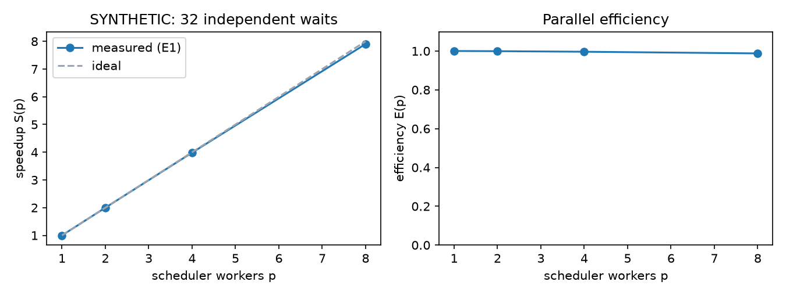
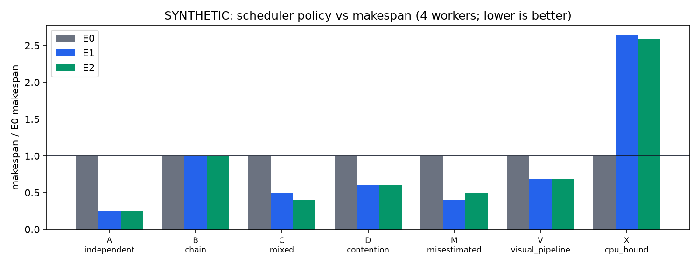
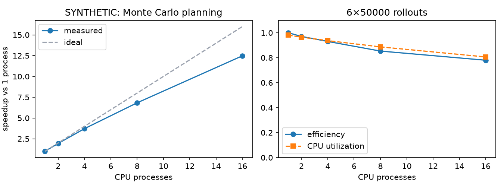
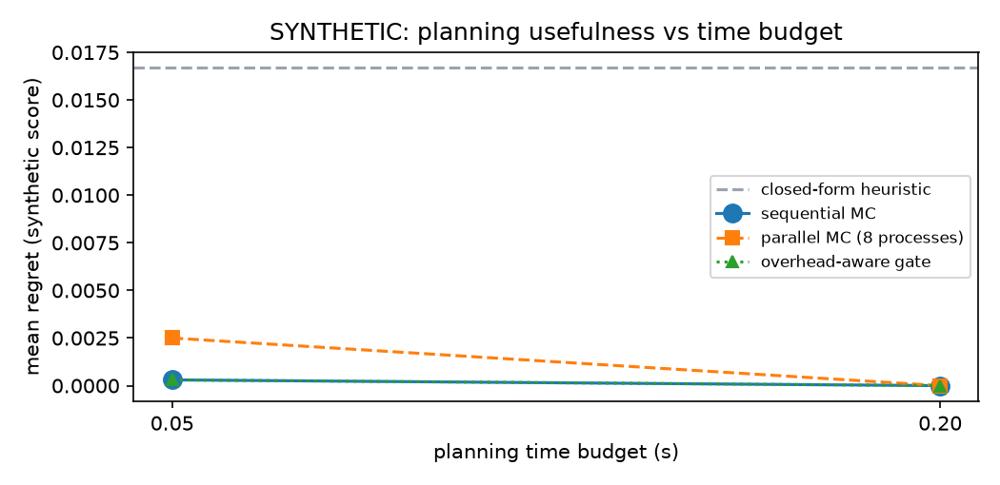
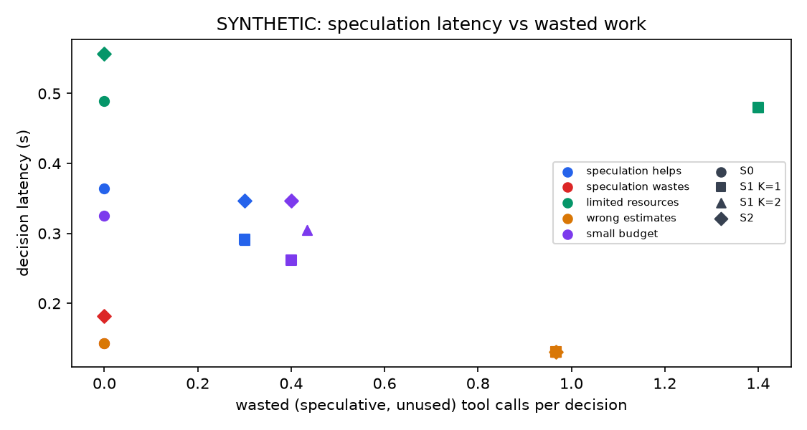
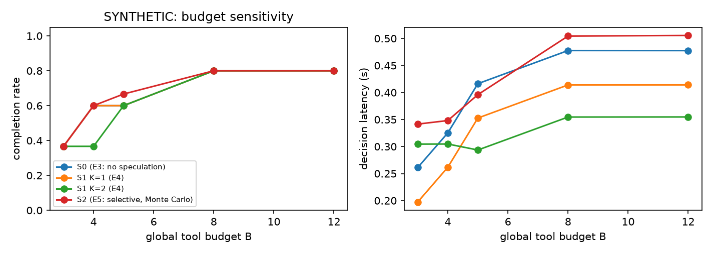
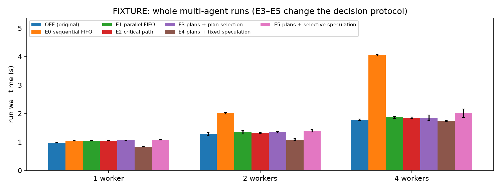
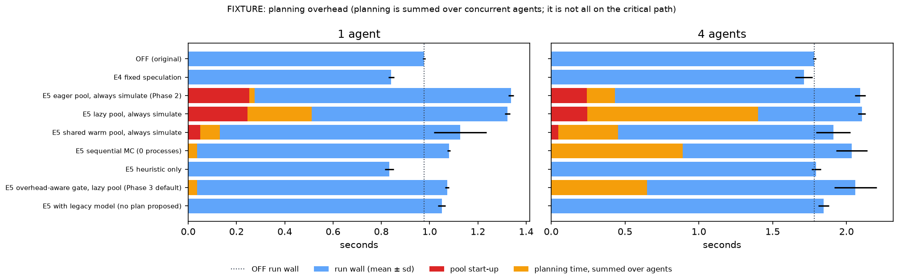
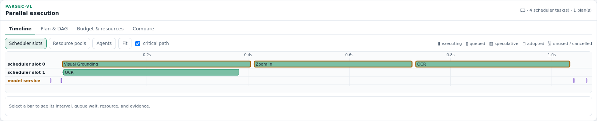
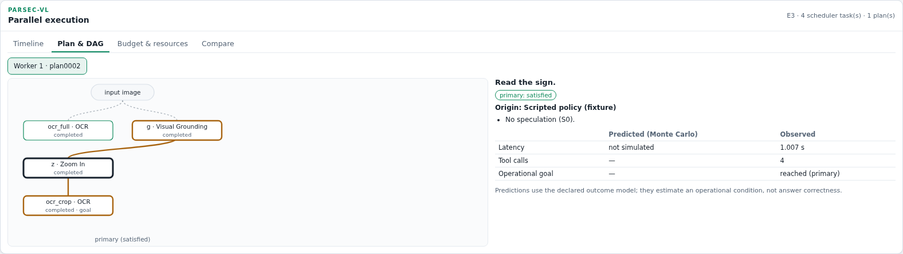

# PARSEC-VL: Parallel Scheduling, Planning, and Speculation for a Multi-Agent Visual-Reasoning Harness

CISC 654 course project, technical report. Every number in this report was measured
in this repository. The commands are in §12 and in
[REPRODUCIBILITY.md §8](REPRODUCIBILITY.md#8-phase-3-course-delivery). Raw results
are under `outputs/parsec_vl/phase3/`.

These are historical measurements. The independent 19 November verification,
new measurements, raw-data limitations, and corrected defects are documented in
[VERIFICATION_REPORT.md](VERIFICATION_REPORT.md); the advisor procedure is in
[ADVISOR_DEMO.md](ADVISOR_DEMO.md).

Each result carries one of three evidence labels:

| Label | What ran |
|---|---|
| **REAL** | The Qwen vision-language model and/or the GPU tool services (SAM 3 grounding, OCR, depth). |
| **FIXTURE** | The real harness and multi-agent runtime with a scripted model and local tool transports with injected delays. |
| **SYNTHETIC** | Scheduler workloads whose tasks sleep or burn CPU for declared durations. |

Results from different labels are never mixed in one table.

---

## 1. Abstract

OpenVLHarness answers questions about images. A vision-language model (VLM) agent calls
visual tools such as grounding, zoom, OCR, and depth, one tool call per model turn. A
multi-agent runtime runs a coordinator and up to four workers.

PARSEC-VL adds four parallel-computing mechanisms to this existing system without
rebuilding it:

1. a **DAG scheduler** with resource pools and three policies (E0 sequential FIFO,
   E1 parallel FIFO, E2 critical-path priority);
2. **declared action plans** (`Execute_Action_Plan`), so one model turn can expose
   independent tool calls;
3. **multicore Monte Carlo plan evaluation** in a process pool with deterministic,
   process-count-independent results;
4. **speculative execution** of alternative branches under one global budget ledger
   (S0 none, S1 fixed width, S2 selective).

Phase 3, the subject of this report:

- removes avoidable planning overhead (lazy and shared pools, an overhead-aware planning gate);
- tests whether the real model proposes plans;
- adds a Gantt, DAG, budget, and comparison panel to the existing Investigation Studio;
- runs eight experiments under a fair protocol.

**Headline results:**

| Finding | Label | Numbers |
|---|---|---|
| Scheduler scales on waiting work | SYNTHETIC | 7.90× speedup on 8 workers for 32 independent waits (efficiency 0.99) |
| Scheduler approaches the equal-delay ideal | FIXTURE | 1.31× for a declared plan; equal-delay T₁/T∞ = 1.33 |
| Multicore Monte Carlo | SYNTHETIC | 12.5× on 16 processes (efficiency 0.78); estimates identical for 0–16 processes |
| Overhead-aware gate | FIXTURE | Removes the 0.25 s pool start from every E5 run that does not need it |
| Real model and plans | REAL | Never proposed a plan unprompted (0/20 first decisions). When asked explicitly, 10/10 proposals were valid, and the two executed plans were serial chains |
| Speculation | SYNTHETIC | Lowers latency 20% when the first branch often fails; uses 75% more tool calls when it rarely fails |
| Whole harness | FIXTURE | Planning (E3, E5) is slower than the original runtime; fixed speculation (E4) is 2–15% faster |

The dominant cost in real runs remains model inference, which tool scheduling cannot shorten.

## 2. Problem and motivation

A visual-reasoning trajectory is a sequence of model turns. Each turn either calls one
tool or answers. Phase 1 profiled recorded real runs and found:

| Measurement (Phase 1 profile) | Value |
|---|---|
| Model busy time / run wall time | 0.95 |
| Tool busy time / run wall time | 0.26 |
| Multi-call model turns | 0 of 90 |
| Available parallelism T₁/T∞ of recorded trajectories | 1.0–2.39 |

The available parallelism comes only from concurrent agents. Three parallel-computing
questions follow:

1. **Task parallelism.** If one turn could declare several independent tool calls, can
   a scheduler overlap them safely? This must respect data dependencies, GPU service
   capacity, and a global tool budget.
2. **Data parallelism.** Choosing between alternative plans is a Monte Carlo
   estimation. Does it scale on many cores, and is it worth its overhead inside a
   ~1 s decision?
3. **Speculation.** Can alternative branches start before the primary branch fails,
   without exceeding the budget or wasting scarce GPU time?

The system has several properties that make these questions harder than in a textbook
DAG:

- Trajectories are adaptive.
- Tools have stochastic latency.
- GPU requests cannot be cancelled once running.
- The budget is shared by all agents.

## 3. System background (unchanged components)

| Component | Role | Changed by PARSEC-VL? |
|---|---|---|
| OpenVLHarness agent loop | model turn → parse one tool call → execute → observe | Only through an optional tool executor hook |
| Tool capabilities (SAM 3, OCR, depth, zoom, coding agent) | HTTP services or local functions | No |
| Multi-agent runtime | coordinator, workers, memory, peer messages, concurrency cap | Reads new optional settings |
| Event store and Investigation Studio | `events.jsonl` with schema validation; SSE live view and replay | New event types and one new panel |
| Global budget ledger (`BudgetManager`) | one ledger per run | Reused; never duplicated |
| Model weights | Qwen VLM | No |

## 4. Design

### 4.1 DAG scheduler (Phase 1)

Every tool call becomes a task with:

- an id;
- dependencies;
- a resource pool (`service:<host:port>`, `cpu`, or `model`);
- an estimated duration.

Each pool has a capacity. A GPU service defaults to capacity 1, because the probe in
§8.6 shows that SAM 3 does not scale with concurrency.

```
SCHEDULE(ready queue Q, worker slots W, pool capacity cap[·]):
  loop:
    wait until a slot is free or a task finishes
    for task t in ORDER(Q, policy):            # E0: FIFO on one slot; E1: FIFO; E2: largest bottom level first
      if deps(t) all finished and in_use[pool(t)] < cap[pool(t)] and budget.reserve(t):
        start t on a worker thread; in_use[pool(t)] += 1
    on finish(t): in_use[pool(t)] -= 1; budget.commit(t); release dependants
```

- The **bottom level** of a task, used by E2, is the longest estimated path from that
  task to any sink. It is the classic critical-path list-scheduling priority.
- Budget reservation happens **before** a task starts. Tasks that are denied are
  recorded, never silently dropped.

### 4.2 Declared action plans (Phase 2, extended in Phase 3)

The model may call `Execute_Action_Plan` with a set of actions:

```json
{"actions": [
  {"id": "o", "tool": "OCR_Tool",              "arguments": {"image_id": "input_image_1"}},
  {"id": "g", "tool": "Visual_Grounding_Tool", "arguments": {"image_id": "input_image_1", "query": "sign"}},
  {"id": "z", "tool": "Zoom_In_Tool",          "arguments": {"image_id": "input_image_1", "coords": "$g.boxes_normalized.0"}, "depends_on": ["g"]},
  {"id": "c", "tool": "OCR_Tool",              "arguments": {"image_id": "$z.image"}, "depends_on": ["z"]}]}
```

The plan is validated before anything runs. Validation checks:

- tool names against the agent's capabilities;
- image ids;
- acyclicity;
- references.

The scheduler then executes the plan. Each action's observation returns to the model as
its own tool message, preserving the "one call, one observation" contract.

Phase 3 changes:

- **Dependencies from references.** A `$id.field` reference now implies a dependency on
  `id`. The inferred dependency is recorded in `plan.estimates["inferred_dependencies"]`.
  Before this change, the real model's plans were rejected for omitting `depends_on`
  (§8.3).
- **Optional simpler schema** (`plan_schema: simple`). The plan is a list of `steps`
  with `after`. It is translated into exactly the same internal plan.
- **Origin labels.** Every plan records who proposed it: the model service, the
  scripted fixture policy, or the controller's heuristic alternative. The Studio shows
  this label. Controller-generated alternatives are never presented as the model's.

### 4.3 Multicore Monte Carlo plan evaluation (Phase 2)

Each candidate branch has an outcome model: success probability and latency
distribution per action. Estimating expected latency and success needs R rollouts per
candidate.

```
EVALUATE(candidates C, rollouts R, processes p):
  batches = [(c, k) for k in 0..R/B-1 for c in C]       # fixed batch size; default 250, benchmark 500
  rollout_seed(k) = base_seed * 1_000_003 + k           # same draws across candidates and process counts
  results = pool.map(simulate_batch, batches)            # sliding window, ≤ 2p batches in flight
  return reduce_common_contiguous_batch_prefix(results) # identical seeds for each candidate, including on timeout
```

The estimates are bit-identical for p = 0 (in-process) through p = 16. This is tested
and verified in every benchmark row. A worker crash restarts the pool once and re-runs
the lost batches.

### 4.4 Speculation (Phase 2)

| Policy | Behaviour |
|---|---|
| S0 (E3) | Runs the selected branch only. |
| S1 (E4) | Starts the next K alternatives immediately. |
| S2 (E5) | Starts an alternative only if Monte Carlo predicts a gain larger than its cost and the budget and pool capacity admit it. |

Common rules for every policy:

- The first branch to satisfy the goal is **adopted**. Other queued branches are
  **pruned**.
- Running GPU requests are allowed to finish, because they cannot be cancelled. Their
  calls count as wasted work.
- All branches draw from the single run ledger.
- Bounded replanning happens only when every branch fails.

### 4.5 Phase 3: removing avoidable planning overhead

In Phase 2, a planning process pool started eagerly with every planned run, costing
0.25 s even when the model never proposed a plan. Phase 3 changes the pool lifecycle:

| Mode | Behaviour |
|---|---|
| `lazy` (default) | The pool starts on the first evaluation that needs it. |
| `eager` | The Phase 2 behaviour, kept for comparison. |
| `shared` | One pool per process, reused across runs. A lock guarantees exactly one start under concurrent first use (tested). |

Phase 3 also adds the **overhead-aware planning gate**, which picks the cheapest
adequate backend before any evaluation:

```
GATE(candidates C, rollouts R, processes p, pool):
  if |C| ≤ 1:                                   return heuristic   ("single candidate")
  stakes = max closed-form score − min closed-form score
  if stakes < min_stakes (0.05 s):              return heuristic   ("nearly equivalent")
  seq  = |C|·R·24 µs                            # measured per-rollout cost
  par  = seq / p + 0.12 s + (0.25 s if pool not started)
  if min(seq, par) > stakes:                    return heuristic   ("planning would cost more than it can gain")
  return sequential if seq ≤ par else parallel
```

The choice, its reason, and every cost term are written to the event log
(`PLAN_EVALUATION_SKIPPED`/`STARTED`) and shown in the Studio.

## 5. Parallelism analysis (work, span, Amdahl)

**Declared plan (sign question).**

- The plan is OCR(full image) ‖ (ground → zoom → OCR(crop)).
- With four equal tool delays d: work T₁ = 4d and span T∞ = 3d.
- Parallelism T₁/T∞ = 1.33. With p ≥ 2 workers, Brent's bound gives T_p ≤ T₁/p + T∞ = 5d.
- Greedy list scheduling achieves T∞ here.
- Measured (FIXTURE, `actions-bench`): E0 1.310 s, E1 0.999 s, a speedup of **1.31×**,
  which is 98% of the equal-delay idealisation. The local pixel detector and image
  processing add unequal costs, so 1.33 is not an exact work/span bound for the
  measured fixture implementation.

**Synthetic scaling.**

- The workload is 32 independent tasks of 0.1 s each: T₁ = 3.2 s and T∞ = 0.1 s, so
  T₁/T∞ = 32.
- With p ≤ 8, the bound is T₁/p.
- Measured: 2.00×, 3.99×, and 7.90× at p = 2, 4, and 8 (efficiency 0.99).
- The residual at 8 workers is 7 ms over 0.4 s (0.407 s measured), i.e. dispatch overhead.

**Chain (workload B).**

- T∞ = T₁, so no speedup is possible.
- Measured: 1.00× at every p. This is the expected negative control.

**Monte Carlo (data parallel).**

- Work = |C|·R rollouts at about 24 µs each (default batches of 250; scaling benchmark batches of 500).
- Span = (work / p) + dispatch and merge.
- Fitting Amdahl's law S(p) = 1 / (f + (1−f)/p) to the measured speedups gives a
  serial fraction f ≈ 0.025 at p = 8 (6.83×) and f ≈ 0.019 at p = 16 (12.48×).
- The serial part is the parent's dispatch and in-order reduction. Pool start-up
  (0.21–0.29 s) is excluded from these warm-pool numbers and reported separately.

**Whole harness (Amdahl at system level).**

- Phase 1 measured model busy/wall ≈ 0.95 and tool busy/wall ≈ 0.26.
- Even infinite tool parallelism can remove at most the tool time that is not
  overlapped with model time.
- In single-agent real runs, tool time is about 20% of the wall, which bounds the
  speedup at ≈ 1.25×.
- In the real-model plans of §8.3 the plan was a chain, so T₁/T∞ = 1 and the
  achievable speedup was 1.0×.

**CPU-bound tools (workload X).**

- Python threads share the GIL, so CPU-bound tool bodies do not parallelise.
- E1 at 2 workers is **0.48×**, slower than sequential, because of contention.
- Logical concurrency is not multicore speedup. This is why plan evaluation uses
  processes, not threads.

## 6. Implementation

| File | Contents |
|---|---|
| `openvlharness/parsec_vl/scheduler.py` | DAG scheduler, pools, E0/E1/E2, event emission |
| `openvlharness/parsec_vl/plans.py` | Plan parsing and validation, dependency inference, simple-schema translation |
| `openvlharness/parsec_vl/controller.py` | `PlanController`, `PlanningConfig`, `choose_planning_backend` (the gate), branch lifecycle |
| `openvlharness/parsec_vl/montecarlo.py` | `PlanEvaluator` (spawn process pool, lazy start, shared instance, crash recovery), closed-form heuristic |
| `openvlharness/parsec_vl/harness.py` | Attaches plan mode to an existing agent (`attach_plan_mode`), origin labels |
| `openvlharness/parsec_vl/experiments.py`, `report.py` | Benchmarks, variant sets, the 16-configuration matrix, figures, normalized comparison tables |
| `openvlharness/multi_agent/{config,orchestrator}.py` | Validated settings: `plan_dispatch`, `planning_gate`, `planning_pool`, `plan_schema`; pool lifecycle per run |
| `openvlharness/studio/static/parsec-view.js` | Studio panel: Gantt, DAG, budget/resources, comparison |
| `openvlharness/studio/server.py` | `GET /api/parsec/experiments`: authenticated, read-only, fixed files only |
| `scripts/parsec.py` | `demo`, `bench`, `plan-bench`, `spec-bench`, `compare`, `matrix`, `figures`, … |
| `scripts/plan_probe.py` | Real-model plan probe and offline re-validation |

Rollouts are pure functions of their seed, and the parent reduces in batch order, so
the process pool needs no shared mutable state.

The scheduler uses one lock and condition variable for its ready queue and pool
counters. Every state change is emitted as an event with monotonic and wall
timestamps. The Studio derives everything from those events.

## 7. Experimental methodology

- **Fixed workloads.** Speedup is only reported where every policy executes the same
  task set. SYNTHETIC workloads and FIXTURE runs are deterministic in their tool
  outcomes. Adaptive real trajectories differ between runs, so they are reported as
  case studies, never as speedups.
- **Paired comparisons.** In `spec-bench`, every policy sees the same per-trial
  outcome draws (30 trials). In `compare`, every variant runs the same fixture
  question with the same injected tool delay (0.2 s, 5 trials).
- **Overhead is included.** Run wall time includes planning and pool start-up. These
  are also reported separately ("planning s", "pool start-up s", and
  "runs with pool start").
- **First run vs later runs** are reported separately, so warm-pool effects are visible.
- **No evaluation labels in planning.** Outcome models come from declared estimates
  or from earlier recorded runs (`outcome-model`), never from ground-truth answers.
- **Hardware:** 64 CPU cores, 4× NVIDIA L40S, Linux 6.1. Tool services are local HTTP
  servers.

## 8. Results

### 8.1 Experiment 1: fixed-workload speedup (SYNTHETIC)




| Workload | Best speedup vs E0 | Note |
|---|---|---|
| A, 8 independent tasks | 7.83× at 8 workers | Bound reached (observed / T_LB = 1.02) |
| B, chain | 1.00× | No parallelism, as expected |
| C, mixed | E2 2.00× vs E1 1.43× at 2 workers | Critical-path priority matters when slots are scarce |
| D, GPU contention | 1.67× cap | Pool capacity 1 bounds it |
| M, wrong estimates | **E1 1.67× vs E2 1.43×** at 2 workers | Negative: E2 follows the wrong estimates |
| V, visual pipeline | 1.47× | Equal to its T₁/T∞ |
| X, CPU-bound | **0.48×** (E1, 2 workers) | Negative: GIL contention |

### 8.2 Experiment 2: multicore Monte Carlo (SYNTHETIC, 6 candidates × 50,000 rollouts)



| Processes | Wall s | Speedup | Efficiency | CPU util. | Identical estimates |
|---:|---:|---:|---:|---:|:---:|
| 0 (in-process) | 7.375 | 1.03 | — | 0.99 | yes |
| 1 | 7.566 | 1.00 | 1.00 | 0.98 | yes |
| 2 | 3.896 | 1.94 | 0.97 | 0.97 | yes |
| 4 | 2.033 | 3.72 | 0.93 | 0.94 | yes |
| 8 | 1.108 | 6.83 | 0.85 | 0.89 | yes |
| 16 | 0.606 | 12.48 | 0.78 | 0.81 | yes |

Cold pool start-up is 0.21–0.29 s, and the per-evaluation overhead is 0.12–0.14 s. The
pool therefore pays off only for evaluations of about 0.3 s or longer. Real plan
evaluations in the harness are 1–40 ms, which is what motivated the gate.

### 8.3 Experiment 3: planning usefulness (SYNTHETIC decision quality, REAL plan proposals)



| Method | Budget | Best choice | Mean regret | Actual planning s |
|---|---:|---:|---:|---:|
| Closed-form heuristic | 0 | 0.80 | 0.0167 | 0.00002 |
| Sequential MC | 0.05 s | 0.97 | 0.0003 | 0.061 |
| Parallel MC (8 processes) | 0.05 s | 0.95 | 0.0025 | 0.068 |
| Overhead-aware gate | 0.05 s | 0.97 | 0.0003 | 0.061 |
| Sequential MC | 0.2 s | 1.00 | 0 | 0.212 |
| Parallel MC (8 processes) | 0.2 s | 1.00 | 0 | **0.266** |
| Overhead-aware gate | 0.2 s | 1.00 | 0 | 0.212 |

- Under a tight budget, the parallel pool performs *worse* than sequential: it spends
  its budget on dispatch.
- At 0.2 s, the parallel run overruns its budget by 33%.
- The gate chose sequential in all 40 instances. It matches the best method here, but
  it minimises planning time and does not try to maximise decision quality.

**Real model (REAL, `scripts/plan_probe.py`, first decisions only).**

| Question | Schema | Plans proposed | Valid (current parser) | Independent work |
|---|---|---:|---:|---:|
| Sign, natural wording | current / simple | 0/5, 0/5 | — | — |
| Count grapes, natural wording | current / simple | 0/5, 0/5 | — | — |
| Sign, explicitly asked to plan | current | 5/5 | 5/5 (0/5 before dependency inference) | 5/5 |
| Sign, explicitly asked to plan | simple | 5/5 | 5/5 | 3/5 |

- With natural questions, the model **never** proposed a plan. It called OCR,
  grounding, or zoom directly.
- When explicitly told to plan, it always proposed one. The original parser rejected
  all five current-schema plans, because the model referenced `$z.image` without
  listing `z` in `depends_on`. Dependency inference fixed this.
- **Executed real plans** (`plan_probe.py --execute 2`, real model and real services):
  - Both proposals were valid but were serial chains, grounding → zoom → OCR.
  - 0 overlapping tool pairs; answer "EXIT 42"; 2.8 s and 2.5 s wall.
  - The model omitted the parallel full-image OCR it had been asked for.
- One multi-agent E3 run on the same image (`real_sign_e3_explicit`) answered without
  any tool call.
- Conclusion: **the real model never produced a plan with executed parallel work.** All
  overlapping plan execution in this report comes from scripted fixture plans, and is
  labelled FIXTURE.

### 8.4 Experiment 4: speculation (SYNTHETIC, 30 paired trials, decision latency in s)



| Scenario | S0 | S1 K=1 | S2 | S1 wasted calls | S2 wasted calls |
|---|---:|---:|---:|---:|---:|
| A, first branch often fails | 0.364 | **0.291** | 0.346 | 0.30 | 0.30 |
| B, first branch rarely fails | 0.143 | 0.130 | 0.182 | **0.97** | 0.00 |
| C, one GPU slot | 0.489 | 0.480 | 0.557 | 1.40 | 0.00 |
| D, wrong estimates | 0.143 | 0.130 | 0.130 | 0.97 | 0.97 |
| E, small budget | 0.325 | 0.262 | 0.347 | 0.40 | 0.40 |

Findings:

- S1 always has the lowest latency, but in B it spends 75% more tool calls for a 9% gain.
- S2 avoids that waste in B and C, as designed.
- In C with one GPU slot, speculation queues behind the primary branch: 0.060 s of
  necessary queue wait, and no gain.
- With GPU capacity 2 (`speculation_gpu2`), S1 cuts latency **26%** (0.361 vs 0.489 s)
  at 1.2 wasted calls per decision.

**Negative result: the Phase 3 gate made S2 slower than Phase 2's S2.**

| Scenario | Phase 2 S2 (warm pool) | Phase 3 S2 (gate) |
|---|---:|---:|
| A | 0.312 | 0.346 |
| B | 0.160 | 0.182 |
| C | 0.519 | 0.557 |
| E | 0.302 | 0.347 |

- The gate's cost model charges 0.12 s per parallel evaluation. On these tiny
  evaluations it therefore chose in-process sequential Monte Carlo, which took
  0.04–0.09 s on the decision path.
- Phase 2 used a pool that was started once and reused across the 30 trials, so its
  start-up was never on the decision path.
- In D, the gate skipped Monte Carlo (stakes below threshold), so S2 behaved like S1:
  0.130 s, 0.97 wasted calls. Phase 2's S2 also speculated in D, at 0.156 s.
- The fixed constants are miscalibrated for a warm pool. Section 11 lists the fix:
  measure the overhead online.

### 8.5 Experiment 5: budget sensitivity (SYNTHETIC, scenario E, global budget B)



| B | Completion: S0 / S1 K=1 / S1 K=2 / S2 | Note |
|---:|---|---|
| 3 | 0.37 / 0.37 / 0.37 / 0.37 | Budget binds everyone |
| 4 | 0.60 / 0.60 / **0.37** / 0.60 | K=2 speculation spends calls the fallback needed |
| 5 | 0.60 / 0.60 / 0.60 / **0.67** | S2 admits speculation only when it fits |
| ≥ 8 | 0.80 for all | Budget no longer binds |

Latency rises with B because more trials reach the slow fallback instead of failing
early. Admission denials and unused budget are recorded per trial in
`phase3/budget/speculation.json`.

### 8.6 Experiment 6: resource contention

**Real tool services (REAL, 8 requests per level, no model):**

| Tool | Throughput c=4 / c=1 | Median latency c=1 → c=4 |
|---|---:|---|
| SAM 3 grounding | **0.91×** | 1.18 → 4.96 s |
| OCR | 3.12× | 0.24 → 0.29 s |
| Depth | 1.16× | 0.33 → 1.09 s |
| Zoom (CPU) | 2.56× | 0.064 → 0.086 s |

SAM 3 does not scale with concurrency: four concurrent requests make each one about 4×
slower. Capacity 1 per GPU service is therefore the default.

**Whole runs (FIXTURE, 4 agents, run wall s):**

| Variant | Run wall |
|---|---:|
| E2, 1 scheduler slot | 3.977 |
| E2, 4 slots | 1.820 |
| E2, tool-pool capacity 1 | 3.966 |
| E4, capacity 4 | 1.682 |
| E4, capacity 1 | 3.926 |
| E5, capacity 1 | 4.222 |

A single-capacity pool serialises the four agents. Neither speculation nor planning
can recover from that, and E5 adds its planning time on top.

### 8.7 Experiment 7: whole harness, OFF and E0–E5 (FIXTURE, 0.2 s tool delay, 5 trials)



| Agents | OFF | E0 | E1 | E2 | E3 | E4 | E5 |
|---:|---:|---:|---:|---:|---:|---:|---:|
| 1 | 0.972 | 1.044 | 1.048 | 1.050 | 1.054 | **0.834** | 1.076 |
| 2 | 1.280 | 2.003 | 1.341 | 1.321 | 1.348 | **1.084** | 1.396 |
| 4 | 1.777 | 4.048 | 1.862 | 1.852 | 1.855 | **1.737** | 2.008 |

Notes on reading this table:

- OFF–E2 use the original one-call protocol.
- E3–E5 let the scripted model declare a plan, so they change the decision protocol.
  The comparison is therefore of whole runs, not of identical work.
- E0 serialises all agents' tools on one slot, so it is 2.3× slower at 4 agents.
- E1 and E2 cost 3–8% over OFF. This is hand-off overhead with nothing extra to overlap.
- E4 is fastest: its speculative branch saves a model turn.
- E3 and E5 are *slower* than OFF. Their planning time grows with concurrent agents
  (E5: 0.035, 0.117, and 0.860 s summed per run at 1, 2, and 4 agents), because agents
  contend for the same CPUs.
- No pool was started in any E3–E5 run (gate and lazy pool).

### 8.8 Planning overhead before and after Phase 3 (FIXTURE)



| E5 variant | 1 agent | 4 agents | Pool starts |
|---|---:|---:|---:|
| Eager pool, always simulate (Phase 2 behaviour) | 1.337 | 2.092 | 5/5 |
| Lazy pool, always simulate | 1.323 | 2.104 | 5/5 |
| Shared warm pool, always simulate | 1.127 (first 1.321, later 1.079) | 1.910 | 1/5 |
| Sequential MC (0 processes) | 1.080 | 2.034 | 0 |
| **Heuristic only** | **0.833** | **1.795** | 0 |
| Overhead-aware gate (Phase 3 default) | 1.073 | 2.061 | 0 |
| Legacy model (no plan proposed) | 1.050 | 1.846 | 0 |
| OFF (reference) | 0.976 | 1.783 | — |
| E4 (reference) | 0.841 | 1.711 | — |

- **Before → after.** The Phase 3 default removes the 0.25 s pool start: 1.337 → 1.073 s
  (−20%) with 1 agent, and 2.092 → 2.061 s with 4 agents.
- If the model proposes no plan, no pool starts: 1.050 s vs 1.337 s for Phase 2's eager
  pool.
- **Negative result.** "Heuristic only" beats every Monte Carlo variant, including the
  gate. In this fixture, the closed-form heuristic picks the same branch, and E5 then
  speculates (4 speculative calls), which saves a model turn. Monte Carlo predicts that
  speculation is not worth it here, and Monte Carlo is wrong about wall time: it
  optimises expected latency under the outcome model, but omits the model-turn saving.

### 8.9 Experiment 8: multi-agent configuration matrix (FIXTURE, E5)

All 16 configurations completed with the correct answer "EXIT 42". The configurations
were workers ∈ {1, 2, 3, 4} × memory on/off × peer messages on/off.

- Recorded memory and peer settings matched the request in every run.
- Tool calls were 4 per worker. With peer messages on, they doubled
  (32 vs 16 at 4 workers).
- Messages grew from 2 (1 worker) to 28 (4 workers with peer).
- The fixture's `max_concurrent_workers` is 4; the shipped `configs/multi_agent.yaml`
  uses 2.

### 8.10 One-command demo (FIXTURE, `python scripts/parsec.py demo`, 0.3 s tool delay)

| Case | Run wall | Tool span |
|---|---:|---:|
| OFF (original protocol) | 1.367 s | 1.316 s |
| E3, plan executed sequentially | 1.406 s | 1.326 s |
| E3, plan executed in parallel | **1.109 s** | **1.002 s** (1.32× vs sequential dispatch) |
| E4, speculation | 1.121 s | 1.020 s |

## 9. Visualization (Investigation Studio)

A collapsible **PARSEC-VL panel** was added to the existing Studio. There is no new
dashboard. The panel reads the same event stream as the story, live through SSE or in
replay, and builds its model as a pure function of the visible event prefix. Replay
therefore never shows future events. Runs without scheduler data show "No PARSEC-VL
planning or scheduler data was recorded for this run."

| Tab | Shows |
|---|---|
| Timeline | A Gantt chart with lanes by scheduler slot, resource pool, or agent; model requests and the planning process as their own lanes. Queue wait is drawn hatched and execution solid. Supports zoom, pan, and fit. Selecting a bar highlights the critical path and its dependencies, shows a detail card, and offers "Show tool evidence", which opens the real tool input and output in the evidence panel. |
| Plan & DAG | The plan's explicit dependency graph (inferred dependencies are marked), branch status (adopted, pruned, failed), the origin label (model / scripted fixture / controller heuristic), the gate decision, and predicted vs observed latency and calls. |
| Budget & resources | Budget used, reserved, physical, and denied, from the single ledger. Pool occupancy over time is labelled as a proxy derived from scheduler events, not GPU utilisation. |
| Compare | Recorded benchmark tables from `GET /api/parsec/experiments`. Each table carries a REAL/FIXTURE/SYNTHETIC badge and its source file. The tab is read-only: clicking never runs anything. |

The story view gained two plain-language steps: "<agent> proposed an action plan" and
"<agent> adopted the speculative … result". All other planning events stay in the
Technical Trace.

Screenshots are from a real browser run of `studio_browser_matrix.mjs --parsec`, 55
checks, in `docs/images/parsec/`:




## 10. Discussion and negative results

The negative findings are as important as the positive ones:

1. **The real model does not plan in parallel.** Unprompted, it makes one tool call
   per turn. When asked, it writes valid but serial plans. With today's model, the
   harness's achievable tool-level speedup on single-agent questions is ≈ 1.0×.
2. **Monte Carlo planning is rarely worth its cost inside a 1 s decision.**
   - The multicore evaluator scales well (12.5× on 16 cores), but the useful
     evaluations are milliseconds long.
   - Pool overhead (0.12 s warm, 0.25 s cold) dominates.
   - Under a 0.05 s budget, the parallel pool chooses *worse* than sequential.
3. **The gate removes the overhead it can see, but is miscalibrated.** Its constant
   0.12 s warm-pool cost made E5 slower than Phase 2's warm-pool E5 in four of five
   speculation scenarios. Its objective (planning time) is not the user's objective
   (end-to-end wall time).
4. **E2 critical-path priority is fragile.** With wrong duration estimates (workload M)
   it is worse than FIFO.
5. **Threads do not give CPU speedup.** CPU-bound tool bodies run 0.48× under E1.
6. **The scheduler costs 3–8% in the original one-call protocol.** E1 and E2 vs OFF,
   with nothing extra to overlap.
7. **SAM 3 does not scale in this probe.** Throughput at 4 concurrent requests is 0.91×; OCR does scale (3.12×).
   GPU-bound speculation needs real spare capacity (§8.4, capacity 2).

## 11. Limitations and future work

**Limitations.**

- **Fixture vs real.** All overlapping plan execution comes from scripted plans. Real
  model runs are a small number of case studies with stochastic trajectories.
- **Outcome models.** These are declared estimates, or are fitted from a few earlier
  real runs. Their error directly affects E2 and S2.
- **Planning time in multi-agent runs** is summed over concurrent agents, and is not
  all on the critical path (Fig. 8). The Gantt shows when it is.
- **Pool occupancy** in the Studio is a proxy derived from scheduler events, not
  measured GPU utilisation.
- **Real-model evidence is small.** The probe used 30 first decisions and 2 executed
  investigations, by design: no broad GPU sweep was authorized.

**Future work.**

- Calibrate the gate online: measure per-rollout and warm-pool cost in the running
  process.
- Include the model-turn cost in the speculation objective.
- Fine-tune or few-shot prompt the model to emit independent actions.
- Batch GPU requests inside a service, which would give real capacity > 1.

## 12. Reproduction

Run from the repository root after `source scripts/env.sh`.

| Purpose | Command | Requirements |
|---|---|---|
| Demonstration | `python scripts/parsec.py demo` (`--studio` to open the runs) | About 10 s; no GPU, no model |
| Figures | `python scripts/parsec.py figures` | Regenerates `docs/figures/` from recorded results |
| Tests | `python -m pytest tests -q` | — |
| Full experiment set | The commands in [REPRODUCIBILITY.md §8.2](REPRODUCIBILITY.md#82-full-experiment-set-25-minutes-cpu-only-the-probe-line-needs-the-tool-services) | About 25 min; CPU, except the tool probe |
| Real model | [REPRODUCIBILITY.md §8.3](REPRODUCIBILITY.md#83-real-model-needs-the-model-and-tool-services-small-bounded) | Model and tool services |
| Browser checks and screenshots | [REPRODUCIBILITY.md §8.4](REPRODUCIBILITY.md#84-studio-browser-checks-needs-node-and-chrome-see-investigation_studiomd) | Node and Chrome |

Background results for the earlier phases are in [PHASE1_RESULTS.md](PHASE1_RESULTS.md)
and [PHASE2_RESULTS.md](PHASE2_RESULTS.md). The architecture is described in
[ARCHITECTURE.md](ARCHITECTURE.md).
