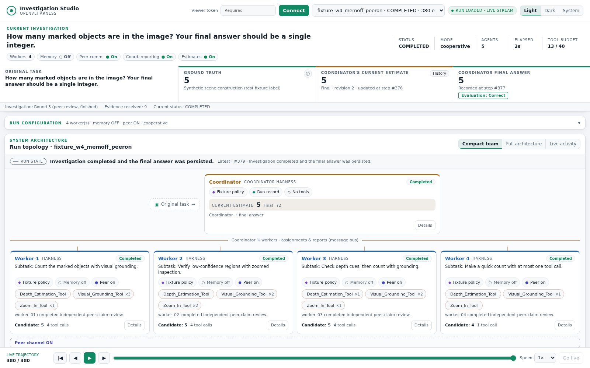
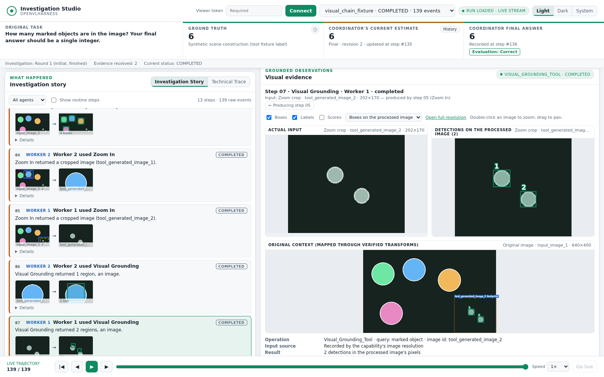
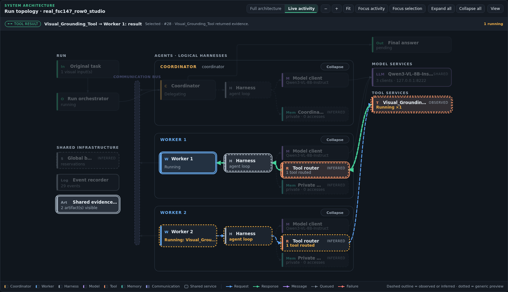

# Harness guide: install, services, data, and runs

Operating instructions for the OpenVLHarness-derived runtime that PARSEC-VL builds
on: environments, model/tool services, dataset preparation, single-agent and
multi-agent runs, the Investigation Studio, and evaluation smoke runs. The
project overview is in the [README](../README.md); the scheduler is described in
[ARCHITECTURE.md](ARCHITECTURE.md).

The optional passive evidence observer (`BITE_OBSERVER_ENABLED`, package
`openvlharness/bite/`) is retained from the earlier BITE research and is off by
default. The BITE research pipelines themselves are archived (see
[LEGACY_ARCHIVE.md](LEGACY_ARCHIVE.md)).

## Install and start the services

This section starts from a clean Linux checkout and ends with a scored benchmark
smoke run. CPU-only analysis and tests need Python 3.10 or newer. Local model and
perception services require NVIDIA GPUs, compatible CUDA drivers, Git, and enough
disk for the environments, checkpoints, datasets, and outputs.

The validated deployment used Python 3.11 and four GPUs: Qwen on GPUs 0 and 1,
depth on GPU 2, and OCR/SAM 3 on GPU 3. Those assignments are defaults, not hard
requirements; change the `*_GPUS` values in `.env` for your machine. Smaller GPU
layouts have not been fully validated.

### 1. Clone and create the environments

```bash
git clone <your-public-bite-repository-url> BITE
cd BITE

# Core package, evaluation dependencies, tests, and configuration file.
bash scripts/setup.sh
source scripts/env.sh

# Verify the self-contained CPU-side installation before downloading weights.
python -m pytest tests/parsec_vl tests/bite -q
python -m pytest tests/evaluation/test_cli_end_to_end.py -q
```

The end-to-end tests and retained offline smoke bind a temporary loopback
server. If your container or sandbox prohibits local sockets, run them on the
host.

For local Qwen, OCR, and depth/camera-pose services, install the isolated worker
environments as well:

```bash
bash scripts/setup.sh vllm depth
```

Add `sam3` when you need grounding experiments:

```bash
bash scripts/setup.sh vllm depth sam3
```

The setup creates `.venv` for the main package and `.venvs/` for workers whose
GPU dependency stacks are intentionally isolated. It also copies `.env.example`
to the ignored `.env` file if `.env` does not exist. Re-running setup does not
replace an existing `.env`.

### 2. Configure paths, ports, and GPUs

Open `.env` and check at least these settings:

```dotenv
LMUData=${PWD}/data
HF_HOME=${PWD}/.cache/huggingface
QWEN_GPUS=0,1
DEPTH_GPUS=2
OCR_GPUS=3
SAM3_GPUS=3
AGENT_CONFIG=configs/local_qwen.yaml
```

`MODEL_API_KEY=empty` is intentional for the local OpenAI-compatible Qwen
server. The default endpoints are Qwen `127.0.0.1:8222`, the capability router
`:8101`, OCR `:8085`, SAM 3 `:8086`, and depth/camera pose `:8087`. Keep the
router's `AGENT_CONFIG` identical to the `--config` passed to inference or
evaluation.

Use one of these maintained profiles:

| Profile | Capabilities | External key |
| --- | --- | --- |
| `configs/local_qwen.yaml` | OCR, depth, camera pose, Zoom, Python | None |
| [`examples/local_grounding_tools.yaml`](../examples/local_grounding_tools.yaml) | The above plus SAM 3 grounding | None; gated checkpoint access is required |
| `configs/local_qwen_grounding.yaml` | Grounding plus text search and web visit | `SERPER_API_KEY` |
| `configs/agent/qwen3_8b_paper.yaml` | Full nine-capability compatibility profile | Search key and public query-image hosting |

For a hosted model with only Zoom and local Python, use
[`examples/local_tools.yaml`](../examples/local_tools.yaml) and set its model
endpoint and key through the documented environment placeholders.

### 3. Download pinned model checkpoints

After `source scripts/env.sh`, cache only the workers you plan to run:

```bash
# Base local profile
python scripts/download_models.py qwen ocr depth

# Grounding profile; requires accepted facebook/sam3 access and HF_TOKEN.
python scripts/download_models.py qwen ocr depth sam3
```

The downloader pins exact revisions rather than silently following a changing
`main` branch:

| Worker | Model | Revision |
| --- | --- | --- |
| Qwen | `Qwen/Qwen3-VL-8B-Instruct` | `0c351dd01ed87e9c1b53cbc748cba10e6187ff3b` |
| OCR | `PaddlePaddle/PaddleOCR-VL-1.5` | `2a4195faa5e7914c12f2fc601d72c81caf8d2da5` |
| Depth | `depth-anything/DA3NESTED-GIANT-LARGE` | `8615eefb62f2db4f8d6ebaa59160086981672829` |
| Grounding | `facebook/sam3` | `3c879f39826c281e95690f02c7821c4de09afae7` |

Check each model card and dataset page for its separate license and access
conditions before redistribution.

### 4. Start the local services

Each service stays in the foreground, so run each command in its own terminal.
The base profile needs four processes:

```bash
# Terminal 1
bash scripts/service.sh qwen

# Terminal 2
bash scripts/service.sh ocr

# Terminal 3
bash scripts/service.sh depth

# Terminal 4
bash scripts/service.sh router
```

For local grounding, first set
`AGENT_CONFIG=examples/local_grounding_tools.yaml` in `.env`, then start an
additional worker before the router:

```bash
bash scripts/service.sh sam3
```

From another terminal, verify configuration resolution and service health
without issuing tool calls:

```bash
source scripts/env.sh
python scripts/check_environment.py

# Router-only checks, useful while bringing up workers one at a time.
curl --fail http://127.0.0.1:8101/health
curl --fail http://127.0.0.1:8101/backend-status
```

`/health` reports whether the router is running and how many tools it registered.
`/backend-status` reports concurrency limits and accumulated backend degradations;
it does not prove that every GPU worker or provider credential will succeed on a
real request. Keep degradation counters at zero during a clean experiment.

Only use `python scripts/check_environment.py --probe-tools` when real calls are
intended. Provider-backed tools can consume credits. The local Python backend
runs model-generated code with the current user's filesystem and network access;
it is not a security sandbox.

## Download and prepare evaluation data

`LMUData` controls all evaluation data storage. The default `.env` keeps it at
`./data`, which is ignored by Git. Registered datasets are prepared on first use,
so the basic experiment command below is also the download command. Interrupted
downloads can be rerun and will reuse the cache.

| Dataset name | Task and score | Source behavior |
| --- | --- | --- |
| `FSC147_val` | 1,286 counting rows; exact count | TSV and images download on first use |
| `CountQA` | 1,528 counting rows; exact count | Built from `Jayant-Sravan/CountQA` |
| `PixmoCount_val` | up to 534 counting rows; exact count | Built from `allenai/pixmo-count`; unavailable source images are skipped |
| `FSCD_147_bbox_val` | 1,286 grounding rows; box AP | TSV/images download on first use |
| `FSCD_LVIS_bbox_val` | 1,181 grounding rows; box AP | TSV/images download on first use |
| `ODinW13_bbox_val_qwen3` | 4,938 rows across 13 domains; box AP | Data plus GLIP annotations download on first use |

The complete dataset registry, preparation rules, metrics, custom-TSV format,
and judge requirements are in the
[`evaluation_kit/dataset` guide](../evaluation_kit/dataset/README.md). Most release
TSVs and images come from the evaluation dataset bundle identified there.
Search, general VQA, and spatial benchmarks may require extra source datasets or
an LLM judge; do not use `configs/judge_no_judge.yaml` for a benchmark whose
guide says a judge is required.

To prefetch a dataset without running inference, instantiate its loader:

```bash
source scripts/env.sh
python -c "from evaluation_kit.dataset import build_dataset; d=build_dataset('FSC147_val'); print(len(d.data))"
```

Data are cached below `$LMUData`; model snapshots stay below `$HF_HOME`. Do not
commit either directory. You are responsible for the source datasets' licenses,
terms, and any required access approval.

## Run a basic experiment

### CPU-only offline smoke run

Before downloading model weights, verify the complete image-to-metric path with
three generated examples and a deterministic OpenAI-compatible fixture model:

```bash
source scripts/env.sh
python scripts/offline_smoke.py
```

This exercises the real agent loop, image dataset adapter, inference writer,
count evaluator, HTML reporting, and passive BITE observer. It retains outputs
under `outputs/offline-smoke/`. The fixed fixture answers validate integration;
they are not a model-quality result.

### Inspect a complete agent trajectory

With the local services running, execute one image task and print every model
turn, tool call, tool response, memory update, and final answer:

```bash
source scripts/env.sh
python scripts/trajectory_demo.py
```

Pass another image and question when needed:

```bash
python scripts/trajectory_demo.py /path/to/image.jpg \
  --question 'What evidence in this image answers the question?'
```

Each run creates a readable Markdown trace, a browsable HTML report, and the
unmodified trajectory JSON under `outputs/trajectory-demo/<timestamp>/`.

### Run coordinated multi-agent inference

The optional multi-agent mode creates N isolated worker agents plus one independent
coordinator. Workers retain private model contexts, memory, capability instances,
budgets, and traces. They investigate concurrently, exchange bounded typed messages,
and return evidence for coordinator synthesis. The original single-agent paths are
unchanged.

Run the deterministic server-free integration first:

```bash
source scripts/env.sh
python scripts/multi_agent_smoke.py
```

With the local model and tool services running:

```bash
python -m openvlharness.multi_agent.run \
  --config configs/multi_agent.yaml \
  --agent-config "$AGENT_CONFIG" \
  --num-agents 2 \
  --image data/images/FSC147/190.jpg \
  --task 'How many seagulls are visible? Use visual evidence.'
```

Use `--no-peer-communication` for an isolated-worker comparison, or
`--mode cooperative` for stable debugging order. Each run persists coordinator and
worker trajectories, private-memory records, messages, events, budgets, resolved
configuration, and the final result below `outputs/multi_agent/`. See
[the architecture, configuration, execution, and reproducibility guide](MULTI_AGENT.md).

### Observe a live investigation

The authenticated Investigation Studio turns the structured multi-agent event log
into a live research dashboard. It includes a complete, interactive architecture graph
(coordinator, every worker's harness, model client, tool router, and private memory,
shared model and tool services, communication bus, budget, and evidence store) that
lights up the actual direction of each tool request and result, message and reply,
memory read and write, model call, and budget decision. It also has a compact
timeline, original-image ROI overlays, crop and tool-result inspection, scoped memory
views, final synthesis, deterministic replay, and light, dark, and system themes. It
reads the same run directory written by normal inference; watching is optional and
never blocks an agent.

Create a complete two-worker visual trajectory without model servers:

```bash
./scripts/run_studio_demo.sh
```

The run commands start or reuse a compatible Studio for the same runs directory and
print which instance they used. They then open the browser on that exact instance
with a **single-use launch link** that selects the new run; the page waits for the
run to appear if necessary. Older or unrelated servers on the port are reported and
left untouched. Run a dataset task with one command:

```bash
./scripts/run_studio_dataset_task.sh FSC147_val 0
```

To run one or two real inferences with live visualization, after starting the
model/tool services and preparing the dataset:

```bash
bash scripts/run_custom_inference.sh 0             # one task, two workers + coordinator
bash scripts/run_custom_inference.sh -w 4 -m off 0 10  # four workers, memory off, two tasks
bash scripts/run_custom_inference.sh --dry-run 0 10   # print commands only
```

For a custom team per run (worker count, memory, peer messages, message bus,
coordinator estimates, mode) and any task indexes, use the flag-based runner:

```bash
bash scripts/run_custom_inference.sh -w 4 --memory off --peer on 25      # one task
bash scripts/run_custom_inference.sh -w 1 -m off -p off -e off 0-2 7     # several tasks
bash scripts/run_custom_inference.sh --check 0-4                         # inspect inputs, no model calls
bash scripts/run_custom_inference.sh --help
```

Each task opens its **Investigation Story**; switch to **Technical Trace** for
every original event or expand a step and select **View underlying events**.
`STUDIO_NUM_AGENTS=1` selects one worker plus coordinator; `STUDIO_DATASET` selects
another prepared dataset. The launcher honors the existing Studio environment
options.

If the environment cannot open a browser, open the printed link. Links carry a
short-lived ticket, not the viewer token. Manage instances with
`scripts/studio_ctl.py`: `status` lists Studios and their compatibility, `url --run
<id>` mints a fresh link, `ensure --open` reuses or starts one, and `stop --port
<p>` stops only your own Studio server. Set `STUDIO_OPEN_BROWSER=0` only for a
headless run. Before you connect, the canvas shows a generic **architecture
preview**. After connecting without a run, it shows the **configured architecture**
(coordinator, a worker template, registered tools, and model services). After
selecting a run, it shows that run's recorded topology and activity.

For a real image outside a dataset, start the model/tool services described above
and execute:

```bash
./scripts/run_studio_investigation.sh /path/to/image.jpg \
  'What visual evidence answers this question?'
```

The run appears immediately and continues if the browser disconnects. Select a
completed run from the same menu to replay it without new model or tool calls.
Private-memory endpoints require the viewer token and can be disabled with
`./scripts/studio.sh --disable-private-memory`. Hidden model reasoning is never
published; the dashboard shows recorded public action intent or states that no
explicit rationale was available.

The graph has two modes over one topology. **Full architecture** shows everything;
**Live activity** subdues components that are idle at the current position. Click an
event, component, or connection to inspect it. Zoom, fit, focus, and per-worker
collapse are in the graph toolbar. The topology comes from the sanitized run manifest,
and activity comes only from recorded events (never from future events during
replay). Components that older runs did not declare are drawn dashed as *observed* or
*inferred*. See the [Investigation Studio architecture, event mapping, correlation,
theme, lifecycle, security, and troubleshooting guide](INVESTIGATION_STUDIO.md),
which also explains the harmless `None of PyTorch … found` tokenizer notice and
documents run-to-run variation on repeated real tasks.

**Answer status, configuration, and compact team (`studio.ui.v3`).** A sticky strip
keeps three separate fields in view: the **ground truth**, released by an
evaluator-only endpoint after the run is terminal (shown as *Sealed until completion*
while inference runs, with dataset/row provenance), the **coordinator's current
estimate** (starts as *No estimate yet*; changes only when the coordinator records a
new provisional, revised, unresolved, or final answer state, with an expandable
history linked to the evidence it cited), and the **final answer**, plus an
evaluation label when a deterministic rule exists. The page opens in a **Simple view**:
one picture of the team (coordinator on top, a card per worker with the tools it used
and its answer, arrows with recorded assignment/report/peer counts), the numbered
story beside a *Selected step* card that reads Why → Request → Result →
Interpretation → Next, and each agent's conclusion; everything below is kept under a
collapsed **Technical details** section. There, the **Compact team** view
draws each agent as one harness card with model, memory, peer-communication, and
tool-chip indicators and directional request/result arrows; *Full architecture*
keeps the detailed graph. The default **Investigation Story** shows a short numbered
sequence of meaningful steps (assignments, tool investigations with their inputs and
results, answers and revisions, communication, coordinator estimates, failures, and the
final answer) built deterministically from the recorded events — e.g. 185 raw events
become 17 steps — while the **Technical Trace** keeps every raw event, and each step
links to its underlying events. Worker count (1–4), the optional worker
memory notebook, peer communication, and coordinator estimates are real runtime
switches recorded with every run:

```bash
STUDIO_NUM_AGENTS=3 STUDIO_WORKER_MEMORY=off STUDIO_PEER_COMMUNICATION=on \
  ./scripts/run_studio_dataset_task.sh FSC147_val 10        # real models
STUDIO_NUM_AGENTS=4 STUDIO_WORKER_MEMORY=on STUDIO_PEER_COMMUNICATION=off \
  ./scripts/run_studio_demo.sh                              # deterministic fixture
python scripts/studio_config_matrix.py matrix               # all 16 configurations (fixture)
```

Labels never reach agents, prompts, tools, messages, memory, or event payloads; see
[answer status and reference security](INVESTIGATION_STUDIO.md#answer-status-run-configuration-and-the-compact-team-view-studiouiv3).



**Visual tool actions.** Selecting a tool step shows the image the tool actually
processed and what it returned: the selected region and executed crop on the input,
the actual zoomed crop, detection boxes drawn on the image the detector saw (including
crops of crops), and the same boxes mapped back to the original through verified
transforms. Lineage comes from recorded image IDs, artifacts, and geometry; unknown
frames are never guessed. Try the deterministic chain (original → ROI → Zoom →
detection on the crop → nested crop):

```bash
python scripts/studio_config_matrix.py run --scenario visual --workers 2 --mode concurrent \
  --output-dir outputs/multi_agent --run-id visual_chain_demo
python scripts/studio_ctl.py url --run visual_chain_demo --open
```





### Single-image inference (optional evidence observer)

With the base services running and `AGENT_CONFIG=configs/local_qwen.yaml`, run:

```bash
source scripts/env.sh
export BITE_OBSERVER_ENABLED=true
export BITE_OBSERVER_REFERENCE_BUDGET=15
export BITE_OBSERVER_RUN_ID=my_bite_run

python scripts/infer.py /path/to/image.jpg \
  --question 'How many objects of interest are visible?' \
  --output outputs/bite-example.json
```

The saved result contains the normal trajectory and
`extra_records.bite_observer`.

### Four-example counting smoke run

This command downloads `FSC147_val` if needed, samples four rows deterministically,
runs inference, applies the rule-based count metric, and writes an HTML report:

```bash
source scripts/env.sh
openvlharness-eval \
  --config configs/local_qwen.yaml \
  --judge-config configs/judge_no_judge.yaml \
  --data FSC147_val \
  --num-examples 4 \
  --shuffle --seed 42 \
  --num-proc 1 \
  --save-html all \
  --work-dir outputs/base-smoke
```

`--num-examples` applies separately to every name passed to `--data`, and
`--num-proc` is the number of concurrently evaluated examples. Remove
`--num-examples` and `--shuffle` to run a complete selected split. A small smoke
run checks installation and data flow; it is not a benchmark reproduction.

### Four-example grounding smoke run

First use the grounding-only profile for both the router and CLI and start SAM 3
as described above. Then run:

```bash
source scripts/env.sh
openvlharness-eval \
  --config examples/local_grounding_tools.yaml \
  --judge-config configs/judge_no_judge.yaml \
  --data FSCD_147_bbox_val \
  --num-examples 4 \
  --shuffle --seed 42 \
  --num-proc 1 \
  --save-html all \
  --work-dir outputs/grounding-smoke
```

Run roots are created under
`<work-dir>/<model-name>/<agent-class>/<run-id>/`. They contain a redacted run
manifest and configuration snapshots. Important dataset-run artifacts are:

| Artifact | Contents |
| --- | --- |
| `<model>.xlsx` | Aggregated predictions; `PRED_FORMAT=tsv` or `PRED_FORMAT=json` changes the format |
| Dataset-specific metric files | Scores and row-level diagnostics |
| `full_trajectories/<sample-id>.json` | Agent turns, tool results, and final answer |
| `full_trajectories/images/` | Copied evidence images; `--save-images base64` embeds them instead |
| `tool_detections/<sample-id>.json` | Grounding detections when available |
| `htmls/<sample-id>.html` | Browsable evidence generated by `--save-html` |
| `bite_observations/<sample-id>.json` | BITE observer sidecar when observation is enabled |

Add `--resume` to the same inference command to continue its latest compatible
partial run. Effective configuration changes require a new run identity.

If a service failed during inference, restart it and rerun the exact run with
`--run-dir <run-root> --ignore-failed`. To score saved predictions again without
loading an inference agent:

```bash
openvlharness-eval \
  --mode eval \
  --run-dir /absolute/path/to/run-root \
  --data FSC147_val
```

`python run_benchmark.py` is the source-checkout compatibility entry point for
the same evaluator. Use `openvlharness-eval --help` for raw-trace, incremental-output,
prediction-format, and image-storage options.
