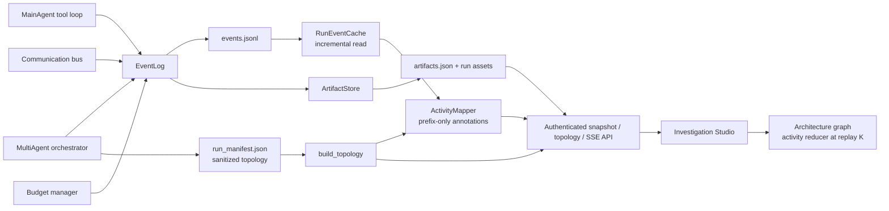
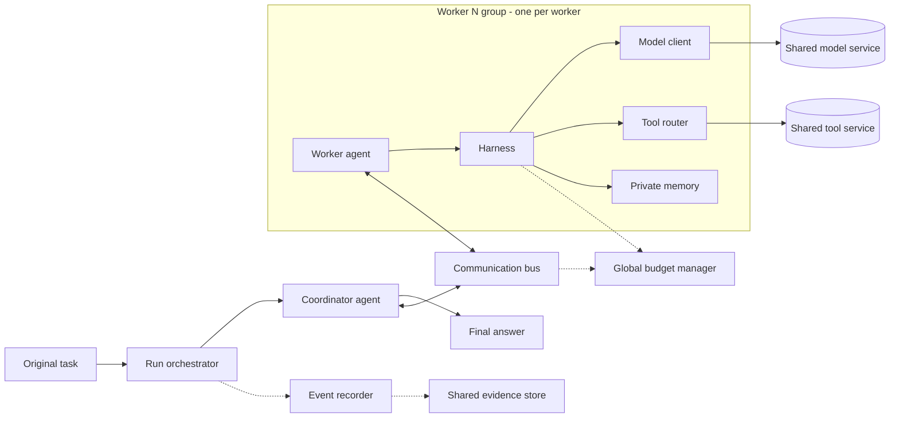

# Live Multi-Agent Investigation Studio

## Scope and architecture

The Studio is an authenticated observer for the existing `MainAgent` and
`MultiAgentOrchestrator`. It does not implement a second agent runtime. The real
model/tool loop remains in `openvlharness/agent/agent.py`; coordinator planning,
worker execution, peer review, typed messages, budgets, and persistence remain in
`openvlharness/multi_agent/`.

The repository had no browser application or frontend build system. The viewer is
therefore a small FastAPI service with static HTML, CSS, and JavaScript. This avoids
adding a frontend framework and keeps deployment inside the existing Python
environment.



Event recording is optional from the perspective of `MainAgent`: an observer
exception is caught and logged, so a disconnected or broken viewer cannot stop
inference. The browser only reads persisted data. Replay does not invoke models or
tools.

## Answer status, run configuration, and the compact team view (`studio.ui.v3`)

The page is organized top-down as: task and effective configuration → a sticky
**answer strip** → the collapsible **Run configuration** panel → the **architecture
panel** (Compact team by default; Full architecture and Live activity unchanged) →
**Investigation story / Event log** beside **Visual evidence** and **Step details** →
component inspector, memory inspector, and **Estimate history**.

### Three separate answer fields

| Field | Source | Changes when |
| --- | --- | --- |
| Ground truth | Evaluator-only reference endpoint (dataset row or evaluation artifact) | Only after the run is terminal **and** the viewer holds evaluator scope |
| Coordinator's current estimate | `COORDINATOR_ESTIMATE_UPDATED` events | The coordinator records a new answer state |
| Coordinator final answer | `FINAL_ANSWER_RECORDED` | Task finalization |

The strip stays visible while scrolling (it sits below the sticky top bar and stops
being sticky on narrow phones). It also shows the investigation round, the number of
worker reports that reached the coordinator, and the run status, all from the
visible event prefix. A correctness label appears only when the reference was
released, the final answer is visible at the current position, and the dataset has a
deterministic rule (FSC-147 and the fixtures use `fsc147_parse_count_exact_match`,
the same `parse_count` the benchmark evaluator uses). Without a rule or reference,
nothing is called correct or incorrect.

### Ground truth: sources, release, and protection

Ground-truth states: `NOT_AVAILABLE` (no authoritative source), `SEALED` (run not
terminal), `ACCESS_DENIED` (no evaluator scope), `AVAILABLE`, `REFERENCE_ERROR`
(source inconsistent). While a reference request is in flight the cell shows
“Checking reference status”, never a guessed state.

* **Sources.** (1) The official dataset row named by the run's label-free
  `inputs/dataset_task.json` (dataset, row position, dataset index, question), loaded
  through the repository dataset loader and verified against the recorded index and
  question; (2) an evaluator-written artifact `<runs>/.references/<run_id>.json`
  (`studio.reference.v1`), used by deterministic fixtures and labelled as a test
  label. Worker or coordinator outputs, tool results, and file names are never used.
* **Separation from inference.** `openvlharness/studio/reference.py` is imported only
  by the Studio server. `scripts/run_studio_dataset_task.py` drops the `answer` column
  from its in-process dataset immediately after loading and writes only label-free
  row identity before inference. Prompts, tool arguments, messages, memory, events,
  and every run file are label-free; `tests/studio/test_reference.py` asserts this
  with a distinctive label across the full runner.
* **Authorization.** The viewer token cannot read labels. The server holds a separate
  **evaluator token** (`STUDIO_EVALUATOR_TOKEN`, or generated at start-up and stored
  only in the owner-only `<runs>/.studio/studio-<port>.json`). `GET
  /api/runs/{id}/reference` returns the value only with `X-Studio-Evaluator-Token`.
  Launch tickets carry evaluator scope only when minted by an evaluator: local
  runners and `studio_ctl.py url` do this by default for the owner; use
  `studio_ctl.py url --viewer-only` (or `STUDIO_EVALUATOR_LINKS=0`) for a link to
  share. A viewer can also paste the evaluator token in the ground-truth popover
  (kept in page memory only). `--disable-evaluator` turns release off entirely.
* **Provenance.** The ⓘ popover lists dataset, split, row position and index, question
  type, reference source, value, and normalization rule. For counting rows it states
  that the value is the official annotated instance count, not guaranteed exhaustive
  visual truth.
* No live, non-blinded diagnostic mode exists; references are never released before
  a run is terminal.

### Coordinator provisional estimate

With `coordinator.estimate_updates.enabled`, the coordinator makes one bounded
**reassessment** after a round that produced new worker reports (trigger
`meaningful_evidence`; `every_round` is also accepted), at most
`max_reassessments` times. It returns JSON with `estimate` (or null), `status`
(`provisional` | `unresolved`), a one-sentence public `summary`, a `reason`, and
optional follow-up requests. `EstimateTracker` (`multi_agent/estimate.py`) turns that
into answer state:

* first value → `initial` (status *provisional*); different value → `revised`;
  a value after being unresolved → `restored`; `unresolved` after a value →
  `withdrawn` (the stale value is no longer current);
* the same value again → **no revision**; a `COORDINATOR_REASSESSMENT_RECORDED`
  (`outcome: retained`) event records that new evidence was reviewed;
* synthesis always records `finalized` (status *final*, or *abstained* with no
  answer). `value_changed: false` marks a finalization that confirms the provisional
  value, so the UI never presents it as a numeric change.

There is no initial guess, no zero default, no confidence percentage, and no estimate
derived from worker answers. Every revision payload (`studio.coordinator_estimate.v1`)
carries `revision`, `estimate`, `estimate_type`, `status`, `change_kind`,
`previous_estimate`, `value_changed`, `summary`, `revision_reason`, `round`,
`model_requests` (measured cost), and `evidence`: for each worker report the
coordinator consumed, its `report_event_id`, `delivered_event_id` (message bus) or
direct-handoff channel, candidate, and cited `tool_call_refs`. History is persisted in
`coordinator/estimate_history.json` and in `final_result.json`.

**Cost.** Each reassessment is a normal coordinator model call charged to the
coordinator and global model budgets; the measured cost is recorded per revision. A
real coordinator call can use two requests (Qwen sometimes needs an answer-tag retry),
so before each reassessment the orchestrator reserves the largest per-call cost seen
so far for synthesis and caps the reassessment to the remainder; when the budget is
too small the reassessment is skipped with an explicit `skipped_budget` event and
synthesis still runs. `configs/multi_agent.yaml` sets `coordinator.model_requests: 8`
for this reason. Estimate updates are **off** in the library defaults and the
checked-in config (no change to existing research runs); the Studio runners enable
them (`STUDIO_ESTIMATE_UPDATES=on`). Viewing the dashboard never triggers a model call.

**Replay.** The strip, history, and story are folds over the visible event prefix
(`answer-state.js`, `story.js`): before the first estimate event the field reads
“No estimate yet”; later revisions and the final answer never appear early.
Selecting an estimate in the story or history highlights the cited steps (“cited by
selected assessment”) and shows the cited tool's crop and original-image ROI,
using only recorded references.

### Compact team view

Each agent is **one harness card**: role and assigned subtask, live status, a model
badge, a memory indicator, a peer-communication indicator, tool chips with per-tool
call counts, the latest activity, the worker's candidate (a worker claim, not the
coordinator's estimate), and tool-call count; actor budgets are in the card tooltip
and the expandable **Details** (harness implementation, model endpoint, working
context, notebook policy, memory modules, budget). Shared model and tool services,
the global budget, and the recorder/evidence store form one strip; the coordinator
card holds the current estimate. Directional flows use text and arrows, not color
alone: tool chips show `→` (request), `←` (result), `✕` (failure), the model badge
`→/←`, the card's connector `↓ assignment` / `↑ report`, and the peer lane
`Worker 1 → Worker 2: hypothesis`. Clicking a card, chip, or badge opens the
inspector, the authorized memory view (it never changes memory policy), or that
worker's messages; **Show in full architecture** switches to the full graph and
focuses that worker. Workers render 1 centered, 2–4 side by side on desktop, and
fall back to 2 × 2 or one column in narrow containers.

Indicators: `● On`, `○ Off`, `? unknown` (legacy run did not record it), `◌ Peer on ·
no peers` (one-worker run), `◆ Run record` (coordinator).

### Runtime configuration

One canonical configuration (validated in `multi_agent/config.py`) drives the CLI,
the generated launch commands, and the persisted record:

| Setting | Config key | CLI flag | Studio env var |
| --- | --- | --- | --- |
| Workers (1–4) | `num_agents` | `--num-agents N` | `STUDIO_NUM_AGENTS` |
| Optional worker memory | `memory.optional_worker_memory` | `--worker-memory` / `--no-worker-memory` | `STUDIO_WORKER_MEMORY=on\|off` |
| Peer communication | `communication.peer_to_peer` | `--peer-communication` / `--no-peer-communication` | `STUDIO_PEER_COMMUNICATION=on\|off` |
| Message bus (reports, peers) | `communication.enabled` | `--communication` / `--no-communication` | — |
| Execution mode | `execution.mode` | `--mode concurrent\|cooperative` | `STUDIO_EXECUTION_MODE` |
| Coordinator estimates | `coordinator.estimate_updates.enabled` | `--estimate-updates` / `--no-estimate-updates` | `STUDIO_ESTIMATE_UPDATES=on\|off` |
| Reassessment limit | `coordinator.estimate_updates.max_reassessments` | `--max-reassessments N` | — |
| Follow-up delegation rounds | `coordinator.max_follow_up_rounds` | `--follow-up-rounds N` | `STUDIO_FOLLOW_UP_ROUNDS` |

Invalid values raise errors instead of being ignored. Each run records
`effective_config` (`studio.run_config.v1`) in `run_manifest.json` and as a
`RUN_CONFIGURATION_RECORDED` event; the UI renders only from that record. A running
run is never reconfigured.

**Optional memory semantics.** *Working context* (the agent's conversation and its
per-question image registry/inventory) is required for tool use and is always on;
its events carry `memory_kind: working_context`. The **optional worker memory** is a
private cross-phase notebook: with it ON, each worker writes its findings and
compact tool observations after every phase (`OPTIONAL_MEMORY_WRITTEN`) and retrieves
them at the start of peer review or follow-up (`OPTIONAL_MEMORY_READ`); the records
are persisted as `workers/<id>/private_memory.json` and inspectable. With it OFF no
notebook is written, retrieved, or persisted, no notebook events exist, and the
memory inspector explains why. Execution logging is unaffected. The coordinator's run
record is not governed by this switch.

**Communication semantics.** *Peer communication OFF* removes worker-to-worker
messages (and therefore peer review); coordinator assignments and worker reports still
flow, and the UI says so (“Peer communication: OFF · Coordinator assignment/reporting:
ON”). With *peer communication ON*, each completed worker shares its candidate with
its peers and peer review runs when there are at least two workers; nothing is sent
for a single worker. `communication.enabled: false` is the broader mode: assignments
are still delivered and reports reach the coordinator by direct result handoff
(`coordinator_reporting_channel`). Assignment and report traffic is never labelled
peer communication.

**UI controls.** The **Run configuration** panel shows the selected run's effective
settings and, under *Plan a new run*, worker count, memory, peer communication, mode,
and estimate toggles that generate a copyable command for the approved runner (the
dataset runner or the deterministic demo). The browser never starts inference; there
is no launch endpoint.

### Investigation story

The default left panel is a concise story built from recorded fields: plan and
assignments, one step per tool invocation (recorded intent or “no explicit public
rationale was recorded”, the request, a factual summary of the result such as “4
regions, 1 low-confidence region” or “a crop of 50×50 px, 1 additional candidate”, and
the next recorded action once it has happened), candidate reports and revisions,
peer sharing, verification, follow-up delegation, notebook writes/reads (minor steps),
coordinator assessments, estimate revisions, and the final answer. Outcome tags
distinguish *Execution failure* (a tool failed), *Budget stop* (a reservation was
denied), *Hypothesis revised* (a worker dropped its earlier candidate), *Contradiction*
or *Inconclusive* (only when recorded), *Estimate revised*, and *Withdrawn*. **Step
details** shows what happened, recorded intent, the tool request as key/value lines,
what it returned, the original-image region, assessment and uncertainty, memory
update, what happened next, and which coordinator assessment cites the step; raw JSON
is under *Technical record (advanced)*. The raw event log remains one tab away.

### New event types

| Event | Emitted by | Payload highlights |
| --- | --- | --- |
| `RUN_CONFIGURATION_RECORDED` | orchestrator | `effective_config` |
| `INVESTIGATION_ROUND_STARTED` / `_COMPLETED` | orchestrator | `round`, `kind` (`initial`, `follow_up`, `peer_review`), `workers`, `reports` |
| `COORDINATOR_ESTIMATE_UPDATED` | coordinator | see above (`studio.coordinator_estimate.v1`) |
| `COORDINATOR_REASSESSMENT_RECORDED` | coordinator | `outcome`: `retained`, `skipped_budget`, `skipped_limit`, `unreadable` |
| `FOLLOW_UP_ASSIGNED` | coordinator | `assignment`, `worker_id`, `delivery_status` |
| `FOLLOW_UP_FINISHED` | worker | `candidate_answer`, `previous_candidate`, `uncertainty` |
| `OPTIONAL_MEMORY_WRITTEN` / `_READ` | worker | `memory_kind: optional_episodic_notebook`, `phase`, counts |

`HYPOTHESIS_UPDATED` now records `previous_hypothesis`, `revision_kind`, `phase`,
`uncertainty`, and `tool_call_refs`; `MESSAGE_SENT`/`MESSAGE_DELIVERED` record
`channel` (`peer` or `coordinator`) and message `metadata` (the report event it
carries). Workers may state limitations inside `<limitations></limitations>`.
Peer claims that arrive before a worker's own investigation are now kept for its
peer review instead of being discarded (previously, in cooperative mode, a worker
only reviewed claims from workers that ran after it).

### Older runs

Runs recorded before `studio.ui.v3` still open. They have no effective
configuration, answer-state events, rounds, or notebook policy, so the UI shows
“Provisional estimate history: not recorded (legacy run)”, the final answer from
`FINAL_ANSWER_RECORDED`, `? Memory unknown`, and peer communication only if the
manifest recorded it. Nothing is reconstructed from worker answers. Historical run
directories are never modified.

### Tests and demonstrations

```bash
# Deterministic 16-configuration matrix (TEST FIXTURE: scripted policy + tools, real MainAgent loop)
python scripts/studio_config_matrix.py matrix --output-dir outputs/studio_matrix \
  --report outputs/studio_matrix_report/matrix_report.json
# One configurable fixture run, opened live in the Studio
STUDIO_NUM_AGENTS=3 STUDIO_WORKER_MEMORY=on STUDIO_PEER_COMMUNICATION=off ./scripts/run_studio_demo.sh
# A real dataset task with the same switches (model and tool services required)
STUDIO_NUM_AGENTS=4 STUDIO_WORKER_MEMORY=off STUDIO_PEER_COMMUNICATION=on \
  ./scripts/run_studio_dataset_task.sh FSC147_val 10
# Unit, integration, leakage, and frontend-model tests
python -m pytest tests/multi_agent tests/studio
# Browser validation and screenshots (Studio running on the validation runs directory)
STUDIO_VIEWER_TOKEN=... STUDIO_EVALUATOR_TOKEN=... node scripts/studio_browser_matrix.mjs \
  --base http://127.0.0.1:8799 --runs-dir outputs/studio_validation --out docs/images/studio_v3
```

The fixture (`openvlharness/multi_agent/testing.py`) runs every actor as a real
`MainAgent` with a real Qwen-protocol `ModelAdapter` whose endpoint is a scripted
policy deciding from the actual request (so memory and peer switches change behavior),
plus deterministic grounding, zoom, and an always-failing depth tool over a synthetic
five-object scene. Worker 4 has a one-call tool budget to exercise budget stops; a
`withdrawal` scenario exercises estimate withdrawal. Results validate engineering
behavior only. See [the v3 validation report](STUDIO_V3_VALIDATION.md).

## Run it

Create a deterministic run (default: two workers, optional memory and peer
communication on, coordinator estimates on) over a generated non-dataset image, with
grounding boxes, zoom crops, a failing tool, a budget stop, worker disagreement,
follow-up delegation, peer review, and estimate revisions:

```bash
source scripts/env.sh
./scripts/run_studio_demo.sh
STUDIO_NUM_AGENTS=4 STUDIO_WORKER_MEMORY=off ./scripts/run_studio_demo.sh   # any 1-4 / on|off combination
```

The fixture uses a scripted model policy and deterministic tools for integration
testing. It is not a model-quality result. The agent loop, events, artifacts,
communication, memory, budgets, and replay use the production paths. The earlier
fixed two-worker smoke (`scripts/multi_agent_smoke.py`) is still available.

The demo, image investigation, and dataset runners start or reuse the viewer,
open the authenticated run in a browser, and follow its event stream automatically:

```bash
./scripts/run_studio_demo.sh
./scripts/run_studio_dataset_task.sh FSC147_val 0
```

No separate viewer command or token entry is required. Each runner prints which
Studio it used (`reused existing instance` or `started (pid N)`) and a
**single-use launch link** carrying a short-lived ticket (valid 10 minutes), not the
viewer token. The page exchanges the ticket for the token in memory, removes it from
the address bar, and keeps only `#run=<id>` so a refresh still knows the run. If
browser launching is unavailable, open the printed link. Set `STUDIO_OPEN_BROWSER=0`
for deliberate headless use.

### Which Studio instance? (lifecycle)

A listener counts as a usable Studio only if `GET /api/info` reports this
application, API version `studio.api.v3`, and the same runs directory (a non-secret
hash, `runs_root_id`), **and** the recorded viewer token is accepted. A bare HTTP 200
or `/health` is never enough. The launcher (`scripts/run_with_live_studio.py`):

1. checks the instances recorded in `<runs>/.studio/studio-<port>.json` (mode 0600,
   written by each server once it is ready and removed when it stops), plus the
   legacy `session.json`;
2. reuses the first compatible, authorized one;
3. otherwise starts a new Studio on the first free port at or after `STUDIO_PORT`
   (default 8787), passing the token through the environment (never the command
   line, where `ps` would show it), and waits until its API answers;
4. reports outdated Studios and unrelated listeners as notes and never kills them;
5. opens the exact chosen instance with a link that selects the run. The page waits
   (up to 5 minutes) for a run that has not been created yet and loads it
   automatically when it appears.

Repeated launches reuse the same compatible Studio, so no duplicates accumulate.
Manage instances explicitly with `scripts/studio_ctl.py`:

```bash
python scripts/studio_ctl.py status                 # every recorded/probed Studio and its compatibility
python scripts/studio_ctl.py url --run RUN_ID       # fresh single-use link to a usable Studio
python scripts/studio_ctl.py ensure --open          # reuse or start one, then open it
python scripts/studio_ctl.py stop --port 8787       # stop *your* Studio server on that port
```

`stop` refuses any process that is not your own `openvlharness.studio.server`.

A manually managed foreground viewer remains available:

```bash
STUDIO_PORT=8790 STUDIO_RUNS_DIR=/absolute/path/to/runs ./scripts/studio.sh
```

It binds the port *before* announcing anything. On success it prints
`Studio ready: <url>` and a single-use link once the API answers (`--print-token`
also prints the long-lived token). If the port is taken, it exits with status 2 and
says whether the holder is a compatible Studio (use its link), an outdated Studio
(stop it or pick another port), or an unrelated process (left untouched). Loopback
is the default; a non-loopback bind requires `STUDIO_VIEWER_TOKEN`:

```bash
STUDIO_HOST=0.0.0.0 STUDIO_VIEWER_TOKEN='replace-this' ./scripts/studio.sh
```

Use a TLS-authenticated reverse proxy when exposing the service beyond a trusted
machine. Disable all private-memory inspection when it is not authorized:

```bash
./scripts/studio.sh --disable-private-memory
```

Run a real task after the configured model, tool workers, and router are healthy:

```bash
./scripts/run_studio_investigation.sh /path/to/image.jpg \
  'How many target objects are visible? Use visual evidence.'
```

Run one row from a prepared repository dataset through its official loader:

```bash
./scripts/run_studio_dataset_task.sh FSC147_val 0
```

The optional arguments are dataset name, zero-based row position, and run ID. The
runner persists the selected dataset index, question, and image paths under
`inputs/dataset_task.json`. It deliberately does not read, pass, print, or persist
the row's answer. `STUDIO_NUM_AGENTS` and `STUDIO_EXECUTION_MODE` override the worker
count and scheduling mode.

The script uses two concurrent workers, `configs/multi_agent.yaml`, and
`outputs/multi_agent`. The lower-level equivalent is:

```bash
python -m openvlharness.multi_agent.run \
  --config configs/multi_agent.yaml \
  --num-agents 2 \
  --image /path/to/image.jpg \
  --task 'How many target objects are visible? Use visual evidence.' \
  --output-dir outputs/multi_agent \
  --run-id my_investigation
```

## Structured event contract

Every new record validates against `studio.event.v1` before it is appended. Core
fields are:

```json
{
  "schema_version": "studio.event.v1",
  "run_id": "run_001",
  "task_id": "task_001",
  "agent_id": "worker_01",
  "event_id": "evt_immutable_uuid",
  "sequence": 15,
  "timestamp": "2026-11-16T15:00:00+00:00",
  "event_type": "TOOL_CALL_STARTED",
  "parent_event_id": "evt_request",
  "causal_refs": ["evt_observation"],
  "tool_name": "Visual_Grounding_Tool",
  "status": "running",
  "summary": "Started Visual_Grounding_Tool.",
  "artifact_refs": [],
  "payload": {"tool_call_id": "call_01"}
}
```

The event ID is immutable. A lock assigns a unique append sequence under concurrent
workers. `parent_event_id` correlates decision, request, start, result, observation,
and memory records; `causal_refs` supports non-tree dependencies. Sequence is the
stable replay order, while timestamps remain useful for elapsed time. Pre-Studio
events are normalized conservatively during replay without inventing evidence.

The runtime currently records:

- run start, task receipt, state transitions, completion, failure, and cancellation;
- coordinator plans, assignments, verification requests, synthesis, and final answer;
- worker start/completion, candidate hypotheses, peer review, and revised hypotheses;
- public action decision summaries, tool request/start/completion/failure, evidence
  insertion, and memory writes from the real `MainAgent` loop;
- typed message send/delivery with sender, recipient, message type, and artifacts;
- granted and denied model, tool, and message budget reservations.

The observer does not publish `<thinking>`, chain-of-thought, private reasoning
tokens, or scratchpads. When a provider returns only a tool call, the public decision
record explicitly says that a rationale was not recorded. No extra inference call is
made to decorate the UI.

## Live transport and replay

The browser first loads `/api/runs/{run_id}/snapshot`, then opens an SSE response
using `fetch()` so the mandatory `X-Studio-Token` header can be sent. The stream:

- accepts `cursor=<last sequence>` for resume;
- sorts by sequence and event ID and sends at most 200 records per poll;
- emits event IDs and ten-second heartbeats;
- tolerates an incomplete final JSONL line while a writer is appending;
- is deduplicated again in the browser by immutable event ID;
- does not hold or call into the agent process.

`follow=false` returns one bounded SSE batch and closes, which supports diagnostics
and reconnection tests. The JSON fallback `/events?after=<sequence>` exposes the same
cursor semantics.

Replay slices the immutable event list at the selected sequence. Play, pause, step,
scrub, speed, agent filters, event filters, and failure filters operate entirely in
the browser. Selecting “Go live” returns to the latest received event.

## Evidence and coordinate handling

`ArtifactStore` extracts embedded tool images from event payloads and writes them as
content-addressed files under the run's `assets/` directory. `artifacts.json` maps
opaque `artifact_<sha256>` IDs to MIME type, digest, dimensions, producing actor and
event, artifact type, coordinate system, and transform metadata. Equal bytes share
one artifact. Base64 images and large opaque strings are not retained in the event
stream; large masks are represented by bounded metadata.

The source image is copied into the run and registered as `input_image_1`. The API
only accepts a strict run ID and content-derived artifact ID, rejects symlinks and
path traversal, and never accepts an arbitrary filesystem path.

The overlay mapper supports:

| Coordinate system | Required metadata | Mapping |
| --- | --- | --- |
| `source_pixels` | source dimensions | direct, then clipped |
| `normalized_0_1` | source dimensions | scale each axis by source size |
| `normalized_0_1000` | source dimensions | scale each axis by source size / 1000 |
| `resized_pixels` | `coordinate_width`, `coordinate_height` | inverse resize |
| `crop_pixels` | crop bounds and coordinate dimensions | inverse crop resize plus source offset |
| `padded_resized_pixels` | content dimensions and top/left padding | remove padding, inverse resize |

Invalid, empty, unsupported, or under-specified geometry is not drawn. Overlays use
the source artifact's recorded width and height. If those are missing, no box is
drawn and a warning is shown, rather than falling back to a guessed 1000×1000 frame.
When a tool reports its own input size (`orig_img_w`/`orig_img_h`) that differs from
the artifact, boxes are rescaled explicitly as `resized_pixels`. Evidence images load
fully before the DOM is updated, and a stale response for an earlier selection is
discarded, so a slow request can never replace the current evidence. Selecting a
tool *start*, *evidence*, or *memory* event shows the evidence of the same invocation
(request arguments or result), never a future result. The source
image and SVG share the same source-sized view box with `preserveAspectRatio`, so
boxes stay aligned on non-square and responsive displays. Grounding/detection boxes,
zoom crops, OCR text, depth summaries, images, numeric results, and generic structured
results have bounded renderers. Unknown tools fall back to safe text created with
DOM `textContent`; external tool text is never injected as HTML. Mask raster overlays
and video frame tracks are not implemented because the current inspected runtime did
not expose a stable browser-ready format for them.

## Architecture graph

### Three states: preview, configured, run

The canvas is never blank. What it shows depends on the connection state, which the
header chip names explicitly: *Not connected*, *Authentication required*,
*Connecting*, *Connected*, *Invalid token*, *Backend incompatible*, *Waiting for
run*, *Loading run*, *Run loaded · live stream*, *Run unavailable*, or *Stream
reconnecting*.

| State | Canvas title | Source | Activity |
| --- | --- | --- | --- |
| Not authenticated | **Architecture preview — not live execution** | a generic component diagram built into the page (`previewTopology()`), dotted outlines, provenance `preview`; no host, service, run, or memory data | none |
| Connected, no run selected | **Configured architecture — no task running** | `GET /api/architecture`: `configs/multi_agent.yaml` (or `--multi-agent-config`) plus the runners' agent config (`$AGENT_CONFIG`): coordinator, one dashed **worker template** (*×default, up to max*), harness, model client, memory modules, tool router, every registered tool, model service, bus, budget, recorder, evidence store, and final answer | none: worker instances do not exist until a run starts |
| Run selected | **Run topology · <run_id>** | the run's sanitized manifest topology (or what older events establish) | only recorded events, up to the replay position |

**Configured architecture** describes what the system *can* run. The **observed
trajectory** is what a run actually executed. A configured component that never
appears in a run's events stays idle in that run's graph.

An old Studio backend that serves these static files but has no `/api/info` is
detected on page load. The page shows *Backend incompatible* with the exact remedy and
disables Connect instead of looking connected and empty.

The top panel draws the whole configured system and lights up the paths that
recorded events actually travelled. It replaces the earlier hard-coded
coordinator/worker sketch with one canonical, versioned graph
(`studio.topology.v1`) used identically for live streaming and replay.



The coordinator group has the same harness, model client, and memory nodes; it has a
tool router only when `coordinator.tool_access` is enabled. Dotted edges are
infrastructure links, hidden until active unless **View → Budget & recorder links**
is enabled.

### Where the topology comes from

After actors are constructed and before any inference, the orchestrator rewrites
`run_manifest.json` with a `topology` section (`studio.topology_manifest.v1`). For
each actor it records only attributes that already exist on the built objects: role,
tool access, harness class and iteration limit, model ID/protocol, the endpoint
reduced to `scheme://host:port/path`, memory modules, and each registered
capability's public name, backend, and service base URL (credentials, query strings,
and fragments removed). No model or tool request is made to describe the system.

`build_topology()` turns that into nodes and edges:

| Node type | One per | Shared? |
| --- | --- | --- |
| `coordinator`, `worker` | agent | no |
| `harness`, `model_client`, `memory`, `tool_router` | agent (owned, `owner_agent_id`) | no |
| `model_service` | distinct (model ID, sanitized endpoint) | yes, lists its client agents |
| `tool` | registered public tool name | yes when used by more than one agent |
| `communication`, `budget`, `event_log`, `artifact_store` | run | yes |
| `task`, `orchestrator`, `result` | run | — |

Each worker owns a *logical* model client, but workers configured with the same
model and endpoint point at **one** model-service node. Tools are stateless shared
services, so a tool is drawn once and every worker's router connects to it. Distinct
endpoints produce distinct service nodes.

Every node and edge carries a provenance:

- `configured` — declared by the manifest topology or configuration;
- `observed` — not declared, but referenced by a recorded event (for example a tool
  name in a run that predates the topology manifest);
- `inferred` — a component the runtime always creates (such as a harness) that an
  older manifest did not describe.

Observed and inferred components are drawn with a dashed outline and labelled in the
inspector. Older runs are reconstructed only from what their manifest and events
establish: `real_two_worker_smoke_v3` (pre-Studio events) and
`real_fsc147_row0_studio` (Studio events, no topology manifest) both render, with
their harnesses marked inferred and tools marked observed.

### Two views of one graph

- **Full architecture** shows every component at normal emphasis with activity
  overlaid.
- **Live activity** keeps the same layout but subdues every node and edge that is not
  part of the selected event, the latest event, or still-running work.

Switching modes keeps zoom, pan, run, replay position, selection, filters, and
collapsed groups. The mode and view toggles persist per browser.

### Directed flows mapped from events

Every event served by the API carries an `activity` annotation (`studio.activity.v1`)
computed on the server: a kind, a phase (`open`, `progress`, `close`, `instant`),
an ordered list of directed hops, the involved nodes, and a correlation ID. Hops are
resolved against structural edges in either direction, so a request and its response
use the same edge with opposite arrowheads.

| Recorded event | Path drawn | Style |
| --- | --- | --- |
| `TOOL_CALL_REQUESTED` | worker → harness → tool router | request (solid) |
| `TOOL_CALL_STARTED` | tool router → tool; tool shows *Running ×n* | request, running |
| `TOOL_CALL_COMPLETED` | tool → router → harness → worker | response (dashed) |
| `TOOL_CALL_FAILED` | same return path, or router → harness → worker when the call never reached the tool (budget denial, unknown tool, argument error) | failure (red, short dash) |
| `EVIDENCE_OBSERVED` | harness → worker | response |
| `MEMORY_WRITTEN` | harness → private memory | memory |
| `MEMORY_READ` | private memory → harness | memory |
| `MODEL_REQUEST_STARTED` / `MODEL_RESPONSE_RECEIVED` | harness → model client → model service, and back | model / model-return |
| `MESSAGE_SENT` | sender → communication bus (queued for the recipient) | message, control (assignment, verification, cancellation), message-return (report, reply) |
| `MESSAGE_DELIVERED` | communication bus → recipient | delivery |
| `BUDGET_UPDATED` | harness → budget (tool/model) or sender → bus → budget (messages) | budget, or failure when denied |
| `TASK_RECEIVED`, `FINAL_ANSWER_RECORDED` | task → orchestrator, coordinator → final answer | lifecycle |

Worker-to-worker information always travels sender → bus → recipient, because that is
the real path through `CommunicationBus`. One worker's private memory is never drawn
as reachable from another worker.

`MODEL_REQUEST_*` and `MEMORY_READ` are new, observability-only events emitted by
`MainAgent` when an event sink is installed. They record timing, phase, and token
counts only, never prompt or response text. A memory read is drawn only when the
runtime actually injected a memory inventory into the model context; it is never
inferred from an earlier write. Runs recorded before these events existed show no
model or memory-read traffic rather than fabricated traffic.

### Correlation and concurrency

- **Tool calls.** `MainAgent` now assigns a random `invocation_id` per call and
  includes it in the decision, request, start, result, evidence, and memory events.
  The mapper correlates by `invocation_id`, then by the `parent_event_id` chain, then
  by (agent, model `tool_call_id`) for older runs. It never correlates by tool name,
  so two workers calling the same tool at the same time, even with identical
  model-supplied call IDs, stay separate.
- **Tool start.** `TOOL_CALL_STARTED` is emitted only once a call is dispatched to its
  capability, after parsing and the budget reservation succeed. A denied call goes
  straight from request to failure and is never shown reaching the tool.
- **Messages.** `MESSAGE_SENT` opens `msg:<message_id>` and the matching
  `MESSAGE_DELIVERED` closes it. A message is labelled a **reply** only when its
  recorded `correlation_id` names an *earlier* message whose sender is this message's
  recipient and vice versa. Later messages are never treated as replies on timing
  alone. The current orchestration sends assignments, candidate answers, peer
  hypotheses, and verification requests; it does not itself emit correlated replies.
  The bus and mapper support them, and `scripts/studio_protocol_fixture.py` exercises
  that path.
- **Prefix-only.** Annotations for event *K* are computed from events `0..K` only.
  This is tested by re-annotating every prefix and comparing it with the full run.

### Replay

The browser folds the visible prefix into activity state with
`static/activity-state.js`: open correlations (running tools, in-flight model
requests, queued messages), per-node touches and failures, per-edge traffic, agent
status, and run status. Topology stays visible throughout a replay; only activity
depends on the position. At position *K*, responses, deliveries, memory writes,
hypotheses, and the final answer recorded after *K* are not shown, and the header
status and budget come from the prefix rather than the final snapshot. Stepping
forward applies one event incrementally; stepping back recomputes from the start
(cheap and deterministic). **Go live** returns to the latest received state.

### Interaction and navigation

- Click a **timeline event** to highlight its path, its correlated request or result,
  and its evidence. Selecting an event never switches replay back to live.
- Click a **node** to open the component inspector: agent ID, role, current subtask
  (from the recorded plan), status, candidate, model, harness, tools, memory modules,
  tool usage, and recent actions. Tool nodes show ownership, backend, service, running
  callers, calls, failures, and evidence. Inspecting an agent never fetches its
  memory; **Open permitted memory** makes an explicit, server-authorized request.
- Click a **connection** to list its source, destination, type, most recent direction,
  traffic count, correlation IDs, artifacts, and related events (each links back to
  the timeline).
- Toolbar: zoom in/out, **Fit**, **Focus activity**, **Focus selection**, **Expand
  all**, and **Collapse all**. Each agent group also has its own Collapse/Expand
  control; a collapsed group shows one node with the live status, for example
  *Running: Visual_Grounding_Tool*. Groups auto-collapse above five agents. Ctrl/⌘ +
  scroll zooms, and dragging the background pans.
- **View** menu: memory nodes, memory flows, budget and recorder links, and flow
  animation. These change the display only, not agent permissions.

New events trigger one short signal along each hop of that event, at most three per
frame. Running work uses a bounded (non-infinite) dash animation. Historical events
are never re-animated, and animation is disabled under `prefers-reduced-motion` or
from the View menu.

## Themes

The theme control in the header offers **Light**, **Dark**, and **System**. The
choice is stored in `localStorage` under `studio.theme` (display preferences only,
never tokens) and applied before first paint by `static/theme.js`; **System** follows
`prefers-color-scheme` live. All colors are semantic CSS custom properties defined
for both themes (`--app-background`, `--panel-background`, `--text-primary`,
`--graph-edge-idle`, `--flow-request`, `--flow-response`, `--flow-failure`,
`--memory-color`, and so on). JavaScript and SVG reference classes only, and there is
no inversion filter. The browser check verifies text contrast of at least 4.5:1 and
arrow contrast of at least 3:1 in both themes.

## Hypotheses and memory

Hypothesis cards are built only from `HYPOTHESIS_UPDATED`; later peer-review records
show a retained or revised candidate without inventing why it changed.

Viewer visibility and runtime memory access are separate controls. The dashboard
cannot change an agent's context, retrieval policy, or cross-agent permissions.
Workers remain private by default and exchange only typed messages and explicit
artifact references. The memory API returns a restricted projection of worker
records and strips trajectories. Coordinator memory contains its assignments and
public synthesis records. All memory endpoints enforce the viewer token on the
server and can be disabled globally.

## Security and performance

- API, stream, artifact, and memory routes require the viewer token. Static assets
  contain no run data.
- Responses set no-store, frame denial, MIME sniffing denial, no-referrer, and a
  restrictive Content Security Policy. Artifact images are fetched with the auth
  header and displayed through temporary blob URLs.
- Configuration persistence redacts key, token, secret, and password fields.
- Run and artifact identifiers are allow-listed and resolved within one configured
  root. Asset files and registries use private permissions.
- Timeline rendering is bounded to the latest 1,000 matching cards; image artifacts
  load only when selected and object URLs are released on run change.
- The server keeps a per-run `RunEventCache` that reads only bytes appended since
  the previous poll (holding back an incomplete final line), so streaming no longer
  re-reads the whole log every 0.4 s. The topology is rebuilt only when the manifest
  changes or a new component is observed.
- The graph DOM is built once per topology and layout option; events only toggle
  classes and overlay visibility. Browser renders are coalesced to one per animation
  frame, and evidence is re-rendered only when the selected or latest evidence event
  changes.
- Snapshot manifests are sanitized: endpoint credentials, query strings, process ID,
  and object IDs are removed. Topology metadata passes the same sanitizer, and keys
  that look like secrets are redacted.
- The URL fragment that carries the token is removed from the address bar
  immediately, even when no token is present. Screenshots show only the masked
  password field.
- A slow or disconnected browser only reads the append-only log and cannot apply
  backpressure to model or tool execution.

Dataset images copied into run assets retain their original licensing and access
requirements. Do not expose a Studio run root containing restricted images to an
unauthorized viewer.

## Extending tool visualization

Add a small renderer decision in `static/app.js` keyed by the real public tool name
or canonical-result keys. Preserve the generic fallback. A renderer should:

1. consume persisted canonical results or artifact references;
2. declare the coordinate system and required transform metadata;
3. refuse geometry it cannot map exactly;
4. render external text with `textContent`;
5. avoid deriving interpretations, confidence, or evidence not recorded by the
   tool or agent.

Add coordinate cases to `tests/studio/test_studio.py` and a deterministic lifecycle
record before enabling a new overlay type.

## Troubleshooting

| Symptom | Cause and fix |
| --- | --- |
| `Studio NOT started: cannot bind …:8787` | The message names the holder. If it is a compatible Studio, `python scripts/studio_ctl.py url --port 8787`. If it is an outdated Studio, `python scripts/studio_ctl.py stop --port 8787`, then start again. If it is another process, set `STUDIO_PORT`. |
| Browser on 8787 but the task used another port | Runners now open the exact instance they used and print its URL. `studio_ctl.py status` lists every instance. |
| *Backend incompatible* | That server predates `studio.api.v3` (answer status, references, run configuration); stop it as above. Runners never reuse it. |
| *Authentication required* / *Invalid token* | Links are single-use. Get a fresh one with `python scripts/studio_ctl.py url`. Each instance has its own token. |
| Preview or configured diagram but no run | Nothing is selected. Pick a run from the menu, or start one: `./scripts/run_studio_demo.sh`. |
| *Waiting for run* | The requested run directory does not exist yet. It loads automatically when the task creates it; after 5 minutes check that the task and the Studio share a runs directory. |
| Run graph with dashed *inferred/observed* nodes | An older run without a topology manifest. Only what its events establish is drawn. |
| *No runs exist yet* | Empty runs directory. Run the deterministic demo. |
| Real task fails at model or tool calls | Model/tool services are not reachable. Start them as in the README; the Studio itself needs no model. |
| `None of PyTorch, TensorFlow >= 2.0, or Flax have been found` | Harmless here. Inference runs behind HTTP (Qwen on the model service, SAM 3 and other tools on tool services). The runner only loads the fast Qwen tokenizer (`ModelAdapter.load_tokenizer`, for context-length counting), which needs `tokenizers`, not PyTorch. The Studio runners set `TRANSFORMERS_NO_ADVISORY_WARNINGS=1`, transformers' supported switch, to silence it. Real tokenizer failures are still logged as `Tokenizer unavailable …`. |

Inspect a stored run without inference: `python scripts/studio_ctl.py ensure --open`,
then pick the run from the menu (or `studio_ctl.py url --run <id>`). Replay never
calls a model or tool.

### Run-to-run variation (FSC-147 `val` row 10)

Five recorded runs of the same row (image `FSC147/216.jpg`, identical SHA-256, same
question, same commit, two workers, the same agent config, and the same model and
endpoint) produced final answers 39, 2, 40, 39, and 39. The artifacts show the runs
are comparable and the variation is behavioural, not a Studio or input defect:

| Run | Worker grounding queries → SAM 3 boxes | Other tools | Workers' reviewed answers | Final |
| --- | --- | --- | --- | --- |
| `…20261116_210557` | "grapes"→39, "grape"→40, then "grapes"→39 ×2 | — | 39, 39 | 39 |
| `…20261116_210721` | "grapes"→39 ×4, "bunch of grapes"→2 | zoom, Python ×2 (counted clusters) | 35, 2 | **2** |
| `…20261116_231837` | "grape"→40 ×2, then "grapes"→39 ×2 | zoom | 39, 39 | **40** |
| `…20261117_002627` | "grapes"→39 ×4 | zoom, Python | 39, 39 | 39 |
| `…live_ui_20261116` | "grapes"→39 ×4 | — | 39, 39 | 39 |

- SAM 3 is consistent per query string ("grapes" always 39 boxes, "grape" always
  40). The model's choice of wording changes the count.
- Decoding is stochastic: Qwen3-VL at `temperature 0.7, top_p 0.8, top_k 20`, with
  `paired_sampling_seed: false` and no seed. Query wording, tool choice, and whether
  a worker reinterprets the task as counting clusters (2, 35) all vary between runs.
- Coordinator synthesis sees the workers' *initial* `CANDIDATE_ANSWER` messages as
  well as their reviewed results. In `…231837` both workers revised to 39 after
  review, but the only candidate messages the coordinator received said 40, and it
  answered 40. This is a property of the current protocol (no post-review candidate
  message), not a Studio defect. Changing it alters the research algorithm, so it
  was left as is and is reported here.
- Settings that affect reproducibility: `temperature`/`top_p`/`top_k` in the model
  profile, `agent.paired_sampling_seed` (seeds per task when the server honours
  `seed`), the worker count, and `peer_review_rounds`. A completed run is not
  evidence of accuracy; ground truth stays sealed from the runtime.

## Validation and troubleshooting

Run the focused checks (the frontend module tests need Node.js and are skipped
without it):

```bash
source scripts/env.sh
pytest -q tests/studio tests/multi_agent tests/test_agent.py
ruff check openvlharness/studio openvlharness/multi_agent \
  openvlharness/agent/agent.py scripts/multi_agent_smoke.py tests/studio
```

`tests/studio/test_architecture.py` covers topology (N = 1–4 and 8), ownership,
shared-service de-duplication, secret stripping, every directed flow, concurrent
same-tool correlation, reply correlation, prefix-only annotations, the incremental
cache, and `MainAgent` instrumentation. `tests/studio/js/studio_frontend.test.cjs`
(run through `tests/studio/test_frontend_js.py`) covers the replay reducer, layout,
and themes.

Browser interaction checks and screenshots use headless Chrome through the DevTools
protocol, with no extra dependencies:

```bash
python scripts/studio_protocol_fixture.py            # writes outputs/multi_agent/studio_protocol_fixture
python scripts/multi_agent_smoke.py --run-id studio_demo_architecture
STUDIO_VIEWER_TOKEN=$(python -c 'import secrets; print(secrets.token_urlsafe(18))')
export STUDIO_VIEWER_TOKEN
STUDIO_PORT=8799 ./scripts/studio.sh &               # separate port, own token
node scripts/studio_browser_check.mjs --base http://127.0.0.1:8799 --out docs/images/studio
```

The protocol fixture is deterministic and makes no inference calls. Its model
"responses" and tool "results" are scripted constants, and its manifest marks the
run and its model service as fixtures. The check script also needs the recorded real
run `real_fsc147_row0_studio`. Add `--live-run <new_run_id>`, then start a producer
such as `python scripts/multi_agent_smoke.py --run-id <new_run_id> --step-delay 0.5`
after it prints `LIVE_READY`, to validate live streaming.

If no runs appear, confirm that the runner and Studio both use
`outputs/multi_agent`, then create the deterministic demo. A `401` means the token
does not match the one printed at server start. A missing source image means the run
predates artifact registration or supplied a remote/data URL that was not copied as
an authorized input file. A missing overlay with visible structured coordinates
means the coordinate system lacks required transform metadata; inspect the selected
event instead of assuming source-pixel coordinates.

Screenshots in `docs/images/studio/` were captured by that script from the
implemented UI:

| File | Shows |
| --- | --- |
| `01-full-architecture-light.png`, `01-full-architecture-dark.png` | full three-worker architecture (protocol fixture) |
| `02-full-page-dark.png`, `10-completed-run-replay-dark.png` | completed deterministic demo in replay mode |
| `03-tool-request-path.png` | Worker 2 → Visual Grounding request with a concurrent call running (real FSC-147 run) |
| `04-tool-result-return-path.png` | tool → router → harness → Worker 1 result return (real run, dark) |
| `05-worker-to-worker-question.png`, `06-worker-to-worker-reply.png` | question and correlated reply (fixture) |
| `07-coordinator-assignment.png` | coordinator → bus task assignment (real run) |
| `08-worker-memory-write.png` | harness → private memory write (real run) |
| `09-selected-event-roi-evidence.png` | selected result with 14 SAM 3 boxes on the source image (real run) |
| `11-concurrent-same-tool-calls.png` | two workers running the same tool concurrently (fixture) |
| `12-live-run-in-progress.png` | live stream mid-run |

| `13-disconnected-architecture-preview.png` | unauthenticated preview |
| `14-connected-configured-architecture.png`, `15-…-dark.png` | connected, no run: configured architecture with a worker template |
| `16-completed-real-run-full-architecture.png` | stored real run loaded through a launch link |
| `17-legacy-run.png` | pre-Studio run with inferred/observed structure |
| `18-laptop-size.png` | 1366×768 |
| `19-incompatible-backend.png` | page served by an outdated backend |

`browser-checks.json` and `browser-live-checks.json` record the assertions from
the last capture. Pass `--old-port <free port>` to include the outdated-backend
scenario (it starts `tests/studio/fake_old_studio.py`). Run the live check through
the real launcher with `--link-file <file>`, where the file holds the launcher's
output. The earlier `docs/images/investigation-studio*.png` images show
the previous graph.
