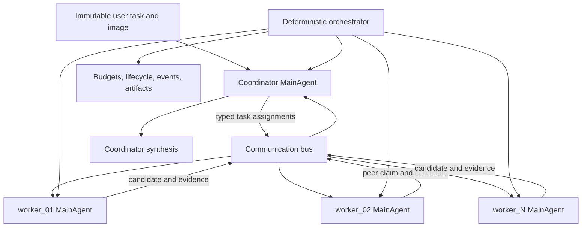

# Configurable multi-agent execution

## Architecture audit

The legacy execution path remains `build_agent()` in `openvlharness/bootstrap.py`
and `MainAgent.generate()` in `openvlharness/agent/agent.py`. `MainAgent._run()` owns
the model/tool loop: it requests a model response, parses autonomous tool calls,
invokes capabilities, appends processed evidence to the provider history, and
terminates when the adapter extracts a final answer or the iteration limit is
reached. `MemoryStore` is already instantiated through a factory for every
question, while model adapters and capability objects belong to a `MainAgent`
instance. This makes separately constructed `MainAgent` objects the isolation
boundary used here. Stateless GPU services may be shared; model conversations,
memory registries, capability clients, trajectories, budgets, and actor records
are separate.

The multi-agent implementation is additive. Existing calls to `build_agent()` and
all single-agent evaluation entry points behave as before. The only legacy-loop
extension is an optional budget guard. It is unset in normal single-agent use.



Each configured worker has a stable `worker_NN` identity, a newly built agent and
adapter, private actor memory, its own capability instances, an actor budget, and
a state directory. `coordinator` is an additional independently built agent. It
plans assignments and performs evidence-aware synthesis. With tool access disabled
the factory removes its advertised capability set; it cannot impersonate a worker
or inspect worker-private memory.

The communication bus validates typed messages, identities, recipient policy,
duplicates, bounded inboxes, and atomic communication budgets. Worker reports are
claims. Peer reports are explicitly described to receiving models as untrusted and
cannot change system constraints. Initial investigations run concurrently by
default. A bounded peer-review round lets recipients evaluate peer claims with a
fresh autonomous reasoning/tool loop. `cooperative` mode gives stable debugging
order and is reported as such.

The budget manager atomically reserves global and actor-local model requests, tool
calls, and messages. A real `MainAgent` reserves before each provider request and
capability invocation. Failed capability attempts consume their reservation.
Reported generated-token usage is measured after responses and does not act as a
preflight token limit. Tool services retain their own capacity controls.

## Configuration

[`configs/multi_agent.yaml`](../configs/multi_agent.yaml) contains a runnable
two-worker profile. Important settings are:

- `num_agents`: worker count; the coordinator is additional.
- `max_agents`: operational ceiling checked before construction.
- `execution.mode`: `concurrent` or deterministic `cooperative` scheduling.
- `max_concurrent_workers`, timeout, and bounded `peer_review_rounds`.
- `coordinator.agent_config`, tool access, model-request budget, and maximum rounds.
- `workers.default` plus per-`worker_NN` overrides for roles, model configurations,
  and budgets. Different agent-system files can point to different supported model
  profiles or endpoints.
- communication enablement, peer policy, inbox size, and message limits.
- global model, tool, and message limits.

A distinct client object does not load another checkpoint. Homogeneous workers can
share the current Qwen service safely while retaining separate contexts. Different
checkpoints need separately configured serving endpoints and enough GPU capacity.

## Execution

Start the agent model, configured tool workers, and router as documented in the
README, then run:

```bash
source scripts/env.sh
python -m openvlharness.multi_agent.run \
  --config configs/multi_agent.yaml \
  --agent-config "$AGENT_CONFIG" \
  --num-agents 2 \
  --image data/images/FSC147/190.jpg \
  --task "How many seagulls are visible? Use visual evidence."
```

Useful controlled variants:

```bash
# One worker plus coordinator
python -m openvlharness.multi_agent.run --num-agents 1 --task "..." --image image.jpg

# Four workers, subject to max_agents and budgets
python -m openvlharness.multi_agent.run --num-agents 4 --task "..." --image image.jpg

# Coordinator aggregation without worker-to-worker messages
python -m openvlharness.multi_agent.run --num-agents 3 --no-peer-communication \
  --task "..." --image image.jpg

# Stable cooperative scheduling for debugging
python -m openvlharness.multi_agent.run --mode cooperative --task "..." --image image.jpg
```

Set different `workers.overrides.worker_NN.agent_config` paths for heterogeneous
models. The agent-system files retain the repository's existing provider adapter
validation.

For a server-free executable check:

```bash
source scripts/env.sh
python scripts/multi_agent_smoke.py
```

## Artifacts and reproducibility

Every run creates a unique directory below `outputs/multi_agent/` (or the selected
output directory):

```text
run_<id>/
  run_manifest.json
  config.resolved.yaml
  events.jsonl
  messages.jsonl
  budgets.json
  final_result.json
  inputs/original_task.json
  coordinator/{trajectory.json,memory.json}
  workers/worker_NN/{trajectory.json,result.json,private_memory.json}
```

Events include run, task, actor, event, sequence, and UTC timestamp fields. The
manifest records the Git commit, runtime, configured model IDs/endpoints,
generation options, and distinct object identities. Secrets are redacted. Exact
replay of concurrent sampled model calls is not claimed; use cooperative mode and
deterministic provider settings when ordering matters.

Existing benchmark evaluators can score `prediction` from the returned mapping.
For fair comparisons, keep task order, prompts, model profiles, tool services,
generation parameters, and total budgets fixed, and report wall time and aggregate
resource use. Multi-agent availability alone is not evidence of better accuracy or
independent source diversity.

## Validation and limits

`tests/multi_agent/` verifies 1–4 workers, object/context isolation, message
validation and duplicate handling, disabled peer communication, worker-failure
isolation, artifact persistence, invalid counts, and concurrent global-budget
reservation. Exactly one of two simultaneous workers receives the final available
tool reservation.

A bounded real run was completed against the configured Qwen and SAM 3 services at
`outputs/multi_agent/real_two_worker_smoke_v3`. Its persisted events show this
non-fictional sequence: the coordinator produced two model-generated assignments;
both workers started; each independently selected `Visual_Grounding_Tool`; each sent
a candidate to the coordinator and a hypothesis to its peer; the coordinator sent
two `VERIFICATION_REQUEST` messages; both workers processed three inbound messages
and performed their own review tool call; and the coordinator synthesized `14`.
The recorded budget totals were 11 model requests, 4 tool calls, 8 messages, and 933
generated tokens reported by the service. All three agent objects and adapters have
distinct runtime identities in the manifest.

Validation on this checkout:

- 30 targeted multi-agent and legacy agent tests passed, with 60 subtests.
- The complete self-contained suite passed: 579 tests and 451 subtests.
- The unrestricted full suite reached 890 passes and 451 subtests, with 68 failures
  and 55 setup errors caused by the absent ignored frozen `outputs/bite/` research
  artifact bundle. Those tests are documented separately in the README and were not
  changed or bypassed.
- Changed Python files pass Ruff, formatting checks, bytecode compilation, and
  `git diff --check`.

Isolation is logical and in-process. Back-end model and stateless GPU tool services
are shared. Python threads cannot forcibly interrupt a provider request safely;
timeouts isolate the result and the configured HTTP timeouts bound underlying
requests. Cancellation is observed at orchestration boundaries. The coordinator
uses structured model planning with a conservative same-task fallback when valid
JSON assignments are absent. Peer exchange is bounded to configured review rounds.
Mid-run actor restart/resume is not implemented; completed and failed state is
persisted for audit, and a new run receives a new run ID.

