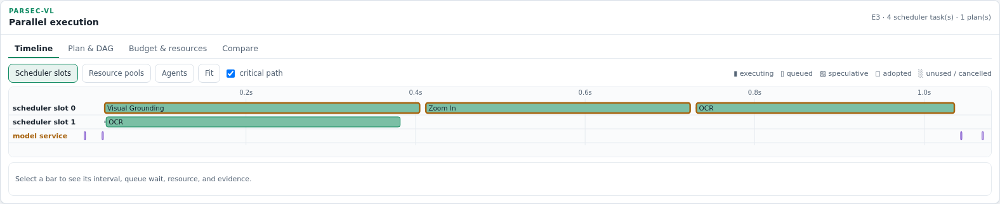
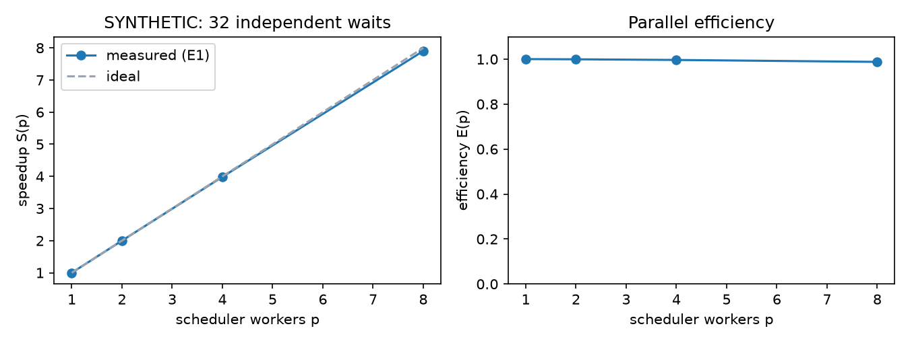
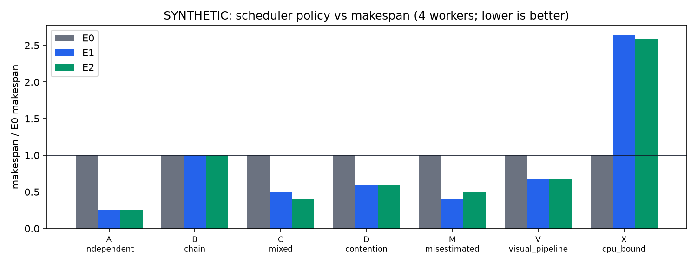
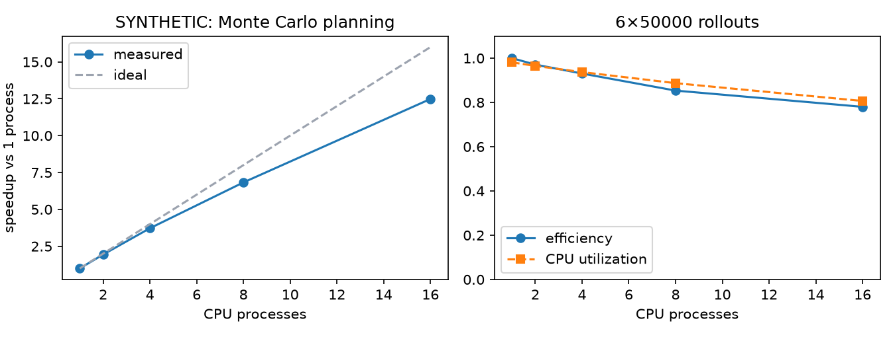
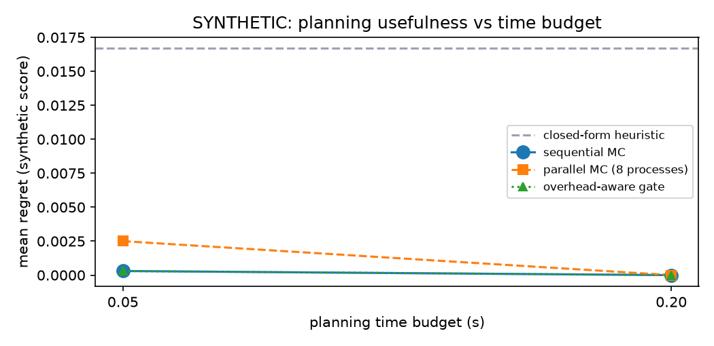
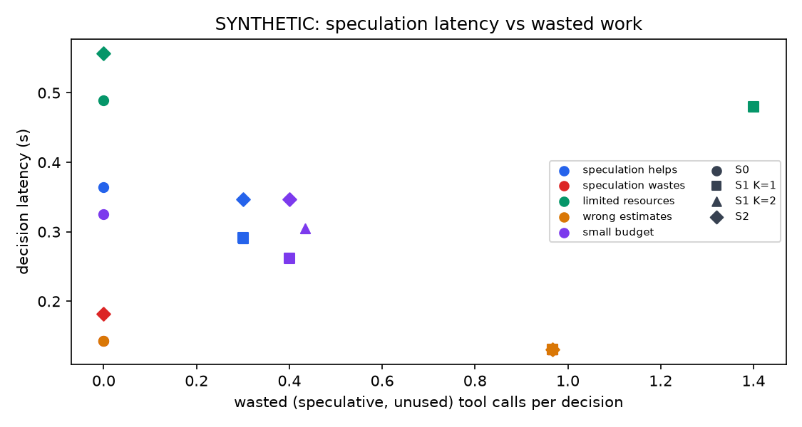
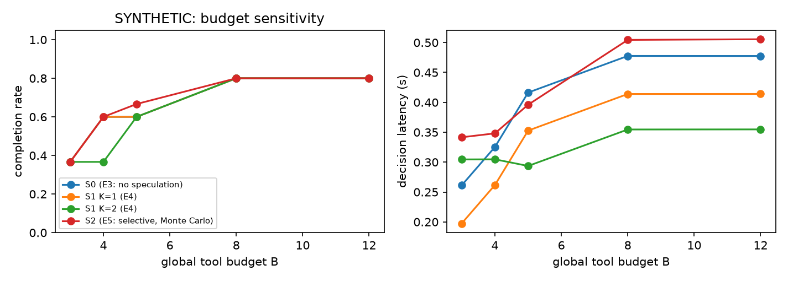
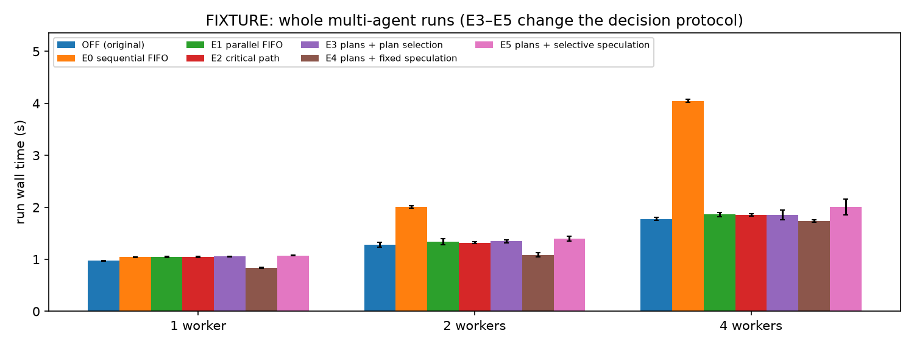
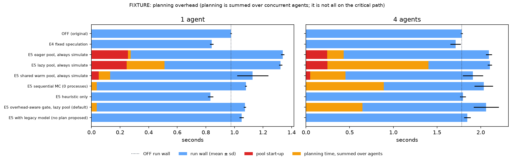

# PARSEC-VL

**Parallel Adaptive Reasoning with Speculative Execution and Constrained Tool Budgets**
CISC 654 — Parallel Computing

## Abstract

PARSEC-VL studies parallel computation in a multi-agent visual-reasoning system.
A coordinator assigns image investigations to workers, which call tools such as
grounding, OCR, zoom and depth estimation. Independent calls can overlap, but
data dependencies, shared service capacity and finite call budgets constrain
execution. Choosing or speculating on alternative investigations also has a cost.

The project implements a dependency-aware scheduler, deterministic multicore
Monte Carlo plan evaluation, budget-aware speculative execution, and a live
visualization of their recorded behavior. Controlled experiments show near-linear
scaling for independent waiting tasks and substantial CPU-process scaling for
Monte Carlo. Chains, resource contention, inaccurate duration estimates and
planning overhead limit or reverse those gains. Real-model case studies establish
working integration, rather than a demonstrated accuracy or end-to-end speedup.

The implementation extends OpenVLHarness; its agent loop, capabilities, model
adapters, services, memory and evaluation kit remain attributed to that project.
PARSEC-VL contributes the parallel scheduling/planning/speculation layer and its
integration, experiments and visualization.

## 1. Problem

A visual agent alternates between a model request and a tool observation.
With a coordinator and multiple workers, independent investigations can proceed
concurrently. Within one investigation, however, reading a crop requires the crop
to exist, and cropping requires the grounding result that identifies the region.

The research question is: **when does parallel computation reduce investigation
time while preserving dependencies, resource limits and a shared budget?**

Three forms of parallelism are evaluated:

- **Task parallelism:** overlap independent tool calls using worker threads.
- **Data parallelism:** distribute Monte Carlo rollouts across CPU processes.
- **Speculation:** start an alternative before it is known to be necessary,
  trading latency against extra calls and resource contention.

## 2. System design

```text
                    Coordinator
                 assignments / reports
                         |
                  Worker 1 ... N
               model calls and tool decisions
                         |
                 PARSEC-VL scheduler
            dependencies + slots + pools + budget
                         |
          Grounding / OCR / Depth / Zoom / Coding
                         |
             private observations and run events
                         |
           Investigation Studio: live view / replay
```

Each worker has its own model context, memory, tool instances and actor budget.
The model endpoint and backend tool services are shared. The orchestrator first
obtains assignments, runs worker investigations, optionally reassesses or follows
up, and synthesizes a final answer. The shipped runtime allows at most two
workers to execute concurrently, even when four workers are instantiated.

The optional message bus transports reports and peer messages. Turning it off
also disables peer messages; assignments and worker results still reach the
coordinator. Optional notebook memory persists information across phases of a
run; disabling it does not remove the working context needed for tool use.

### Scheduling and resources

A tool task records its ID, prerequisites, estimated duration, resource pool,
budget cost and execution interval. It starts only when its dependencies have
completed, a scheduler slot and its resource pool are available, and the shared
ledger has admitted its cost. Budget checks are atomic. A dispatched failed or
unused speculative call remains charged; undispatched reservations can be released.

| Mode | Behavior |
|---|---|
| OFF | Original tool execution without the PARSEC scheduler |
| E0 | Sequential FIFO dispatch |
| E1 | Parallel FIFO dispatch within dependencies and capacity limits |
| E2 | Parallel dispatch prioritized by estimated critical-path length |
| E3 | Declared plans with Monte Carlo branch selection |
| E4 | Declared plans with fixed-width speculation |
| E5 | Declared plans with selective speculation and bounded replanning |

E0–E2 schedule the same declared work. E3–E5 also change the decision protocol:
they allow a model to authorize multiple tool actions through
`Execute_Action_Plan`. Comparisons across these groups are therefore whole-system
comparisons, rather than isolated scheduling-policy speedups.

Pools distinguish CPU, remote I/O, model service and individual GPU backends.
Grounding defaults to capacity one, reflecting the measured contention behavior.
Independent services can still overlap. Failure skips dependent tasks; shutdown
and cancellation release held scheduler resources.

### Declared plans

The following fixture plan provides a fixed dependency graph:

```text
OCR(original) --------------------------+
Grounding(original) -> Zoom -> OCR(crop) |
                                        answer
```

The parser validates tool names, image references, dependencies and acyclicity.
References such as `$ground.boxes_normalized.0` imply a dependency on the producing
action. Crop OCR consumes the actual generated crop in the producing worker's
image scope. Each result retains its source, dimensions and transform metadata.
Plan origins distinguish model proposals, scripted fixtures and controller
alternatives.

### Multicore Monte Carlo

Each candidate is evaluated with the same rollout count and common random draws.
Rollout seeds are derived from the base seed and rollout index, independently of
the process count. Batches are submitted across candidates in round-robin order
to a process pool, then reduced deterministically. Under a time limit, only the
contiguous completed batch prefix shared by every candidate is used. This avoids
comparing candidates evaluated on different seed sets.

Processes provide CPU parallelism for the Python simulations. Threads are used
for HTTP-bound tool calls, where waiting can overlap. Pools can start lazily or be
shared across runs. An overhead gate chooses between a heuristic, sequential
evaluation and parallel evaluation using the estimated value and cost of planning.
The gate's fixed cost estimates can be inaccurate for a warm pool.

### Speculation

S0 starts the selected branch only. S1 starts a fixed number of alternatives
early. S2 admits an alternative when the predicted gain, budget and available
capacity justify it. A successful result is adopted, and unnecessary queued work
is pruned. Running GPU requests may finish after cancellation; their work remains
visible and charged. Replanning is bounded when branches fail.

### Visualization

Investigation Studio reads persisted events and streams new ones. It shows the
coordinator and workers, assignments/reports, evidence images, bounding boxes,
crop provenance, estimates and final answers. The parallel-execution panel adds:

- a timeline grouped by scheduler slot, resource or agent;
- the plan DAG and speculative branch outcomes;
- resource occupancy and budget use;
- read-only comparisons from the bundled reference measurements.

Launch links authenticate the browser automatically. Reloads use an HttpOnly
session cookie. Terminal runs are labeled as recordings; opening a failed
recording does not resume execution. Dataset ground truth is withheld from the
inference runtime and only released to the evaluator after termination.



## 3. Work and span

For four equal-duration actions of duration `d` in the fixture DAG, total work is
`T1 = 4d` and span is `T∞ = 3d`. Its ideal parallelism is `T1 / T∞ = 4/3`.
Real image processing adds unequal costs, so that ratio is an illustration rather
than an exact bound on measured fixture times.

For 32 independent waits of 0.1 seconds, `T1 = 3.2 s` and `T∞ = 0.1 s`.
At eight workers the work bound is approximately 0.4 seconds. A serial chain has
`T1 = T∞`, so additional workers cannot shorten it. Shared service capacities
introduce another bound even when the DAG has independent actions.

Speedup is `S(p) = T(1) / T(p)` for the same workload; efficiency is `S(p) / p`.
Planning, model requests and serial orchestration also constrain end-to-end
speedup. Accelerating tool execution cannot remove model inference time.

## 4. Experimental method

Measurements were collected on Linux with 64 logical CPUs and four NVIDIA L40S
GPUs with approximately 46 GB each. The harness uses Python 3.11; local model
serving uses vLLM 0.18.1 and Transformers 4.57.3. GPU inventory does not imply
that CPU-only experiments used GPU compute.

Every result has an evidence label:

| Label | Meaning |
|---|---|
| SYNTHETIC | Declared waiting/CPU workloads or simulated outcomes |
| FIXTURE | Real agent/runtime integration with scripted decisions and local tool transports |
| REAL | Real model inference and/or actual GPU tool services |

Scheduler experiments use identical DAGs and task durations across policies.
Speculation comparisons share per-trial random outcomes. Whole-harness fixture
comparisons include model-policy, planning and startup overhead. Adaptive real
trajectories are case studies, not paired speedup measurements.

The checked-in reference bundle under `results/reference/` preserves the numerical
sources for the figures below. Its manifest records file hashes and original
source paths. Scheduler raw trials are included, so means, dependencies,
capacities and budgets can be recomputed. Some other original experiments retain
aggregate rows or a representative trace rather than every trial. Their original
trial means cannot all be independently reconstructed from the submission.
New benchmark runs retain richer per-trial records. Timing varies with system load.

## 5. Results

### Scheduler scaling and negative controls

The 32-independent-wait workload achieved **7.90× speedup at eight workers**
(efficiency 0.99). Mixed DAGs benefited from critical-path priority, while chains
and capacity-one resources constrained overlap.

| Workload | Observation |
|---|---|
| Eight independent tasks | 7.83× speedup at eight workers |
| Serial chain | Approximately 1.00×; no useful parallelism |
| Mixed DAG, two workers | E2 2.00× versus E1 1.43× |
| Inaccurate duration estimates, two workers | E1 1.67× versus E2 1.43× |
| CPU-bound Python on threads, two workers | E1 0.48×; thread contention causes slowdown |
| Fixed visual-plan fixture | 1.310 s sequential versus 0.999 s parallel tool span, or 1.31× |




### Monte Carlo scaling and planning overhead

For six candidates and 50,000 rollouts per candidate, estimates were identical
across process counts. Warm evaluation speed increased with more processes:

| Processes | Mean wall time (s) | Speedup | Efficiency |
|---:|---:|---:|---:|
| 1 | 7.566 | 1.00× | 1.00 |
| 2 | 3.896 | 1.94× | 0.97 |
| 4 | 2.033 | 3.72× | 0.93 |
| 8 | 1.108 | 6.83× | 0.85 |
| 16 | 0.606 | 12.48× | 0.78 |

Cold startup cost approximately 0.21–0.29 seconds. Parallel evaluation can be
slower for small decisions: at a 0.2-second planning budget, one experiment took
0.266 seconds with the parallel pool versus 0.212 seconds sequentially. Lazy
startup avoids creating an unused pool, but the planning gate's fixed estimates
do not guarantee the best choice on every machine or for every warm pool.




### Speculation and budgets

The reference speculation experiment used 30 paired trials per scenario.

| Scenario | S0 latency (s) | S1, one alternative (s) | S2 latency (s) |
|---|---:|---:|---:|
| Primary often fails | 0.364 | 0.291 | 0.346 |
| Primary rarely fails | 0.143 | 0.130 | 0.182 |
| One GPU slot | 0.489 | 0.480 | 0.557 |
| Wrong estimates | 0.143 | 0.130 | 0.130 |
| Small budget | 0.325 | 0.262 | 0.347 |

S1 reduced latency about 20% when the primary often failed. When the primary
rarely failed, it used 75% more tool calls for about a 9% latency reduction.
Selective speculation avoided unnecessary alternatives in some scenarios but
paid additional planning cost. With a small budget, speculative work can consume
calls that would otherwise support a necessary fallback and reduce completion.




### Whole-system results and real-model behavior

Whole-harness fixture results show that planning cost can outweigh saved tool
time. E3 and E5 were slower than the original runtime on the short-call workload;
fixed speculation E4 was about 2–15% faster depending on worker count. These
comparisons change the decision protocol and do not isolate scheduling speedup.




In recorded Qwen first-decision probes, natural prompts produced **zero plans in
20 decisions**. Explicit requests produced **10 valid proposals out of 10**, but
the two fully executed plans were serial grounding → zoom → OCR chains. No real
executed parallel plan was established by those probes.

A real FSC147 example-25 integration run used two workers, optional memory on,
communication on, peer communication off and E2. Both workers completed a
grounding call; the run recorded 95 events and no failed events. The coordinator
answered **46** against the official count **38**, an absolute error of **8**.
Grounding capacity one serialized both tool tasks. Successful execution is not
evidence of accurate counting or parallel tool speedup.

## 6. Validation and limitations

Regression coverage includes DAG validation, overlap/dependency order, resource
capacity, concurrent budgets, failure/cancellation, deterministic rollouts,
private image ownership, crop transformations, authentication and event replay.
The configurable worker/memory/communication paths are exercised with fixtures.
The verification scripts generate fresh traces and independently inspect their
intervals and budget charges. Browser checks use actual Chrome sessions.

The source submission was extracted without deployment credentials, Git metadata
or previous run outputs and tested with the prepared Python 3.11 dependency
environment: **854 tests and 451 subtests passed**, with no failures or skips.
Three existing pandas future warnings concern evaluator dtype conversions.
The archive includes a check that excludes local credentials, runs and caches.
The public quick-verification workflow and bounded CPU demonstration also passed
from that extracted copy, including reference validation and newly generated
scheduling, planning and speculation traces.

The main limitations are:

- Real models must expose useful independent work; scripted parallel plans do
  not establish autonomous planning ability.
- Model inference and shared GPU capacity can dominate run time.
- Thread scaling on waiting tasks is not CPU-bound multicore scaling.
- Selective speculation relies on imperfect outcome and cost estimates.
- Simulated completion is not model answer accuracy, and old aggregate-only
  records do not prove every original per-trial mean.
- A finite regression suite cannot prove all possible concurrency interleavings.

## 7. Reproduction and source

[README.md](../README.md) contains installation, the CPU-only demonstration,
custom real runs with automatic service startup, browser access, verification,
benchmark commands and submission packaging. `python scripts/parsec.py --help`
lists individual experiments. New outputs are written under ignored `outputs/`;
reference measurements are read-only.

Core implementation: `openvlharness/parsec_vl/`. Integration:
`openvlharness/multi_agent/`, `openvlharness/studio/` and the existing capability
layer. Tests: `tests/parsec_vl/`, `tests/studio/` and the retained runtime/evaluation
suite. Model configuration: [models.md](models.md).

The code retains the MIT license and upstream acknowledgments. Model weights
and datasets have their own licenses and are not distributed with this submission.
