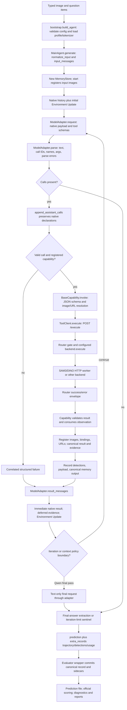

# Phase 01 — OpenVLHarness repository audit and BITE implementation map

Audit date: **2026-10-29 (America/New_York)**. Source baseline:
`c530cdbdc6b7c4f486499eb7e5834ac2bd92692d`, branch `main`, commit subject
`v0 updated`. Repository: the OpenVLHarness checkout root.

This is an audit, not a BITE implementation. Only this report was created.
No configurations, runtime code, services, drivers, datasets, checkpoints, or
existing experiment outputs were changed. No inference, benchmark, calibration
run, package installation, or model-server startup was performed.

Evidence labels used below:

- **Verified / source:** inspected the local implementation at the commit above.
- **Verified / environment:** a read-only check made during this audit.
- **Historical:** an existing artifact inspected, not a fresh reproduction.
- **Proposed:** a recommendation for a later, separately validated phase.
- **Unresolved:** a scientific or engineering question not established here.

Source links are relative to the repository and include relevant line ranges.
Local source is authoritative. Upstream HEAD was not fetched or compared.

## 1. Repository and environment summary

### 1.1 Git and Python

**Verified / environment:** `git status --short` was empty before this report;
there were no existing tracked or untracked changes to overwrite. Ignored local
environments, credentials, caches, and experiment outputs already existed.
The branch and HEAD remained unchanged during the audit.

| Item | Observed state |
| --- | --- |
| OS | Debian GNU/Linux 12, x86-64 CUDA host |
| Default shell Python | `python` is not on the unactivated shell PATH |
| System Python | `python3`: 3.11.2 |
| Harness interpreter | `.venv/bin/python`: 3.11.2 |
| Environment management | Project venvs; `uv` and `conda` were not found on PATH |
| Harness dependency consistency | `.venv/bin/python -B -m pip check`: **No broken requirements found** |
| Worker environments | `.venvs/vllm`, `.venvs/sam3`, `.venvs/da3` exist |
| Current service readiness | All six configured router/main/auxiliary/SAM3/OCR/depth health or model-list requests failed with `ConnectionError` |

Installed harness packages were inspected through distribution metadata:
`openvlharness 0.1.0`, `requests 2.34.2`, `numpy 2.4.6`, `Pillow 13.0.0`,
`jsonschema 4.26.0`, `fastapi 0.162.0`, `pydantic 2.14.1`, `uvicorn 0.54.0`,
`openai 3.37.0`, `transformers 4.57.3`, `huggingface-hub 0.35.3`,
`pandas 2.3.3`, `pycocotools 2.0.11`, `lvis 0.5.3`, and `pytest 9.1.1`.
Worker distribution metadata identifies vLLM 0.18.1 / Torch 2.10.0 in the
serving environment and Torch 2.10.0+cu128 in SAM3 and DA3. This does not
constitute a fresh CUDA inference check.

### 1.2 Hardware and deployment

**Verified / environment:** NVIDIA driver 615.71.10 and four NVIDIA L40S GPUs
were accessible outside the execution sandbox. Memory is a point-in-time
snapshot, not an allocation reservation:

| GPU | Total MiB | Used MiB | Free MiB |
| --- | ---: | ---: | ---: |
| 0 | 46,068 | 14,446 | 31,095 |
| 1 | 46,068 | 4,975 | 40,565 |
| 2 | 46,068 | 4,975 | 40,565 |
| 3 | 46,068 | 3,933 | 41,607 |

The configured deployment is Qwen on GPUs `0,1`, SAM3 and OCR on GPU `3`, and
DA3 on GPU `2`. Qwen's configured context is 168,000 tokens. Its launcher requests
90% GPU memory utilization ([`scripts/service.sh:11–37`](../../scripts/service.sh#L11-L37)).
GPU 0 and GPU 1 currently have less free memory than that reservation would
require. Restoring the previous deployment therefore needs a fresh resource
check and coordination with existing GPU work; this audit did not start or stop
any process or adjust the recipe.

Configured loopback endpoints are main/auxiliary Qwen `:8222/v1`, router `:8101`,
SAM3 `:8086`, OCR `:8085`, and DA3 `:8087`. None was reachable in the read-only
checks. DINO has no configured endpoint, and a DINO checkpoint was not found in
the inspected project cache. No external provider credential or tunnel URL was
authenticated/probed in this phase.

### 1.3 Cached resources and environment variables

**Verified / environment:** model cache `refs/main` and weight-file targets exist:

| Checkpoint | Cached revision | Located weight files |
| --- | --- | ---: |
| Qwen/Qwen3-VL-8B-Instruct | `0c351dd01ed87e9c1b53cbc748cba10e6187ff3b` | 4 |
| PaddlePaddle/PaddleOCR-VL-1.5 | `2a4195faa5e7914c12f2fc601d72c81caf8d2da5` | 1 |
| depth-anything/DA3NESTED-GIANT-LARGE | `8615eefb62f2db4f8d6ebaa59160086981672829` | 1 |
| facebook/sam3 | `3c879f39826c281e95690f02c7821c4de09afae7` | 2 |

Presence and reference resolution were checked; full weight hashes and current
model loading were not. Runtime responses such as SAM3's `model: sam3-image`
do not themselves certify the checkpoint revision.

Relevant values are **not exported in the initial audit shell**, but the ignored
`.env` supplies `MODEL_BASE_URL`, `MODEL_API_KEY`, `AUXILIARY_MODEL_BASE_URL`,
`AUXILIARY_MODEL_API_KEY`, `TOOL_SERVER_URL`, `SAM3_SERVER_URL`, `OCR_SERVER_URL`,
`DEPTH_ESTIMATION_SERVER_URL`, `LMUData`, `HF_HOME`, `HF_TOKEN`, `SERPER_API_KEY`,
`YDC_API_KEY`, `IMAGE_UPLOAD_PROVIDER`, `IMAGE_UPLOAD_PUBLIC_BASE_URL`, and
`AGENT_CONFIG`. Secret values were never printed. `GROUNDING_DINO_SERVER_URL`,
`GLIP_ROOT`, `LVIS_GT_PATH`, `SERPER_API_KEY_FILE`, and `YDC_API_KEY_FILE` are
unset in the effective settings inspected. The effective active configuration is
`configs/agent/qwen3_8b_paper.yaml`.

`scripts/env.sh:3–19` activates the venv and parses `.env`; the bootstrap/Python
API does not load `.env` automatically. The evaluator does, at
`evaluation_kit/cli.py:17–18`. Config validation and capability construction
were checked without model requests for the paper Qwen preset and
`configs/local_qwen_grounding.yaml`.

### 1.4 Documentation versus present evidence

- `docs/local_setup.md` describes the earlier successful deployment as running.
  **It is not currently reachable.** Do not use that wording as a current health check.
- Existing `outputs/setup/pytest.log` records **531 tests and 449 subtests** passing.
  That is historical evidence; the regression suite was not rerun in this audit.
- `docs/validation.md:5–12` describes a different reviewed commit and older test
  counts. Its results are not new measurements at `c530cdb`.
- Optional You.com backends, local launch/check scripts, and depth installation/
  visualization fixes are present in this baseline. Serper remains selected by
  the paper preset. No claim is made about divergence from current upstream HEAD.
- Some ODinW class/header prose describes category-conditioned rows generally;
  actual `_qwen3` code uses one image with multiple category labels. The dispatch
  and evaluator branches, not those broad comments, determine the protocol.

## 2. Verified codebase structure

| Concern | Actual implementation and source location |
| --- | --- |
| Public construction | [`bootstrap.py`, `load_agent_config`, `build_capabilities`, `build_agent`, lines 66–195, 228–291](../../openvlharness/bootstrap.py#L66-L291) |
| Agent request/loop | [`MainAgent.generate`, `_run`, `_turn`, lines 62–228](../../openvlharness/agent/agent.py#L62-L228) |
| Model request, parse, continuation, final extraction | [`ModelAdapter.payload/request/parse/append_assistant_calls/result_messages/final_answer`, lines 281–435](../../openvlharness/services/models.py#L281-L435) |
| Native call decoding and single-call policy | [`models.py`, lines 456–579 and 781–830](../../openvlharness/services/models.py#L456-L579) |
| Model-family behavior | [`model_registry.yaml:5–34`](../../openvlharness/services/model_registry.yaml#L5-L34); explicit profiles, not inferred model-name prefixes |
| Capability lifecycle | [`BaseCapability.invoke/consume_result`, lines 111–217](../../openvlharness/capabilities/_base.py#L111-L217) |
| Shared contracts | [`VirtualCall`, `ArtifactRef`, `ServiceResult`, `CapabilityResult`, lines 6–68](../../openvlharness/contracts.py#L6-L68) |
| Tool HTTP client | [`ToolClient.execute`, lines 32–55](../../openvlharness/services/client.py#L32-L55) |
| Router registration and backend dispatch | [`create_app`, nested `execute` and `call`, lines 77–219](../../openvlharness/services/server.py#L77-L219) |
| Grounding semantics | [`grounding.Capability`, lines 201–379](../../openvlharness/capabilities/grounding.py#L201-L379) |
| Crop semantics | [`zoom.Capability`, lines 98–114](../../openvlharness/capabilities/zoom.py#L98-L114); [`Zoom_In_Tool.execute`, lines 75–109](../../openvlharness/services/tools/zoom_in_image_by_bbox/tool.py#L75-L109) |
| Per-question memory | [`MemoryStore`, lines 14–152](../../openvlharness/memory/store.py#L14-L152); [`MemoryRunState`, lines 20–83](../../openvlharness/memory/run_state.py#L20-L83) |
| Image resolution/registration | [`capabilities/_images.py:50–168, 280–340`](../../openvlharness/capabilities/_images.py#L50-L340); [`memory/images.py:41–151, 212–316`](../../openvlharness/memory/images.py#L41-L316) |
| Structured values for Python | [`bindings.store_binding/copy_bindings_for_execution`, lines 73–111](../../openvlharness/memory/bindings.py#L73-L111) |
| Evaluation CLI and sampling | [`cli.main`, lines 340–690; sampling 542–555](../../evaluation_kit/cli.py#L340-L690) |
| Atomic inference records and aggregation | [`runner._make_committed_gen`, lines 90–197; `infer_image_job`, 410–505](../../evaluation_kit/runner.py#L90-L505) |
| ODinW and FSCD scoring | [`ODinWBBoxDataset.evaluate`, lines 304–787](../../evaluation_kit/dataset/odinw.py#L304-L787); [`_FSCDBBoxBase.evaluate`, lines 279–595](../../evaluation_kit/dataset/fscd.py#L279-L595) |
| Prediction/score/diagnostic bridge | [`eval_bridge.py`, lines 266–426, 657–824, 948–1114](../../evaluation_kit/dataset/eval_bridge.py#L266-L1114) |
| Experiment identity | [`run_identity.build_run_manifest/validate_manifest_compatibility`, lines 181–235](../../evaluation_kit/utils/run_identity.py#L181-L235) |

The `openvlharness` runtime does not depend on benchmark loaders. The evaluation
layer constructs inputs and calls the same agent API. There is no implemented
BITE belief state, identifiability solver, adaptive tool-value estimator, or
controller interface in these execution paths.

## 3. Exact request execution flow

**Verified / source:** the agent-side capability invokes a router-side **backend**.
The router does not own the question's memory or run capability observation
normalization a second time. It constructs capabilities for selection/schema
metadata and dispatches to their concrete backend classes.



| Step | Concrete function and source range | Important data |
| --- | --- | --- |
| 1. Submit input | `MainAgent.generate`, `agent.py:62–90`; dataset `ODinWBBoxDataset.build_prompt`, `odinw.py:294–302` | List of `{type: image/text, value: ...}`; `task_id` is optional in the public API |
| 2. Normalize pixels/text | `normalize_input`, `input.py:36–76`; `input_messages`, `79–113` | Remote input bytes fetched once; provider input is JPEG-encoded; original local image bytes are registered separately |
| 3. Initialize state | `MemoryStore.start`, `store.py:48–60`; `build_image_registry_from_inputs`, `images.py:270–316` | Fresh `input_image_N` IDs for each question; user-role inventory |
| 4. Publish tools | `MainAgent.__init__`, `agent.py:50–60`; `ModelAdapter.payload`, `models.py:281–321` | `Capability.public_schema()` results assigned to adapter; converted to provider-native schema format |
| 5. Ask model | `MainAgent._run`, `agent.py:136–153`; `ModelAdapter.request`, `models.py:323–359` | Native history, effective schemas/choice, generation options, optional seed and capture |
| 6. Parse proposal | `ModelAdapter.parse`, `models.py:361–398`; normalizers `456–579`, `781–830` | Parsed object args plus raw args, ID, name, original/native declaration, parse errors |
| 7. Declare/dispatch | `agent.py:155–166`; `BaseCapability.invoke`, `_base.py:127–165` | Native call declaration appended, then `VirtualCall`; schema validation and resolved image bytes |
| 8. Execute backend | `ToolClient.execute`, `client.py:32–55`; router `server.py:172–217` | `{tool_name, args, tool_call_id}`; configured service URL injected privately; semaphore before worker thread |
| 9. Consume observation | `BaseCapability.consume_result`, `_base.py:167–217` | Image registry → bindings → URL rewriting → evidence renderer → canonical data and artifact refs |
| 10. Continue model | `agent.py:167–192`; `ModelAdapter.result_messages`, `models.py:414–429` | Detection sidecars, per-call result/evidence, immediate/deferred message indexes, Environment Update |
| 11. Stop/finalize | `agent.py:193–216`; `ModelAdapter.final_answer`, `models.py:431–435` | Profile-specific answer extraction, optional Qwen extra final request, error/iteration sentinel |
| 12. Persist/evaluate | `generate`, `agent.py:99–116`; `runner.py:136–195, 467–504`; `cli.py:619–685` | API returns records; evaluator writes prediction/trajectory/detection/HTML files and scores saved predictions |

## 4. Main agent and tool-call lifecycle

### 4.1 Native protocol invariants

**Verified / source:** Chat Completions retains the supplied call ID, or creates
`call_<turn>_<index>` if absent. Calls preserve `raw_arguments`, decoded `args`,
and an `assistant_tool_call` with serialized arguments
([`models.py:456–529`](../../openvlharness/services/models.py#L456-L529)).
The native assistant declaration is followed by a `role: tool` message carrying
the same `tool_call_id`. Successful visual/text evidence follows as deferred
user-role content. Kimi-style `reasoning_content` is copied from the original
assistant message (`400–429`).

Responses normalizes `call_id` (falling back to item ID/generated ID), stores a
`function_call_item`, and emits `function_call_output` with that same `call_id`
([`models.py:781–923`](../../openvlharness/services/models.py#L781-L923)).
Text and image evidence are encoded inside the native function output.
The current continuation path does not retain arbitrary returned Responses
reasoning items: `parse` returns no original Responses item list and
`append_assistant_calls` preserves function calls/text only. This matches the
limitation recorded in `docs/validation.md:190–195`; it is not corrected here.

Malformed arguments become correlated errors. Multiple calls in one response
are rejected **without executing any of them**; every declared ID is retained
and receives error feedback. Although `_run` iterates a list of calls, this is
not permission to execute a parallel multi-action plan. Selecting just one
already-declared call and silently dropping the others would break continuation.

**Proposed invariant for BITE:** preserve each native declaration/result pairing,
retain the untouched model proposal in the audit log, and distinguish it from a
controller-executed action. Do not change only `call['args']`: both native call
representations and raw serialized arguments would otherwise disagree.

### 4.2 Iterations, costs, retries, and stopping

- `max_iterations` bounds regular **model iterations**, not a general resource
  budget. The Qwen preset sets 15 (`configs/agent/qwen3_8b_paper.yaml:6–11`).
- In the final regular iteration the agent asks for a best answer. If the model
  still calls a tool, that call executes. Qwen's profile permits an additional
  final text-only model request (`agent.py:193–206`, `model_registry.yaml:5–15`).
- Malformed calls, unknown tools, and multi-call rejections can consume model
  iterations without a successful backend action. No explicit remaining tool,
  wall-time, dollar, or token-cost ledger exists.
- Model and tool HTTP transports can retry eight additional times in the paper
  configuration. Retries reuse the tool-call ID and request body; the router has
  no observed request-ID deduplication/idempotency store
  (`client.py:48–50`, `http.py:70–118`, `server.py:172–217`). A timeout does not
  prove that the worker did no computation.
- Python coding is one public capability but includes a model-backed code
  generation request and a local execution step (`coding.py:140–172`). Search
  can similarly include provider, image-fetch, and auxiliary-model subrequests.
- Normal stop behavior is profile-specific answer parsing, response failure,
  iteration exhaustion, or context fallback—not an identifiability decision.
  Usage is accumulated from main-loop responses; it is not a complete billed
  cost accounting of all backend model calls.

**Proposed:** define the first BITE budget as the number of dispatched public
capability invocations, including dispatched failures. Record invalid proposals
separately; they make no backend dispatch. Track physical attempts, model usage,
latency, and money separately rather than claiming unit tool cost captures them.
Commit this accounting convention before experiments.

Qwen context handling may compact history or clear it to the first user message,
disable tools, and use direct-answer fallback
([`models.py:610–711`](../../openvlharness/services/models.py#L610-L711)).
The `MemoryStore` remains separate, so accessible artifact state and the model's
current information can diverge. BITE must track that event and distinguish
configured capabilities from currently advertised model tools.

### 4.3 Persistence is selective

`generate` returns `prediction` and `extra_records` containing `trajectory`,
`tool_detections`, and optional usage. It does not itself save files or export
the live `MemoryStore`. Its rich `trajectory.chat_history` includes raw tool
payloads and canonical `memory_outputs` (`agent.py:99–116, 173–182, 219–228`).

The evaluator's canonical `results/<shard>/<sample>/record.json` retains the
original generated result. In contrast, default `full_trajectories/<sample>.json`
is assembled as identity/prediction/ground truth/error/usage and **messages**,
not a dump of the rich `chat_history` or numerical memory
([`runner.py:50–87, 136–194`](../../evaluation_kit/runner.py#L50-L194)).
`tool_detections` preserves selected boxes/scores but not masks, source image IDs,
or the entire provenance graph. HTML is also not a canonical state checkpoint.
Context-compacted model messages cannot reconstruct all prior observations.

Successful `--mode all` runs normally delete canonical file-db records after
scoring; `--keep-file-db` / `MVTK_KEEP_FILE_DB=1` prevents that
([`cli.py:642–685`](../../evaluation_kit/cli.py#L642-L685)).
`FULL_TRAJECTORIES_LIMIT` can additionally suppress full trajectory writes
(`runner.py:103–123`). Future calibration collection must explicitly retain
canonical records or write a dedicated observation sidecar.

## 5. Grounding, zoom, and multimodal memory data contracts

### 5.1 Grounding: three distinct representations

**Verified / source:** SAM3 backend JSON is:

```python
{
    "model": "sam3-image",
    "prompt": str,
    "pred_boxes": list[list[float]],     # pixel xyxy in the submitted image
    "pred_scores": list[float],
    "pred_masks": list[str],             # COCO RLE counts strings
    "orig_img_h": int,
    "orig_img_w": int,
    "num_masks": int,
    "rendered_image_b64": str,
}
```

See [`sam3_segment/server.py:182–300`](../../openvlharness/services/tools/sam3_segment/server.py#L182-L300).
Its HTTP wrapper uploads multipart `prompt` + image to `/v1/segment`
([`sam3_segment/tool.py:73–149`](../../openvlharness/services/tools/sam3_segment/tool.py#L73-L149)).
RLE strings need `size=[orig_img_h, orig_img_w]` to reconstruct masks; they are
not dense arrays by themselves (`server.py:89–100`).

SAM3 uses `sigmoid(pred_logits)` without presence-score multiplication, filters
by the processor confidence threshold, removes overlapping masks with IoM 0.3,
and sorts boxes/scores/masks left-to-right (`server.py:25–76, 242–276`). The
installed upstream `Sam3Processor.__init__` has `confidence_threshold=0.5`
(`.venvs/sam3/lib/python3.11/site-packages/sam3/model/sam3_image_processor.py:17–29`).
That installed-package observation is environment-specific, not an additional
tracked repository setting. Returned scores are **retained, filtered detector
scores**, not the complete pre-threshold logits, mask logits, or calibrated
probabilities of correct localization. Filtered-out alternatives are unavailable
through this HTTP contract.

DINO returns `boxes`, `boxes_normalized`, `scores`, `labels`, `size`, and
`model_id`; no masks. Its worker rounds pixel boxes to two decimals and scores
to three. The wrapper fixes box/text thresholds at 0.4/0.3
([`grounding_dino/tool.py:15–18, 78–148`](../../openvlharness/services/tools/grounding_dino/tool.py#L15-L148),
[`grounding_dino/server.py:113–190`](../../openvlharness/services/tools/grounding_dino/server.py#L113-L190)).
Importing either raw worker loads its model; those modules were read as source,
not imported during this audit.

The agent-side canonical grounding `Output` is a different, unified contract:

```python
{
    "query": str,
    "model_id": str | None,
    "size": list[int] | None,                   # [height, width]
    "boxes": list[list[float]] | None,          # submitted-image pixel xyxy
    "boxes_normalized": list[list[int]] | None, # clamped, rounded 0..1000
    "scores": list[float] | None,
    "labels": list[str] | None,
    "masks": list[str] | None,
    "num_masks": int | None,
    "rendered_image": str | None,              # memory image reference
}
```

Source: [`grounding.py:201–219, 355–379`](../../openvlharness/capabilities/grounding.py#L201-L379).
SAM3 labels repeat the query; DINO supplies labels. DINO masks/count are `None`.
Validation requires finite aligned boxes/scores and positive dimensions, but
does not fully validate mask RLE or establish semantic score calibration
(`239–287`). A future mask consumer needs decoding/shape checks.

The Python binding uses the backend-style keys `pred_boxes`, `pred_scores`,
`pred_masks`, `num_masks`, `orig_img_h`, `orig_img_w`, including a DINO-to-binding
translation (`grounding.py:327–353`). Do not confuse canonical keys, binding
keys, and raw service fields when collecting evidence.

### 5.2 What BITE can obtain now

| Question | Verified answer and missing piece |
| --- | --- |
| Raw detection scores? | Retained numeric `pred_scores` / canonical `scores` are available. Full unfiltered logits and calibrated correctness probabilities are not. |
| Segmentation masks? | SAM3 RLE masks plus dimensions are available in raw payload/canonical result/binding. DINO explicitly has no masks. Default detection sidecars do not preserve masks. |
| New versus duplicate detections? | IoU can be computed from boxes; SAM3 suppresses overlap within a call. There is no persistent cross-call candidate identity, tracking, association uncertainty, or redundancy decision. |
| Original image and every crop? | Image memory can resolve registered input/generated pixels. Exact identical data URLs are deduplicated, so different actions can share an artifact ID; IDs alone do not identify an observation event. |
| Which image produced a detection? | The call's original `image_id` and resolution metadata can be joined to its result within the rich trajectory. Canonical grounding output and score sidecars omit an explicit source image ID. Binding descriptors deliberately drop `image_id` (`bindings.py:94–103`). |
| Crop transforms preserved? | No explicit parent ID, integer crop rectangle, or child-to-root transform is returned/stored by zoom. Requested coordinates and generated refs allow reconstruction only if all relevant rich records and source dimensions survive. |
| Ground a previous crop? | Yes, by passing its registered `tool_generated_image_N` as `image_id`. Boxes then refer to that crop's coordinate frame. This is source-verified, not freshly exercised against a worker here. |
| Two grounding backends in one execution? | Not through the current standard YAML/model interface: `grounding` selects one backend, `build_capabilities` stores one instance per public name, and the router loads only selected backends. Merely configuring both service entries does not expose both. |
| Candidate provenance attachment point? | The `VirtualCall` + capability backend + resolved input metadata before dispatch; raw/canonical results and artifact refs in `consume_result`; the agent's per-call `memory_outputs` record. Add an external evidence ledger rather than relying only on display strings. |

Source anchors: [`grounding.process_tool_output:74–137`](../../openvlharness/capabilities/grounding.py#L74-L137),
[`BaseCapability.invoke:134–165`](../../openvlharness/capabilities/_base.py#L134-L165),
[`build_capabilities:228–254`](../../openvlharness/bootstrap.py#L228-L254),
[`images.register_image_data_url:41–93`](../../openvlharness/memory/images.py#L41-L93).

### 5.3 Zoom geometry and provenance gaps

Zoom accepts normalized xyxy `coords`, optional `image_id`, and padding at least
50 on the 0–1000 scale. Its concrete implementation expands the requested box by
padding, clamps to image bounds, sorts corners, rounds integer pixel extents,
then calls `PIL.Image.crop`. It returns only `cropped_image_base64`; canonical
output is only `{"image": <registry ID or None>}`
([`zoom_in_image_by_bbox/tool.py:75–109`](../../openvlharness/services/tools/zoom_in_image_by_bbox/tool.py#L75-L109),
[`image_utils.coerce_xyxy:123–164`](../../openvlharness/services/tools/image_utils.py#L123-L164),
[`zoom.py:98–114`](../../openvlharness/capabilities/zoom.py#L98-L114)).

**Proposed:** store the actual integer `(left, top, right, bottom)`, parent image
ID/hash, child image ID/hash, source dimensions, and transform version for every
crop. There is no resizing in `Image.crop`, so a child pixel `(u,v)` maps to
parent `(u+left,v+top)`; compose these translations through the crop ancestry.
Convert normalized child boxes to child pixels before mapping to the root.
Reconstruct the exact padding/clamping/rounding recipe, not the unpadded request.
Track other image preprocessing separately: provider image input can be JPEG
re-encoded/upscaled/resized while memory retains source bytes
([`media.py:8–30, 39–91`](../../openvlharness/media.py#L8-L91)).

The image resolver records the matched ref and fallback mode. An unknown name
can silently resolve to the sole available image (`images.py:260–266`); record
the **resolved** ID, not just the requested string. Prefer explicit IDs in BITE
actions. Both public grounding and zoom schemas make `image_id` optional even
though a usable image is required by their backend implementations.

### 5.4 Memory lifetime and candidate provenance

Memory persists **within a question**, not across `generate` calls:
`MemoryStore.start` resets `MemoryRunState` (`store.py:48–60`). Images contain
`id`, `data_url`/lazy `url`, `source`, and aliases. Image provenance is a broad
`tool_output:<tool-name>` string; lazy registration explicitly discards `turn_idx`
(`images.py:78–93, 99–151`). No detection dependency DAG is present.

Bindings contain numerical values and field descriptors, source tool and
compacted arguments (`run_state.py:20–57`, `bindings.py:73–106`). Values are
deep-copied for Python execution, preserving original state (`109–111`).
`ArtifactRef` is only `(kind,id)`, not a globally unique candidate/provenance
record (`contracts.py:20–29`). IDs therefore need a run/sample namespace.

**Proposed evidence identity:** `(run_id, sample_id, logical_action_id,
observation_id, detection_rank)` plus an explicit association to a persistent
candidate hypothesis. Keep observation identity distinct from image deduplication
and geometric association. Record shared image ancestry, checkpoint/backend,
query, preprocessing, and prior evidence parents even when calls differ.

## 6. Dataset and evaluation infrastructure

### 6.1 Actual identifiers and local data

**Verified / source and registry import:** the following detection names resolve
to loaders; registration does not mean their data is installed or downloadable
automatically.

| Family | Supported identifiers |
| --- | --- |
| ODinW basic | `ODinW13_bbox_train`, `ODinW13_bbox_val`, `ODinW13_bbox_test` |
| ODinW Qwen2.5 | `ODinW13_bbox_{val,test}_qwen25`, `_qwen25_raw`, `_qwen25_adapted`, `_qwen25_adapted_raw` (eight concrete val/test combinations) |
| ODinW Qwen3 | `ODinW13_bbox_val_qwen3`, `ODinW13_bbox_val_qwen3_mmdet`, `ODinW13_bbox_test_qwen3`, `ODinW13_bbox_test_qwen3_mmdet` |
| FSCD-147 boxes | `FSCD_147_bbox_val`, `FSCD_147_bbox_test` |
| FSCD-LVIS boxes | `FSCD_LVIS_bbox_train`, `FSCD_LVIS_bbox_val`, `FSCD_LVIS_bbox_test`, `FSCD_LVIS_unseen_bbox_train`, `FSCD_LVIS_unseen_bbox_test` |
| FSCD-LVIS counting | `FSCD_LVIS_count_train`, `FSCD_LVIS_count_val`, `FSCD_LVIS_count_test`, `FSCD_LVIS_unseen_count_train`, `FSCD_LVIS_unseen_count_test` |
| LVIS boxes | `LVIS_bbox_train`, `LVIS_bbox_val`, plus `_positive_only` and `_federated` variants of each |
| LVIS masks | `LVIS_mask_train`, `LVIS_mask_val`, plus `_positive_only` variants |
| Later spatial phase | `MMSIBench_wo_circular`, `MMSIBench_circular`, `ERQA`, `EmbSpatialBench`, `SparBench`, `SparBench_tiny`, `MindCubeBench_tiny_raw_qa`, `MindCubeBench_raw_qa` |

Registration is collected from loader `supported_datasets()` methods in
[`dataset/__init__.py:40–54, 80–103`](../../evaluation_kit/dataset/__init__.py#L40-L103).
ODinW declarations are `odinw.py:216–241`; FSCD box declarations are
`fscd.py:602–622`. Qwen3 rows ask for all prompted domain categories in one
image; category-conditioned FSCD rows ask for one category. They are different
tasks and must not be mixed under one claimed task-risk definition.

**Verified / environment:** `LMUData` points to the existing project `data/`.

| Resource | Present state |
| --- | --- |
| `FSC147_val.tsv` | 1,286 rows; MD5 `1a1ab15000877cad4d80652da61b2e04`; every referenced image exists |
| `ODinW13_bbox_val_qwen3.tsv` | 4,938 rows; MD5 `55ae98c3e4ffa1c3292f4939f1b52012`; every referenced image exists |
| Image roots | `data/images/FSC147`: 2,476 files; `data/images/ODinW`: 6,091 files |
| ODinW annotations/configs | `data/GLIP` exists; 25 unique JSON files; all 13 domain val and test mappings resolve |
| ODinW train annotations | No train entries in the 13 inspected release YAMLs; no train TSV installed |
| FSCD box TSVs | Not present in the inspected data root |
| LVIS/FSCD-LVIS image root and original LVIS GT | Not present in the inspected roots; `LVIS_GT_PATH` unset |

The two TSV hashes match their values in `hf_release.py:70–78`. No dataset was
instantiated or downloaded to produce these inventory checks.

`LMUDataRoot()` requires the environment variable
([`smp/file.py:72–77`](../../evaluation_kit/smp/file.py#L72-L77)).
`ImageBaseDataset.load_data/prepare_tsv` can download missing/mismatched TSVs,
and constructor image checks can download entire image archives
([`image_base.py:70–105, 119–154, 203–217`](../../evaluation_kit/dataset/image_base.py#L70-L217)).
Hosted release mappings include ODinW Qwen3 val/test and FSCD-147/FSCD-LVIS
val/test, not all registered train variants
([`hf_release.py:29–40, 101–139`](../../evaluation_kit/dataset/hf_release.py#L29-L139)).
Train registration alone must not be treated as proof of a downloadable
calibration split; preparation scripts support external training annotations.

### 6.2 Ground truth, matching, and metrics

ODinW resolves `GLIP_ROOT`, alias `ODINW_GLIP_ROOT`, then `$LMUData/GLIP`.
GLIP YAML `DATASETS.REGISTER[split].ann_file` selects COCO annotation files
([`odinw.py:71–145`](../../evaluation_kit/dataset/odinw.py#L71-L145)).
FSCD builds COCO ground truth from normalized boxes in each TSV row's `answer`
column, dimensions, and category ID (`fscd.py:74–126, 309–360`). It does not
require the separate official LVIS JSON merely to score the prepared FSCD-LVIS
box TSV. Native LVIS evaluation has its own annotation-resolution path
(`lvis.py:260–304, 363–661`).

ODinW Qwen3 final predictions should be JSON records such as
`[{"bbox_2d":[x1,y1,x2,y2],"label":"category"}]` on the 0–1000 root-image grid.
The parser also accepts documented equivalent nested forms; labels map
case-insensitively to the prompted `dataset_classes`, and unknown labels drop
([`eval_bridge.py:32–142`](../../evaluation_kit/dataset/eval_bridge.py#L32-L142)).
Boxes are converted to absolute COCO xywh before scoring (`266–426`).

ODinW uses per-domain `pycocotools.COCOeval`, then a macro-average over evaluated
domain/split entries, not an average over image scores. Reports contain AP over
IoU 0.50:0.95, AP50, AP75, APs, APm, APl on a 0–100 scale; unavailable area bands
retain the missing-data sentinel. Small subsets may cover fewer than 13 domains
([`odinw.py:148–193, 648–699`](../../evaluation_kit/dataset/odinw.py#L148-L699)).
GT filtering differs between category-conditioned and full/Qwen3 modes; the
implementation remaps annotation IDs, drops zero-area GT, and checks completion
coverage (`446–595`). Nonempty error-sentinel predictions count as completed
rows for coverage but parse to no predicted boxes. BITE stopping must produce a
well-formed answer, including `[]` for a genuine empty set, rather than an empty
cell that can trigger incomplete-image exclusion.

FSCD runs COCOeval once and adds count MAE/RMSE/NAE, exact match, and within
5%/10% count accuracy (`fscd.py:140–231, 519–583`). COCO default maximum detections
is 100; dense-object experiments need supplementary diagnostics if that cap
masks improvements. Do not change the official cap silently.

Confidence modes are scientifically consequential:

- `constant`: every submitted box scores 1.0; selected by `judge_no_judge.yaml`.
- `original`: IoU-match the final echoed box to pooled tool detections at
  threshold 0.5, recover its detector score **and original pixel geometry**;
  unmatched boxes keep predicted geometry and score 0.5.
- Without an explicit judge-config/environment override, sidecars select both
  modes, original primary (`eval_bridge.py:948–983, 1001–1114`).

The sidecar matcher pools candidates across calls without filtering by candidate
label or source-image/crop transform. This is not object tracking, not a
ground-truth match, and not a safe cross-crop provenance mechanism. Preserve it
for baseline scoring; build independent, frame-aware calibration association.

### 6.3 Diagnostics and safe metric extension

**Verified:** per-image/category TP, FP, FN and mean matched IoU already exist.
`extract_per_row_diagnostics` reads COCO/LVIS matching and ignore arrays plus
IoU matrices at IoU 0.5, area `all`
([`eval_bridge.py:657–824`](../../evaluation_kit/dataset/eval_bridge.py#L657-L824)).
Mean matched IoU is emitted as a **percentage**, not a 0–1 number. ODinW writes
`*_per_row.csv` (`odinw.py:713–739`); FSCD also records predicted/GT counts and
count error (`fscd.py:465–513`). Existing local ODinW smoke artifacts contain a
24-row per-category diagnostic CSV for 12 evaluated images.

Individual matched detection/GT IDs and the complete IoU matrix are available
on the in-memory evaluator object but are not all persisted in that CSV.
Candidate-level calibration needs a new offline export preserving these IDs,
threshold, ignore/crowd rules, frame, and matching convention. A candidate's
correctness event must be defined explicitly; IoU with any GT and official
score-ordered one-to-one matching are different labels.

The CLI supports capability removal through YAML and an iteration bound, not
per-example weighted tool budgets. `--num-proc` means concurrent examples and
`--num-examples` bounds rows, neither bounds tools. Custom BITE metrics can be
written as separate sidecars/postprocessors from canonical records and COCO
diagnostics while leaving `dataset.evaluate()` and official files unchanged.
The CLI also injects evaluation data into saved trajectories after scoring
(`cli.py:619–640`); these labeled artifacts must never be used as policy inputs.

## 7. Calibration feasibility and data availability

### 7.1 Research scope and probability semantics

**Proposed research specification, not implemented:** BITE should maintain a
task-relevant belief/evidence state, analyze attainable risk, plan adaptive tool
compositions, and control execution while preserving native protocols and
multimodal memory. No fine-tuning is required for the proposed initial system.

\[
R^\star(s_t,B_t)=\inf_{\pi:C(\pi)\le B_t}
\mathbb E[L(\hat Y_\pi,Y)\mid s_t].
\]

The code provides observations and traces, not a calibrated model of this risk
or of `K_a(o | H,s,do(a))`. Define hypotheses, terminal estimator, loss, allowed
actions, budget semantics, and what information `s_t` includes before fitting
anything. Include initial-image/model information and a direct-answer/stop
option. An observed candidate list is not an exhaustive set of possible objects:
missed/unseen objects must remain represented if the original task is detection.
Dataset AP is a ranked, cross-image metric and is not automatically a per-task
Bayes loss; predefine a compatible task loss and retain AP as official reporting.

### 7.2 Collectible records

Proposed record (example values are schema placeholders, not observations):

```json
{
  "run_id": "...",
  "sample_id": "...",
  "partition": "calibration_train",
  "logical_action_id": "...",
  "provider_tool_call_id": "...",
  "observation_id": "...",
  "candidate_id": null,
  "action": {
    "capability": "Visual_Grounding_Tool",
    "backend": "sam3_segment",
    "query": "...",
    "requested_image_id": "...",
    "resolved_image_id": "..."
  },
  "source_image_sha256": "...",
  "checkpoint_revision": "...",
  "preprocessing_version": "...",
  "parent_observation_ids": [],
  "crop_to_root_transform": null,
  "prior_state_id": "...",
  "outcome": {"ok": true, "error": null, "empty_detection": false},
  "retained_detector_scores": [],
  "predicted_boxes_local_xyxy": [],
  "predicted_boxes_root_xyxy": [],
  "mask_artifact_refs": [],
  "latency_ms": null,
  "physical_attempt_count": null,
  "logical_tool_cost": 1,
  "labels_offline_only": {"gt_match": null, "iou_threshold": 0.5}
}
```

Here `logical_tool_cost: 1` is a **proposed convention**, not a measured runtime
field. Do not fill unknown measured values with invented zeros.

| Field group | Capture feasibility |
| --- | --- |
| Sample/run | `task_id` in `generate` plus evaluator run manifest; add namespace to per-question IDs |
| Proposed action / native ID | Already normalized by `ModelAdapter.parse`; retain raw args and parse error |
| Executed backend | Capability instance and successful payload `meta.backend`; fill from instance for early failures lacking metadata |
| Resolved source image | Image-resolution rewrites and registry; currently requires joining, not a canonical grounding field |
| Boxes/scores/masks/outcome | Raw payload + canonical result in memory/rich trajectory; account for retained/thresholded score semantics |
| Prior evidence | Live memory, call sequence, canonical outputs; no explicit immutable belief-state snapshot/hash exists |
| Stable candidate/association | New instrumentation/model needed; detection rank and IoU are insufficient persistent identities |
| Crop/root geometry | New explicit metadata/ancestry needed; exact crop can be reconstructed at dispatch with current algorithm |
| Checkpoint/preprocessing identity | Config/cache/source metadata can be collected; worker response alone omits exact SAM3 checkpoint and transformations |
| Latency and physical attempts | New timers/counters needed; no standard per-tool latency/cost fields in result contracts/router |
| GT match | Offline calibration/evaluation join only; never available to policy at inference |
| Action-selection probability | New policy/randomization logging needed for adaptive/off-policy analysis |

### 7.3 Splits, leakage, dependencies, and counterfactual actions

**Verified data blocker:** the local release's 13 ODinW YAMLs declare val/test,
not train; original training annotations are not currently available through
those local mappings. `scripts/prepare_odinw.py:66–109, 149–152, 272` supports
external train/val/test annotations, so a later phase can prepare a genuine
training split once its source and license/access are verified. No such data
was fetched here. Registered FSCD-LVIS train splits likewise need preparation.

**Verified leakage hazard:** `data/GLIP/configs/odinw_13/PascalVOC.yaml` maps
**both val and test** to
`odinw/PascalVOC/valid/annotations_without_background.json`. Therefore a
val-versus-test split-name rule is not a disjointness guarantee. Group by
original image/content identity and, where available, source scene/video;
deduplicate all crops, near-duplicates, and repeated observations with their
parent image. Audit domain distribution and train/validation/test aliases.

Existing public frozen validation samples and previously inspected smoke rows
are development evidence, not newly blind held-out test data. Use separate
calibration-fit, calibration-validation, and final-evaluation manifests and
directories; freeze them and the action policy before final evaluation.
Runtime `generate` discards its `dataset` parameter (`agent.py:83`), and the
evaluator attaches ground truth only after the original generation call
(`runner.py:141–153`). Preserve that separation. Full trajectory files and
post-scoring injections can contain GT and must not be read by the controller.

**Proposed action-data design:** on calibration-training images, predeclare or
randomize feasible actions, save selection probabilities and full prior-state
IDs, and collect repeated/alternative actions from isolated snapshots. Clone
memory and relevant provider history before branching; do not feed branch A's
observations into branch B. A failed download, timeout, malformed output, empty
detection, and correct negative detection are separate outcomes. Keep retries
within a logical action linked to their physical attempts.

Repeated SAM3 calls on the same pixels/query are not independent Bernoulli
trials. Different crops share image pixels, scene content, checkpoint weights,
and proposal history. Different backends can also have correlated errors.
Record these shared causes and model/calibrate them; a provenance DAG by itself
does not estimate their dependence. Adaptive observational logs alone do not
identify an interventional kernel without support/selection assumptions.

Counterfactual collection is feasible with existing capability APIs but has no
built-in branch/snapshot runner. Start on explicitly separated calibration data;
do not try alternate actions on final benchmark images and then select the best
outcome or tune stopping thresholds from them. Synthetic finite worlds should
have known latent hypotheses and joint outcome kernels, and require a new
independent environment/adapter; no such environment is present now.

## 8. Recommended BITE integration hooks

All hooks below are **proposed**, not existing APIs. Keep BITE state local to
`generate`, initialized alongside memory (`agent.py:85–94`), not on shared
`self.belief`: evaluation uses concurrent examples with a shared agent.

| Hook and source range | Inputs / mutable state | Message effect and backend requirement | Main risk / recommended approach |
| --- | --- | --- | --- |
| Initialization: `MainAgent.generate`, `agent.py:85–94` | Normalized question, `task_id`, new memory, initial history; create question-local BITE context | None in observer mode; no backend change | Cross-sample leakage if state is stored on the shared agent. Use a per-call context and immutable shared calibration models. |
| Pre-action: `_run`, after `parse/_turn` at `153–154`, **before** `append_assistant_calls` at `156` | Proposed calls/raw args/errors, text, native original message, history, memory, configured capabilities, model-iteration index, future budget ledger | Read-only observation needs no message/backend change. Replacement must happen before native declarations are committed. | Changing only canonical args or dropping declared IDs breaks protocols. Begin observer-only; later prefer veto-and-reprompt before arbitrary action replacement. |
| Raw observation boundary: `BaseCapability.invoke`, `_base.py:134–165` | Original `VirtualCall`, resolved args and image rewrites, backend, execute envelope; memory still available | Instrument dispatch/result metadata without changing backend algorithm | Record empty/failure events, actual resolved frame and timers; retain pre/post state hashes. Avoid mutating provider schemas or threshold settings. |
| Post-observation update: `_run`, immediately after `invoke` at `166` and before the next loop request | `CapabilityResult.data`, raw payload, artifact refs, detection, backend, memory; update belief/provenance/budget | No backend change for retained outputs; a complete pre-threshold observation model would require worker instrumentation | Memory is already mutated by `consume_result`; retain a pre-dispatch snapshot/reference for dependency updates. Observe errors as well as successes. |
| Stable stopping/replanning boundary: after native results, deferred evidence and Environment Update, `agent.py:174–192`, before `continue`/next request | Updated evidence/belief, history with closed call/result cycle, remaining resources, decision bounds | Optional final model request through adapter; no backend change | Never stop with outstanding call IDs. Count finalization cost explicitly; keep uncertified stop distinct from certified impossibility. |
| Final-answer: no-call path `agent.py:208–216`, or explicit controller finalization, then `generate:99–116` | Belief, chosen prediction, original task and image frame; preserve returned `prediction/extra_records` structure | Native adapter handles model finalization, or controller returns task-formatted prediction directly | OdinW must receive root-frame bbox JSON with valid labels. Do not overwrite it with controller narrative, local crop coordinates, or GT-informed boxes. Save BITE diagnostics in a separate record. |
| Persistence: `runner._make_committed_gen`, `runner.py:143–194` | Complete agent result, run/sample IDs, output directory; GT only in offline label stage | Separate versioned BITE sidecar; no backend/API change | Default full trajectories and cleanup lose canonical observations. Retain file-db/new sidecar; keep official prediction and scorer unchanged. |

Observer integration can collect scores, errors, transformations and costs
without changing the grounding service. A public SAM3+DINO choice would need
an additional allowlisted dispatcher/composite capability or explicit separate
capability registration; it cannot be achieved by adding `backend` or
`server_url` to a public task argument. Router task arguments forbid deployment
overrides (`server.py:177–185`), and bootstrap exposes one grounding backend
per configured public capability.

| Integration mode | Reuse and intervention | Suggested acceptance test |
| --- | --- | --- |
| Observer-only first | Record state/action/observation/cost out of band; keep prompts, calls, budget, observations and final predictions identical | Deterministic replay with BITE absent versus observer enabled yields identical native request payloads, IDs, canonical results and predictions, excluding observer timing fields |
| Advisory second | Feed recommendation/budget text at a complete protocol boundary before a later model request; model retains final action choice | Every declaration has a result; recommendation timing and model compliance recorded; evaluate as a prompt-changing experiment |
| Controller-enforced last | Reject infeasible/redundant actions or select explicit alternative plans; own a separate logical action ledger | Vetoed native calls receive correlated feedback; replacements are serialized consistently by adapter-owned constructors; no unmatched IDs; budget never overspent |

A controller that replaces calls needs a deliberate native action-construction
interface for Chat Completions and Responses, preserving Kimi reasoning and
logging model proposal versus controller action separately. An initial veto can
use the existing structured failure/result-message machinery and request a new
action, but its model turns and finalization overhead must be charged/reported.
Do not silently rewrite the baseline transcript to imply the model proposed
the controller's action.

## 9. Dependency and resource risks

| Risk | Difficulty | Smallest reasonable later modification / control |
| --- | --- | --- |
| Native call IDs, JSON args and provider continuations | High | Adapter-owned action/result constructors; pre-declaration hook; replay tests for Qwen, Responses and Kimi; preserve all declared IDs on rejection |
| Strict config allowlists | Medium | Versioned optional BITE settings parsed explicitly in bootstrap or a separate research wrapper; default path remains identical. Arbitrary `bite:`/agent planner keys currently fail validation. |
| Per-question state and concurrent examples | High | Question-local BITE context; deep-copy branch memory/history; immutable shared fitted models; no controller state on shared agent attributes |
| Tool-count versus iteration/token/time budgets | High | Separate logical dispatch ledger and physical-attempt/resource telemetry; define charge/finalization rules before fitting/planning |
| Candidate generation and missed objects | High | Generate hypotheses/candidates only from permitted image/model/tool evidence; represent undiscovered-object possibilities; never use GT boxes to define runtime candidates |
| Calibration leakage and split aliases | High | Hash/group original images and ancestors; explicitly handle PascalVOC val/test alias; frozen fit/validation/final manifests; offline-only GT labels |
| Correlated detector errors | High | Record shared checkpoint/image/crop/query dependencies; calibrate joint/conditional outcomes, not products of repeated confidence scores |
| Crop and candidate provenance | High | Immutable action/observation IDs, resolved frame, exact integer crop geometry and child-to-root transforms; separate candidate association from artifact deduplication |
| Failures, retries and duplicate physical executions | Medium | Typed outcome categories, attempt IDs/timers, idempotency policy; do not equate empty output with request failure or logical calls with billed attempts |
| Source score censoring / DINO rounding | High | Calibrate the observed post-filtered interface explicitly; collecting full logits needs separately versioned backend instrumentation |
| Exact adaptive planning complexity | High | Start with finite hypotheses/actions/outcomes and short horizons; exact enumeration only in small worlds; larger approximate search must report its gap/uncertainty |
| Confidence certificates with estimated probabilities | High | State assumptions and statistical coverage; use confidence sets or validated bounds; do not label a point-estimated or truncated-search result a proof |
| Official scoring / original score sidecars | Medium | Preserve official scorer and geometry/score modes; export BITE diagnostics independently; fix frame-aware research matching separately, without silently changing baseline files |
| Dense-object limits and AP/task-loss mismatch | High | Keep official maxDets/metrics fixed; add prespecified per-task loss, count/recall and budget curves as separate research metrics |
| Missing calibration train data | Medium | Verify/procure training annotations in a later authorized phase; do not repurpose shared val/test images as a blind final holdout |
| Unreachable services / GPU reservations | Medium | Read-only resource preflight before authorized restart; coordinate allocations; preserve or explicitly version any utilization/context changes |
| Responses reasoning-item omission | High | Isolate this existing adapter limitation in protocol tests; any repair belongs to a separately validated baseline change, not bundled invisibly into BITE |
| Complete experiment identity | Medium | Supplement existing config/profile/prompt hashes with Git revision, worker source/checkpoint/preprocessing IDs, sample manifest, calibration version and resource settings |

**Certificate direction matters.** A feasible policy's estimated risk is a
candidate upper bound on optimal achievable risk under its specified model;
failure to find a good policy is not an impossibility certificate. A valid
impossibility claim needs a justified lower bound on `R*` exceeding the target,
with an admissible hypothesis/action/observation model and treatment of unknown
objects. An optimistic information/budget relaxation can be useful only when its
lower-bound direction is established and its solver bound is valid.

Even a finite naive search with `a` action choices and `o` outcomes per action
can materialize `1 + ao + (ao)^2 + ... + (ao)^d` history nodes through depth `d`.
Weighted budgets require a positive minimum action cost to translate budget into
a finite depth bound. Continuous boxes/scores need an explicit abstraction and
its error control; truncating a tree is a computational approximation, not an
identifiability certificate.

With estimated kernels, a worst-case risk exceeding the target does not prove
every compatible world is impossible. A universal impossibility statement needs
a lower bound valid even for the most favorable compatible kernel (for example,
an appropriately justified bound on `inf_K R*_K` over a statistically covered
kernel set). An achievable guarantee instead needs an upper bound for a concrete
policy, uniformly over its stated uncertainty set. Coverage, adaptive sampling,
distribution shift, approximate planning and discretization error remain open
research obligations. No such theorem or estimator is implemented or validated
by this audit.

## 10. Missing components to implement

The reusable foundation is substantial: capability normalization, native
protocol adapters, per-question image/array memory, transport failures,
source detector scores, official matching diagnostics, and experiment records.
The following research components are absent:

1. **Dependency-calibrated belief state:** task/hypothesis definitions; priors;
   persistent candidate identities including missed objects; frame-aware evidence
   DAG; conditional/joint outcome models; calibration/version uncertainty.
2. **Budgeted identifiability analyzer:** explicit action/cost/loss model;
   feasible action graph; achievable-risk bounds; validity conditions; output
   statuses distinguishing certified impossibility, certified attainability,
   unresolved analysis, and computation-budget exhaustion.
3. **Adaptive Bayesian planner:** finite action generation without GT; branch
   outcome predictions; expected terminal loss/value accounting; dependency-aware
   updates; repeat/switch/skip/stop alternatives; bounded approximate search with
   measurable computational/resource cost.
4. **Runtime controller:** optional per-request context; pre/post/stopping/final
   hooks; native-protocol-safe veto/action construction; logical/physical budget
   ledger; immutable diagnostics and replayable decision traces.
5. **Research infrastructure:** disjoint calibration manifests, branch collector,
   candidate-level offline labels, transformation ledger, synthetic finite-world
   environment with known kernels, disabled-mode equivalence tests, custom risk/
   calibration/budget metrics, and versioned result sidecars.

## 11. Recommended first runnable baseline configuration

**Proposed next-phase baseline:** keep the existing
[`configs/agent/qwen3_8b_paper.yaml`](../../configs/agent/qwen3_8b_paper.yaml)
unchanged, with the cached Qwen/SAM3 checkpoints and
[`configs/judge_no_judge.yaml`](../../configs/judge_no_judge.yaml).
This gives the actual reference tool schemas, 15-iteration policy, 168,000-token
context, decoding settings, and constant-score evaluation. A reduced grounding/
zoom tool set is a subsequent, explicitly named ablation, not a substitute for
this reference. Optional You.com selection should likewise be a separate arm.

This baseline is **not currently runnable end to end until services/resources
are restored**. All required TSV/image paths for the first ODinW sanity example
are local. After a separate authorization to run the baseline and a successful
resource/service preflight, the smallest existing-CLI check is:

```bash
source scripts/env.sh
openvlharness-eval \
  --config configs/agent/qwen3_8b_paper.yaml \
  --judge-config configs/judge_no_judge.yaml \
  --data ODinW13_bbox_val_qwen3 \
  --num-examples 1 --shuffle --seed 42 --num-proc 1 \
  --save-html all --keep-file-db \
  --run-tag bite_reference_preimplementation \
  --work-dir outputs/bite/reference_baseline
```

**This command was not run in Phase 01.** The exact CLI sampler is Python
`random.Random(seed).sample`, sorted before row selection (`cli.py:542–555`),
not pandas sampling. On the installed 4,938-row TSV, the one-example command
selects row 912, `PascalVOC_val_262`. This is a reproducibility/sanity example,
not a blind research test. The analogous cached FSC147 one-example command
selects sample `228`.

Keep canonical file-db records, disable any `FULL_TRAJECTORIES_LIMIT` cap, retain
model failures, and save immutable source/config/checkpoint/sample identities.
Validate `<answer>` extraction and root-image bbox JSON; inspect native call
pairing, raw scores and crop references. Then re-score the saved run with
`--mode eval --run-dir <run>` without loading an inference agent. Do not use
`--ignore-failed` to select favorable scientific outcomes; infrastructure retry
attempts must remain separately identifiable.

Historical evidence available for comparison: the Oct 24
`outputs/grounding-evaluations/.../agent_local_qwen_grounding_v1_judge_direct_metrics_v1_20261024_150839_default`
contains 12 FSC147 and 12 ODinW trajectories. ODinW retains one
`PascalVOC_val_1178` 15-iteration failure and 12 canonical records; successful
FSC147 canonical file-db records were cleaned up. Existing older counting and
one-example raw-trace runs also remain. These were inspected, not reproduced.

## 12. Proposed next-phase tasks and acceptance criteria

| Phase | Small independently validated task | Acceptance criteria |
| --- | --- | --- |
| 02 — reference baseline | Coordinate GPU resources, restore existing services with cached checkpoints, and run the one-example unchanged reference above | Fresh service/model-ID checks; immutable source/config/checkpoint/sample identities; valid native call/result IDs; saved prediction, rich canonical record, detections and HTML; failures explicitly retained; evaluation-only re-score matches |
| 03 — observer/provenance specification | Define versioned BITE state/action/observation/budget schemas; add observer-only capture and crop/root transform records in a separately reviewed implementation | Disabled mode and observer mode replay identical baseline native payloads and predictions; no GT access; exact nested-crop round trips; repeated/empty/failure outcomes recorded; question-local state under concurrent examples |
| 04 — finite-world model | Implement a small synthetic environment with known hypotheses, joint kernels, actions, costs and task loss | Exhaustive enumeration checks optimal policies and budgets; correlated versus independent examples; missed-hypothesis cases; separate unattainability proof from search failure; no real benchmark tuning |
| 05 — calibrated outcome collection | Verify training sources, freeze disjoint image/scene manifests, and collect prescribed/randomized actions on training data | No split aliases/content overlap; canonical outcomes and action probabilities retained; calibration validation separated from final evaluation; uncertainty and failure labels specified |
| 06 — advisory planning | Add dependency-aware recommendations at closed protocol boundaries | Recommendations and compliance logged; no protocol violations; explicit prompt-change/control arm; measured calibration/task-risk and cost metrics with unchanged official scoring |
| 07 — enforced controller | Add bounded pre-action decisions and scientifically justified stopping/finalization | No budget overspend or dangling native IDs; selected actions distinguished from model proposals; confidence bounds match stated assumptions; controller outputs correct root-frame task format; replay and held-out evaluations preserve the reference arm |

The immediate next task is **Phase 02 reference-baseline restoration and capture**,
not fitting beliefs or implementing a planner. Review this audit first, especially
the unavailable services/GPU reservation, missing training data, PascalVOC split
alias, crop provenance, selective persistence, and certificate-validity risks.
No subsequent phase has been started.
